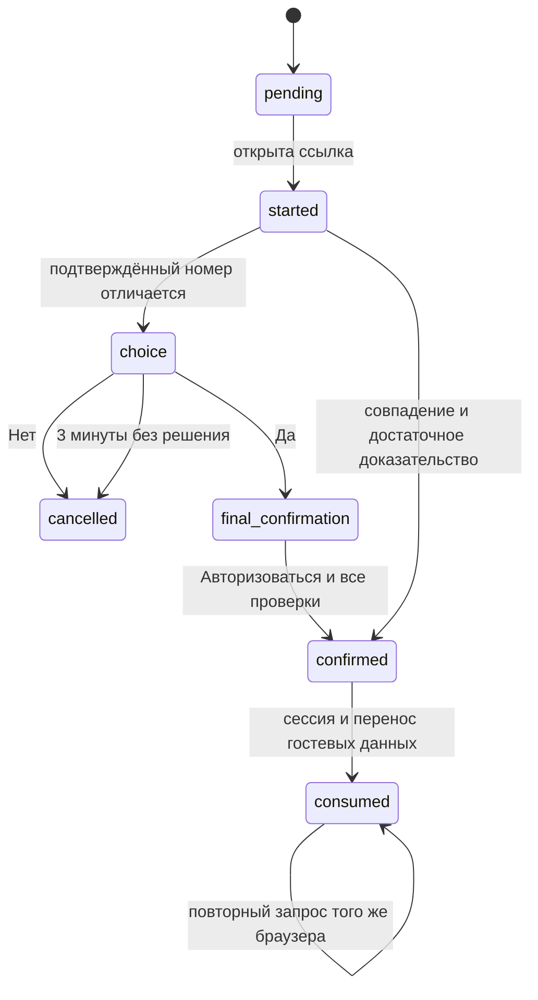
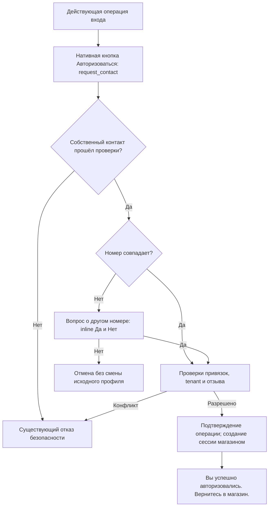

# Ревизия клиентской авторизации Telegram / MAX

## Гостевые сессии и основной чат CRM · итоговая доработка 23.11.2026

### Восстановление индикаторов присутствия · 23.11.2026

Найдены две причины отсутствия «в чате»/«на сайте»: обработчик DOM обновлял только строки с `data-client-id`, тогда как заголовки аккордеона получили ключ группы; публичный heartbeat отклонял действующий гостевой `g_`-токен, проверяя его как обычную клиентскую сессию. В `static/js/chat.js` заголовок и дочерние строки подписаны на свои presence-ID; обновляются только затронутые индикаторы без пересоздания списка. Приоритет — «в чате», затем «на сайте», затем offline. Дизайн прежней точки и бейджа сохранён.

`api/public/shop.js`, `POST /presence/heartbeat`, проверяет гостевой токен существующим `customerAuth.getGuest` и использует владельца из `api/chatTemp.js`, `resolvePresenceChatOwner`. Авторизованный посетитель определяется по карточке, гостевой — только по действующему visitor-контексту устройства; номер телефона не становится доказательством присутствия. Неверный/отозванный токен по-прежнему отклоняется. `services/presence-service.js` хранит различие visitor/карточки, сохраняя прежний смысл счётчиков зарегистрированных клиентов; правила TTL, нескольких вкладок, выхода и SSE не заменялись.

`static/js/shop-presence.js` отправляет актуализацию при смене профиля/токена, а `syncServerChatIdentity` вызывает её после получения серверной идентичности. Это исключает ожидание следующего 30-секундного heartbeat после создания либо смены контекста. Миграция не нужна. Выполнены только статическая ревизия, проверка синтаксиса JS и `git diff --check`; сервер не перезапускался, отображение в работающем приложении не проверялось.

Этот раздел описывает итоговые исходники задания о гостевых сессиях. Последнее согласованное правило сохранено: успешная авторизация **объединяет только текущий доказанный visitor-контекст** с основным чатом, включая вход под другим подтверждённым номером. Требование первоначального приложения оставлять такую переписку отдельной после входа отменено. Остальные гости с тем же номером не объединяются.

### Модель и маршрутизация

Используются существующие `chat_visitor_identities`, `chat_threads`, `chat_messages`, `cust_guest_sessions`, `chat_attachment_gc` и действующие API. Новый helper `api/helpers/customerChatSessions.js` отвечает за жизненный цикл, нумерацию и допустимость удаления; второй системы сообщений или тикетов нет.

- Visitor-cookie резервируется без видимого диалога и номера сессии. Срок доступа отделён от хранения: 400 дней соответствуют уже существующему сроку cookie, а не новому сроку удаления переписки.
- Первое входящее сообщение клиента, включая быстрый вопрос, в `POST /thread/:clientId/messages` под блокировкой visitor-записи фиксирует начало и сохраняется вместе с тредом в одной транзакции. Повторы используют ту же запись и уникальный ID сообщения. Само приветствие тред не создаёт.
- По последнему уточнению нумерация гостевых сессий отменена. В интерфейсе используется «Гостевая сессия»; новые номера не выделяются, счётчик при работе чата не вызывается. Прежние поля и таблица оставлены без удаления данных только как результат уже применённой миграции. Диалоги различаются внутренними ID, датами и состоянием; телефонная группировка CRM не доказывает владение аккаунтом.
- Смена гостевого контекста завершает прежний, прекращает его доступ и входящие push-подписки. Истечение либо отзыв токена также запрещают запись немедленно; фоновая обработка фиксирует завершение. Очистку cookies сервер непосредственно не обнаруживает: без cookie создаётся новый контекст, а старая история не удаляется и завершается только по достоверному событию либо истечению доступа.
- После сильной авторизации существующий `claimVisitorAfterAuthorization` объединяет собственный контекст в транзакции выдачи сессии. Происхождение сообщений и guest-хеш заказов сохраняются. Старые гостевые права доступа не превращаются в права аккаунта; SSE повторно проверяет владельца. Специальное внутреннее чтение уже отозванного при promotion guest-токена допускается только после проверки сильной сессии и доказательства операции, а не для обычных гостевых запросов.
- Завершённый диалог читается сотрудниками с действующими правами. Создание сообщений, изменение истории и snapshot-запись блокируются на сервере; отметка фактически прочитанных сообщений разрешена. Основной чат не получает гостевого статуса завершения.
- Старые треды с visitor-записью нумеруются без перемещения сообщений, в том числе при обнаружении записи, сделанной старым процессом между миграцией и перезапуском. История без visitor-записи и без подтверждённой карточки показывается как «Исторический диалог», только для чтения: номер, владелец и связь с заказами не выдумываются.

### CRM и клиентский виджет

| Область | Итоговое поведение | Источник |
| --- | --- | --- |
| Левая колонка | Один клиент/телефонная группа — одна строка; нажатие разворачивает аккордеон диалогов прямо под клиентом и сдвигает следующие строки вниз. Повторное нажатие сворачивает группу; общий список не заменяется. Несколько групп можно раскрыть независимо | `api/helpers/customerChatSessions.js`, `groupPage`; `GET /clients?view=customers`; `views/partials/chat/left.ejs`; `static/js/chat.js`, `renderClientsList` |
| Состав группы | Загружаются все участники выбранных страниц групп. Показываются только существующие непустые диалоги; основной чат не подставляется фиктивно | `groupPage`, `listSummaries`, `mergeRemoteClients`, `renderClientsList` |
| Выбор по умолчанию | Нажатие клиента выбирает активную гостевую сессию с последней активностью, иначе основной чат, иначе последний имеющийся диалог. Если единственный диалог активен, аккордеон и вложенная дублирующая строка не показываются | `renderClientsList`, `buildChatClientRow` |
| Обновление списка | Строки сопоставляются по ключу и сигнатуре, неизменённые DOM-узлы используются повторно. Формат собственного кеша чата повышен до версии 2 из-за полей сессий | `renderClientsList`, `CHAT_PERSISTENT_CACHE_VERSION` |
| Средняя колонка | Только выбранный тред. Старый `history=phone` не расширяет историю; выбор диалога меняет независимые историю, прокрутку и поле ввода | `GET /thread/:clientId`, `/diff`; `selectClient`, `loadActiveClientData` |
| Завершение | «Сессия завершена» в списке и текущем контексте; поле ввода отключено. Для недостоверной исторической записи — «Только просмотр» | `dialogueLabel`, `syncGuestConversationNotice`, `setComposerEnabled` |
| Красные точки | Используется существующий индикатор строки с модификатором `is-dot`: у клиента сумма непрочитанных его диалогов, у сессии её собственные непрочитанные. Открытие списка диалогов не вызывает select/read | `buildChatClientRow`, `renderClientsList`, `getUnreadCount`; `static/css/style.css` |
| Стрелка вниз | Сохранены прежние `pendingScrollMessageIdsByClient`, видимость сообщений и числовой бейдж выбранного треда. Исходящие не добавляются; прочитанные импортированные сообщения не считаются новыми непрочитанными | `applyRemoteThreadSnapshot`, `collectUnreadIncomingBelowViewportMessageIds`, `getPendingScrollNewCount` |
| Правое окно | Нажатие клиента в общем списке сразу открывает единую карточку подтверждённого аккаунта по `profile_customer_id`. Вкладки привязаны к карточке, а не к гостевому диалогу. Выбор сессии меняет только среднюю колонку; при отсутствии карточки правая колонка пуста, гостевая карточка не подставляется | `getChatCustomerProfileId`, `buildChatClientRow`, `openClientDetailsPanel`, `activateChatRightTab` |
| Обычная отправка клиентом | Существующее поле ввода без обязательной кнопки «Оставить сообщение», выбора диалога или получателя | `static/js/shop-company-chat.js`, `sendUserMessage` |
| Автоматические вопросы | Названия, оформление, ответы и обработчики сохранены, включая «Где мой заказ?». Первое нажатие быстрого вопроса начинает видимый диалог CRM, как обычное сообщение; автоматический ответ сохраняется в том же треде. Прежнее откладывание пользовательских быстрых вопросов отменено | `sendUserMessage`, `pushLiveMessage`, `remoteCreateSharedMessage` |
| Начало переписки после автоматики | Первое обычное сообщение создаёт тред; предшествующая автоматическая история сохраняется в нём существующим механизмом сообщений с исходными датами. Повторный запрос использует прежние ID. При авторизации переносится только локальная история доказанного объединённого контекста | `remoteCreateSharedMessage`, `syncServerChatIdentity`, `claimVisitorThread` |

### Заказы, сохранность и очистка

Хедер гостевой сессии читает последний заказ только по её точному `guest_session_hash`, tenant, store и действующим ограничениям доступа. При отсутствии заказа хедер скрыт. Новый ответ API применяется только если выбранный диалог и номер запроса остаются актуальными; при переключении предыдущий заказ очищается. Дизайн, статусы и действия хедера не заменялись. Основной чат сохраняет прежний выбор заказа, включая доказанные связи с объединённым гостевым контекстом из предыдущего уточнения. Источники: `api/admin/clients.js`, `GET /chat-guests/:visitorId`; `loadActiveClientData`, `setOrderHeaderFields`.

Сами заказы, платежи, бонусные получатели и исходный guest-хеш не удаляются очисткой. Назначение заказов другой карточке по одному номеру не добавлялось; прежний `promoteGuest` не переписан. Источник связи с историей — сохранённые `claimed_customer_id`, `guest_session_hash`, `source_client_id`, `source_message_id`.

Расширенный выбор связанных заказов включается только сочетанием административного контекста `chat` и явного `chat_sessions=1`. Обычный паспорт клиента продолжает читать только его собственные заказы. Контекстные запросы чата не используют общий кеш списка заказов паспорта; в общий снимок записываются только строки с собственным `customer_id`. Это предотвращает появление связанного гостевого заказа как собственного заказа другой карточки за пределами переписки.

Существующий `chat_guest_thread_ttl_days` переименован в интерфейсе в «Срок хранения завершённых гостевых сессий (дней)». Сохранённое значение не изменено. Положительный срок отсчитывается от `session_completed_at`; 0/пустое — бессрочное хранение без автоматического удаления, с ручным удалением завершённой сессии после подтверждения. При положительном сроке ручное удаление также возможно только после его окончания. `chat_thread_ttl_days` сохранён, но явно описан как прежняя настройка, которая больше не удаляет основные/активные чаты.

Оба пути удаления используют `assertDeletable` и `deleteCompletedGuestThread`. Блокировки tenant-политики, visitor-записи и треда повторно проверяют допустимость. Удаляются только сообщения/скрытия/подписки и сам завершённый тред; visitor-запись остаётся с tombstone и технической связью, счётчики не удаляются. Вложения обрабатывает существующая очередь `chat_attachment_gc` с проверкой оставшихся ссылок. Ошибка удаления не выдаётся за успех; CRM убирает строку только после успешного ответа. События удаления и `reconcile_ids` удаляют устаревшие записи на других административных подключениях.

Очистка запускается существующим планировщиком при запросах и независимым таймером с прежним `CHAT_GUEST_THREAD_CLEANUP_MIN_INTERVAL_MS` (по умолчанию 5 минут). Она не требует новых сообщений. Интервал запуска не является сроком хранения. Достоверное время завершения при обнаружении истечения фиксируется сервером, а не выдумывается как время закрытия браузера.

### Изменённые файлы этого этапа

`api/helpers/customerChatSessions.js`; `api/chatTemp.js`; `api/admin/clients.js`; `static/js/chat.js`; `static/js/shop-company-chat.js`; `static/css/style.css`; `views/partials/chat/left.ejs`; `views/partials/home/right.ejs`; `migrations/2026-11-23_chat_guest_sessions.js`; исключение миграции в `.gitignore`; настоящий отчёт и [таблица состояний](customer-auth-states-and-bot-responses.md#гостевые-сессии-crm--итоговые-состояния-23112026). Другие уже существовавшие изменения рабочей копии не отменялись.

### Миграция и фактические проверки

По отдельному разрешению пользователя миграция `2026-11-23_chat_guest_sessions.js` применена **только к `a1186497_test`**. Добавлены семь nullable-полей visitor-записи и таблица счётчиков. После выполнения подтверждены семь колонок; номер получил один существующий гостевой диалог. Миграция не удаляла сообщения/заказы и не меняла настройки хранения. На production она защищена проверкой имени БД и не выполнялась.

Выполнены статическая ревизия маршрутов, `node --check` изменённых JS-файлов, компиляция двух EJS-шаблонов и `git diff --check`. Тесты и проверочные сценарии не создавались и не запускались. CSS-модификатор просмотрен статически; установленного `postcss` для отдельного разбора CSS нет, зависимости не устанавливались. Развёртывание и перезапуск не выполнялись; работающее приложение новой реализации не проверялось.

Технические ограничения: сервер не наблюдает ручное удаление cookies; без достоверной связи нельзя восстановить владельца исторического диалога; локальная автоматическая история до начала серверной переписки зависит от сохранности хранилища браузера. Это не даёт доступа к чужим сессиям и не служит основанием для объединения по телефону. Дополнительных решений пользователя для реализованной модели не требуется.

## Объединение текущей гостевой переписки · итоговое уточнение 22.11.2026

Этот раздел имеет приоритет над историческими описаниями ниже: успешная авторизация объединяет текущую доказанную гостевую переписку с основным чатом подтверждённого аккаунта, **в том числе при другом подтверждённом номере**. Другие visitor-контексты не выбираются по телефону и не затрагиваются.

Объединение выполняет `api/chatTemp.js`, `claimVisitorAfterAuthorization` → `claimVisitorThread`, на том же соединении и в той же транзакции, что выдачу сильной сессии в `api/public/shop.js`, `customerBrowserSession`. Доказательство — действующая непредсказуемая visitor-cookie устройства (для native — существующий visitor-заголовок), tenant, подтверждённая активная учётная запись и совпадение сохранённого guest-хеша с контекстом операции авторизации. Перед транзакцией `prepareVisitorThreadClaim` завершает существующую подготовку таблиц; DDL в транзакцию не добавляется. При ошибке откатываются и выдача сессии, и объединение. `/identity` сохраняет восстановительный путь по выданной сильной сессии и сохранённой связи операции.

Блокировки visitor-записи и тредов сериализуют перенос с отправкой сообщений. Существующий основной чат используется как целевой; при его отсутствии история становится основным чатом без второй активной записи. Исходные строки сообщений перемещаются, а не копируются: сохраняются даты, отправители, вложения, реакции, ответы, статусы прочтения. При коллизии логического ID используется детерминированное переименование с исправлением ссылок. `source_client_id`, `source_message_id`, `claimed_customer_id`, `guest_session_hash` сохраняют техническую связь. Повторная обработка уже claimed-контекста не переносит сообщения заново.

Событие CRM публикуется после успешного ответа завершённой транзакции. `applyServerMergeNotice` убирает старую запись и вкладку, обновляет основной тред, непрочитанные и данные заказа в хедере. При пропуске события `/clients?reconcile_ids=…` восстанавливает переход по сохранённому claim. Diff при обнаружении добавленных старых сообщений требует полного снимка; используется существующий счётчик прокрутки. Старые гостевые запросы и SSE больше не проходят проверку владельца. Запоздалые административные записи разрешают целевой чат под блокировкой. Неподтверждённые отправки текущего устройства повторяются в новом чате с проверкой исходной cookie; уже сохранённое сообщение возвращается без повторной отправки и сброса прочтения.

**Устаревший общий просмотр по номеру удалён.** Ветки `history=phone`, helper `customerChatHistory` и его вызовы не участвуют в чтении. Старые проекционные сообщения `history:` отбрасываются при чтении локального кеша. Выбранный чат содержит только собственные сообщения и историю реально объединённых контекстов, а не переписки других гостей с тем же номером.

**Заказы не переназначаются этой правкой.** Существующий `promoteGuest` назначает аккаунту только заказы конкретного guest-хеша с совпадающим подтверждённым номером. Исходный guest-хеш заказа сохраняется. В административном контексте чата `api/admin/clients.js`, обработчики `/:id/orders` и `/:id/orders/header-candidate`, дополнительно читают оставшиеся гостевые заказы только через `claimed_customer_id` + точный `guest_session_hash`, с прежними ограничениями tenant, store и полномочий. Совпадение телефона не используется; `customer_id` заказа не меняется.

Новых миграций для этого уточнения нет: используются уже согласованные поля visitor-идентичности и происхождения сообщений. Тесты, проверочные сценарии, миграции, развёртывание и перезапуск не выполнялись. Проверены синтаксис и `git diff --check`; соответствие запущенного сервера не заявляется. [Актуальная таблица и схема](customer-auth-states-and-bot-responses.md#приоритетное-уточнение--22112026).

## Историческая ревизия гостевых чатов до последнего уточнения · 22.11.2026

Историческая фиксация предыдущего прохода. Описания общего просмотра по номеру и запрета объединения при другом номере ниже отменены итоговым уточнением в начале документа.

### Реализация

1. **Состояние собеседника.** Сервер возвращает `client_state`: `anonymous`, `guest` или `authorized`. Авторизованный диалог принадлежит карточке, запись в которую разрешена только по действующей сильной сессии. Гость определяется по собственной visitor-идентичности и связанной гостевой сессии; совпадение номера и найденное имя не дают авторизацию. В списке и заголовке имя гостя дополнено «(гость)». Предупреждение: «Гость не подтвердил номер телефона. Не раскрывайте персональные данные.» Номер диалога позволяет различить гостей с одинаковыми именами. Источники: `api/chatTemp.js`, `customerChatOwner`, `resolveStrongChatSession`, `mapSummaryRow`; `static/js/chat.js`, `formatChatClientName`, `syncGuestConversationNotice`; `views/partials/chat/center.ejs`.
2. **Общий просмотр администратором.** `api/helpers/customerChatHistory.js`, `readAdminChatHistory` расширяет только административные `GET /thread/:clientId?history=phone` и `/diff?history=phone`. Номер берётся из серверной карточки или гостевой сессии. Выбираются сообщения аккаунта и отдельных неподтверждённых посетителей этого tenant с тем же номером. Это представление с пагинацией, а не физическое объединение диалогов. Порядок — `created_at`, затем ID строки. Обновления, счётчики источников, появление и исчезновение участников учитываются без смешивания собственных превью и непрочитанных сообщений.
3. **Источник и адресат.** У сообщений из других диалогов — короткая подпись источника и переход в исходный диалог. Полный ID и отсутствие исторического происхождения видны только в подсказке, а не отдельным техническим абзацем в каждом сообщении. У собственных сообщений подпись не добавляется. Над перепиской указан текущий адресат. Чужие сообщения в общей истории доступны только для чтения: ответ, реакция, редактирование и удаление выполняются после перехода в их исходный диалог. Проекционные ID имеют префикс `history:` и отвергаются серверными мутациями. Источники: `static/js/chat.js`, `fetchRemoteThreadSnapshot`, `fetchRemoteThreadDiff`, `createThreadMessageNode`, обработчики действий; защитный middleware в `api/chatTemp.js`.
4. **Изоляция клиента.** `req.customerChatRequest` исключает общий просмотр независимо от параметра `history`. Клиентские чтение, diff, события и мутации проверяют `customerChatOwner`; номер телефона не используется для расширения клиентского доступа. Вложения проверяются по владельцу текущего диалога либо по достоверной записи о завершённом переносе. Push-подписки переводятся только с конкретного объединяемого visitor ID, а не со всех гостей с этим номером. Существующие полномочия администратора и tenant-проверки сохранены.
5. **Объединение после авторизации.** `claimVisitorThread` проверяет сильную сессию, совпадение подтверждённого номера с номером исходной гостевой сессии и связь именно этой сессии с запросом, выдавшим авторизованную сессию (`auth_browser_requests.result_session_id`, `guest_session_hash`). `bindGuestChatForAuthorization` фиксирует связь с текущей visitor-cookie в существующей транзакции выдачи сессии, включая случай ещё не завершившейся ленивой загрузки чата. Политика входа и заказы этой привязкой не меняются. Перенос выполняется транзакционно с блокировкой visitor-записи и тредов; существующий авторизованный тред основной. Если основного треда не было, исходная история становится его содержимым, а дополнительный гостевой тред не остаётся.
6. **Сохранность сообщений.** Перенос меняет принадлежность исходных строк, не удаляя их. Даты, вложения, направления, реакции, ответы и статусы сохраняются. `source_client_id` и `source_message_id` сохраняют происхождение. При конфликте логических ID исходная строка получает детерминированный новый ID; ссылки ответов и скрытия корректируются в той же транзакции. Повторное объединение остановлено `claimed_at`. Старые гостевые варианты `/thread/merge` без доказательства авторизации отклоняются. Снимок треда сохраняется upsert-операциями вместо удаления всей истории перед записью.
7. **Конкурентные действия и восстановление.** Отправка администратором в уже объединённый гостевой ID разрешает основной адресат под блокировкой visitor-записи; сообщение не создаёт прежний гостевой тред повторно. Коллизии старых ID разрешаются через поля происхождения. Индикатор набора обновляет существующую строку треда, не создаёт её заново. Клиентская старая гостевая запись после объединения больше не является владельцем диалога. Административный список восстанавливает пропущенные события по сохранённому `claimed_customer_id`; старая гостевая запись и вкладка удаляются из списка, основной тред перечитывается.
8. **Другой номер.** Гостевая история не переносится. Старый тред остаётся отдельным в CRM. Подключение исходного visitor истекает, его входящие push-подписки отключаются; аккаунт получает отдельную cookie-привязку к своей сильной сессии. При выходе из гостя или смене гостевой сессии прежняя гостевая идентичность также не переиспользуется для нового собеседника. Остальные гости не изменяются.

### Изменённые точки текущего задания

| Файл | Изменение |
| --- | --- |
| `api/chatTemp.js` | Проверка трёх условий объединения; сохранение происхождения; безопасные мутации при гонке с переносом; административное представление истории; изоляция старых подключений; запрет legacy-объединения гостя |
| `api/helpers/customerChatHistory.js` | Общая история только для администратора, пагинация/diff, источник сообщения и счётчики исходных диалогов |
| `api/public/shop.js`, `customerBrowserSession` | Один вызов привязки гостевого чата к серверной гостевой сессии до её подтверждённого завершения; логика авторизации и заказов не переписана |
| `static/js/chat.js` | Пометка гостя, предупреждение, видимый адресат, отображение общей истории, переход к источнику, защита действий и независимые счётчики диалогов |
| `views/partials/chat/center.ejs`, `static/css/style.css` | Постоянное предупреждение и компактное оформление источников без повторения технических ID в пузырях |
| `migrations/2026-11-22_chat_message_origin.js`, `.gitignore` | Явная миграция двух nullable-полей происхождения; миграция включена в версионирование |

### Проверка и пределы достоверности

Миграция **применена с отдельного разрешения пользователя только к `a1186497_test`**. Наличие обоих столбцов подтверждено. История миграцией не переписывалась. Проверки JS/CSS/EJS и `git diff --check` выполнены; автоматические тесты и сервер не запускались, сервисы не перезапускались. Соответствие работающего интерфейса не заявляется.

Read-only ревизия тестовых данных на момент выполнения: 138 сообщений, 0 с уже записанным происхождением, 0 объединённых guest-сессий с сохранённым гостевым хешем, 0 обнаруженных несовпадающих номеров среди таких связей. Для ранее перенесённых сообщений без сохранённого происхождения первоначальный диалог и имя конкретного сотрудника нельзя достоверно восстановить из имеющихся полей. Такие данные не выдумываются и не перепривязываются задним числом. Новые записи фиксируют происхождение на сервере.

### Ручная проверка владельцем CRM — не выполнялась

- Открыть подтверждённый аккаунт и отдельного гостя с тем же номером: в обоих административных диалогах доступна общая история, но гость помечен и предупреждение постоянно видно.
- Отправить ответы из каждого диалога: каждый ответ доставляется только выбранному собеседнику. В гостевом браузере не должны появляться чужая история и вложения.
- Создать три независимые гостевые сессии на один номер: проверить отдельные ID, предупреждения и раздельную доставку.
- Авторизовать только одного гостя под тем же номером: один основной авторизованный тред, полная исходная история без повторной вставки, остальные гости остаются отдельно.
- Авторизовать гостя под другим номером: прежний гостевой тред остаётся в CRM, новый аккаунт не получает его историю и не может использовать старую visitor-cookie для доступа.
- Повторить получение результата авторизации, обновить страницу и восстановить административное соединение: объединённый гостевой тред не появляется снова.
- Отправлять сообщения из нескольких вкладок и из админки непосредственно во время авторизации: проверить доставку, сохранность строк, дат, вложений, ответов и статусов; старый клиентский гостевой запрос не должен писать в аккаунт.
- Пролистать длинную общую историю и открыть цитату из другого диалога; проверить переход к источнику, пагинацию и независимость прочтения/счётчиков.

## Уточнение перехода гостя после оформления заказа · 22.11.2026

Актуальное правило заменяет прежние описания безусловного переноса гостевых заказов: в профиль после авторизации переносится только заказ текущей гостевой сессии, у которого `customer_phone` совпадает с подтверждённым номером этого профиля. Заказ на номер A не назначается профилю B. `promoteGuest` блокирует строку клиентской карточки и повторно проверяет её номер; номер заказа, бонусный получатель и остальные поля заказа не меняются (`api/helpers/customerAuth.js`, `promoteGuest`). Уже сохранённые заказы этой правкой не переназначались.

Переписка объединяется `claimVisitorThread` только при подтверждённой авторизации под тем же номером и доказанной принадлежности гостевой сессии. При другом номере остаётся отдельной. Общий просмотр истории администратором не меняет клиентскую принадлежность сообщений; подробности — в приоритетном разделе выше.

Дата: 18.11.2026. Ветка: `feat/messenger-auth`, исходный HEAD `5082253`.
Рабочая копия: `C:\Users\Admin\Desktop\markin-me-messenger-auth`.

Актуальная политика входа описана в разделе «Подтверждение номера и привязки Telegram и MAX». Предыдущие разделы о входе фиксируют историческое поведение. Последняя ревизия чатов описана в разделе «Завершение ревизии клиентских чатов». Предыдущие разделы отражают состояние первого прохода и его развёртывание.

## Объём и достоверность результатов

Изучены серверные маршруты магазина, общая идентификация, адаптеры обоих ботов,
on-demand polling Telegram, MAX webhook, очередь очистки, гостевые сессии,
перенос заказов и адресов, получение/начисление бонусов и веб-карточка входа.
Выводы ниже основаны на чтении кода и схемы тестовой БД. Это **не протокол
успешного сквозного, регрессионного или нагрузочного тестирования**.
По отдельному указанию пользователя тесты не запускались. Подготовлены сценарии.

Существующее поведение сотрудников сохранено отдельными ветвлениями по
`account_type`; неизменность поведения сотрудников тестами не подтверждалась.
Production, main, системные боты и порт 3000 не изменялись.

## Фактическая архитектура до правок

1. `/auth/phone-flow/start` выбирает OTP для подтверждённого клиента с доступным
   каналом; для неподтверждённого номера возвращает варианты входа и гостя.
2. `/auth/guest` создаёт независимый токен `g_…`. Введённый номер — контакт,
   а не право доступа к карточке с этим номером. Ограничения гостевых маршрутов
   находятся в `api/public/shop.js` (`router.use('/me', ...)`).
3. Корзина хранится в браузере: `static/js/shop-core.js`, `CART_KEY` около строки
   462, `loadCart`/`saveCart` около 6846. Ключ содержит tenant, а не customer ID.
4. При гостевом заказе сервер записывает `guest_session_hash`, оставляет владельца
   `customer_id=NULL`, а `customerBonus.ensureRecipient` создаёт/находит карточку
   получателя по контактному номеру. При создании новой карточки используется
   `guest_bonus_only=1`. Получатель сохраняется отдельно в `bonus_customer_id`.
5. Браузерный вход: `auth_browser_requests`, хеш cookie браузера, tenant,
   провайдер, начальный номер, необязательный хеш гостя; ссылка `b_…`.
6. Обработчики ботов проверяют собственный контакт. Telegram проверяет private
   chat, отправителя, `contact.user_id`, признаки пересылки. MAX проверяет
   подпись VCF, единственный телефон, `max_info.user_id` и dialog.
7. `browserBotAction` устанавливает аккаунт и привязку; `consumeBrowserRequest`
   проверяет браузер и актуальную привязку; `customerBrowserSession` создаёт strong
   сессию и вызывает `promoteGuest` в той же транзакции.
8. Авторизованный профиль подключает мессенджер через `createLinkChallenge` /
   `completeLinkChallenge`. Гостевое подтверждение профиля использует отдельное
   назначение `profile_link` в существующей таблице браузерных запросов.
9. `unlinkAccountChannel` удаляет связь аккаунта с каналом, legacy ID и identity.
   Сам `auth_messenger_channels` и `auth_account_links` клиента сохраняются.
10. Общий dispatcher обслуживает оба транспорта; polling Telegram координируется
    по токену бота, MAX принимает webhook и сохраняет автоматическую регистрацию.
    Очистка сообщений имеет отдельную сохраняемую очередь `messengerCleanup.js`.

## Обнаруженные проблемы и изменения

Номера строк относятся к итоговым файлам; для исходного поведения используется
`git show 5082253:<путь>`. Воспроизведения ниже — инструкции для ручной проверки,
а не утверждение, что они выполнялись.

| Проблема и причина | Код / воспроизведение | Реализованная правка | Проверка |
|---|---|---|---|
| Введённый номер затирался подтверждённым контактом, и вход под другим номером завершался без выбора | `api/messengerAuth.js`, `browserBotAction`: исходный UPDATE `requested_phone=IF(account_type='customer',?,requested_phone)`; гость А → контакт Б | `requested_phone` неизменяем в обработчике контакта; `contact_phone`, `phone_choice_at`, `phone_consent_at` раздельны; «Да» не завершает вход | Статический просмотр; сценарий не запускался |
| Начальный номер записывался отдельным UPDATE после INSERT | `api/public/shop.js`, `/auth/messenger-browser/start` | Номер передаётся непосредственно в `createBrowserRequest`, исключено окно с NULL | Синтаксис |
| Подтверждение номера через активную привязку повторно использовалось только для Telegram и не использовалось для гостевого входа | `restoreVerifiedBrowserContact`, ветка `known && provider === 'tg'` | Для клиентского login одинаково используются активные подтверждённые связи Telegram/MAX; profile_link по-прежнему требует контакт | Статический просмотр |
| Повторное открытие и несколько браузерных операций создавали несколько запросов контакта | `browserBotAction`, выбор контакта `LIMIT 2` | Повторное открытие started-запроса не создаёт сообщения; новая клиентская login-операция атомарно отменяет прежние login-операции того же tenant/provider/UID | Конкурентный сценарий не запускался |
| Контакт из старой клавиатуры мог сразу завершить заменившую операцию | Та же функция, контакт без ID операции | После замены `contact_confirmation_required=1`: контакт сохраняет доказательство, но вход требует отдельной кнопки с ID текущего запроса | Сценарий не запускался |
| Гостевой profile_link автоматически менял назначение на login и пропускал часть relink-проверок | `browserBotAction`, исходные ветви `r.purpose='login'`, `profileLinkResolvedAsLogin` | Назначение больше не меняется; для существующей карточки сохраняется отказ и необходимость штатного входа/доказательства владения | Статический просмотр |
| Вход обновлял телефон существующей карточки | UPDATE `cust_customers` в `browserBotAction` | Проверяется совпадение подтверждённого контакта с телефоном найденной карточки; телефон не перезаписывается | Статический просмотр |
| Отвязка не аннулировала браузерные операции и могла оставить запрос с ещё неизвестным account_id | `unlinkAccountChannel` | Отмена pending/started/confirmed по account ID либо UID отключаемого канала в пределах tenant/provider/customer | Сценарий не запускался |
| Создание link challenge отменяло прежний и создавало новый вне общей транзакции | `createLinkChallenge` | Клиентские создание/замена выполняются в транзакции с тем же порядком блокировок tenant; служебный путь сохранён | Синтаксис |
| Привязка могла заменять другой активный ID того же провайдера | `completeLinkChallenge`, upsert account/provider | Явный отказ при другом активном ID; добровольно отвязанный канал можно подключать снова; глобальный `revoked_at` не сбрасывается клиентской операцией | Сценарий не запускался |
| Успех сообщался до создания браузерной сессии и переноса гостевых данных | Адаптеры ботов, исходный ответ на confirmed | Клиентское login-сообщение отправляется worker только после `state='consumed'`; исходный сотруднический сценарий сохранён | Сквозной сценарий не запускался |
| Потеря ответа consume вынуждала повторять вход | `consumeBrowserRequest`, исходный отказ на consumed | `result_session_id` позволяет исходному браузеру получить ту же действующую сессию без повторного переноса данных | Сценарий потери ответа не запускался |
| Срок первой стадии мог закончиться прямо после получения контакта | Общее `expires_at` | Отдельные сроки выбора, окончательного подтверждения и получения браузерной сессии, перечислены ниже | Синтаксис |
| Тайм-аут выбора не обрабатывался без входящих событий | `createMessengerCleanupWorker` | Worker находит истёкший выбор по БД, отправляет согласованное сообщение и завершает операцию; состояние переживает restart | Restart не проверялся |
| Лишние тексты и CRM-формулировки в клиентских ответах; переопределённый шаблон добавлял строку перед OTP | Адаптеры; `api/messengerDelivery.js:deliverCode`; `bot_content_templates` | Согласованные login/link тексты используются только в клиентских ветках. Клиентский login OTP — только `<название tenant>: <код> - Ваш код подтверждения.` | Синтаксис; сообщения не отправлялись |
| Клиентские /start и контакты ставились в очередь удаления | Dispatcher, `recordCurrentTelegramUserServiceMessage` | Для распознанных клиентских операций пользовательские сообщения больше не регистрируются для удаления | Статический просмотр |

Защитная `CONTACT_REQUEST_AMBIGUOUS` сохранена. Независимые tenant и операции
сотрудников не отменяются. Если один нативный контакт потенциально относится к
нескольким независимым операциям, система отказывает, а не выбирает произвольно.
Полное устранение этой ситуации для пересекающихся link/login и служебных
операций общих ботов **не подтверждено**.

## Состояния и сроки после правок

Физические значения `state` сохранены; стадии выбора задаются nullable-полями.

| Стадия | Срок | Что изменяется |
|---|---|---|
| Обычный browser login | 3 минуты от создания | Только запрос до подтверждения |
| Гостевой profile_link / profile challenge | 10 минут от создания, с учётом срока гостя | Существующая модель привязки |
| Выбор другого номера | 3 минуты от первого сохранённого выбора | Только контакт и состояние операции |
| После «Да» | 3 минуты от согласия | Только согласие и срок; повторное согласие срок не продлевает |
| Ожидание браузерного consume после confirmed | 10 минут | Существующие проверки актуальной гостевой сессии остаются |
| Cookie браузерной клиентской операции | 30 минут | Cookie HttpOnly/SameSite/secure по прежним правилам; сотрудникам прежние 10 минут |
| Удаление после успеха/отмены | 15 секунд | Существующая очередь очистки |
| Удаление финального сообщения об истечении | Не менее 30 секунд после отправки | Существующая очередь очистки |

Согласие связано с конкретной строкой запроса: public ID, tenant, provider,
messenger UID, browser hash, guest hash и подтверждённый телефон. Контакт нельзя
заменить другим после его сохранения. Callback другой операции не подтверждает
эту операцию. До окончательной кнопки аккаунты, привязки и гостевые данные не
изменяются. Клиентские стадии используют общий серверный обработчик.

## Заказы, бонусы, адреса и корзина

`api/helpers/customerAuth.js:promoteGuest` (около 117) вызывается из
`api/public/shop.js:customerBrowserSession` и через него из browser consume и OTP
verify. Проверены оба пути чтением кода. Передача гостевого токена и совпадение
хеша обязательны. Переносятся все заказы с этим хешем и `customer_id IS NULL`,
без фильтра по завершённости. Меняется только `customer_id` (около строки 125).
Телефон заказа, `bonus_customer_id`, история бонусов и чужие заказы не меняются.
Адреса копируются через `transferGuestAddresses`, с проверкой дубликатов; после
успеха гостевая сессия отзывается в той же транзакции. При отмене/ожидании выборов
`promoteGuest` не вызывается. Слияние клиентских карточек не добавлено.

Получатель: `api/helpers/customerBonus.js:ensureRecipient`; запись заказа:
`api/public/shop.js`, блок INSERT с `guest_session_hash` и `bonus_customer_id`
около 26300. Начисление: `api/admin/orders.js`, `settleOrderBonusTransactions`,
выбор `guestOrigin ? bonusOrder.bonus_customer_id : customerId` около 846.
Получатель блокируется FOR UPDATE; повторное начисление проверяется по причине
`order:<id>:bonus_accrual` перед изменением баланса, около 926.

Отмена до начисления проходит существующий `releaseOrderBonusReserve` и
`releaseCanceledOrderResources`; у гостевых заказов списание бонусов запрещено.
Возврат уже начисленных бонусов при денежном возврате заказа **не подтверждён**:
в изученном refund-пути нет доказанной полной цепочки обратного начисления.
Новые правила возврата/частичной корректировки бонусов в рамках этих правок не
вводились; это оставшееся ограничение ревизии, а не успешная проверка.

Корзина остаётся общей локальной корзиной tenant в данном браузере. Вход не
загружает отдельную серверную корзину аккаунта и не сливает две корзины.
Корзина другого устройства не переносится. Решения о серверном хранении,
объединении или замене корзин не принимались. Отдельной реализации такой
конкурирующей корзины в изученном веб-пути не обнаружено.

## Жизненный цикл привязки

Первичная привязка → использование → добровольная отвязка → повторная привязка.
Повторные привязки разрешены без ограничения количества, при тех же доказательствах.

| Состояние / действие | Доказательства и поведение | Изменения БД / завершение | Результат |
|---|---|---|---|
| Никогда не привязывался; действие из авторизованного профиля | Strong browser session, link token, собственный контакт с телефоном профиля | Тот же customer; person/account/channel/messenger link; challenge consumed | Не запускался |
| Добавляется второй провайдер | Те же проверки; конфликт разных person не обходится | Первая связь сохранена, вторая добавлена; заказы/бонусы/адреса не меняются | Не запускался |
| Провайдер уже подключён тем же UID | Проверка существующей связи | Upsert той же связи, без новой карточки | Не запускался |
| Другой UID того же провайдера при активной связи | Отказ на конфликт; сначала штатная отвязка | Транзакция откатывается | Не запускался |
| Мессенджер другой карточки/person | Сохраняется отказ ACCOUNT_PERSON_CONFLICT | Слияния нет | Не запускался |
| Телефон отличается от профиля | Привязка невозможна, выбора смены номера нет | Профиль, телефон и аккаунт не меняются | Не запускался |
| Добровольная отвязка одного из двух каналов | Действующая strong session | Удаляются account/provider link, identity, legacy ID; коды и browser requests аннулируются; данные клиента сохранены | Не запускался |
| Отвязка последнего канала | Существующее правило сохранено | Текущая strong session до конца дня магазина, другие strong sessions отзываются | Не запускался |
| Повторное подключение прежнего UID из профиля | Тот же телефон/контакт и session; глобальный revoked channel не восстанавливается | Используются прежние person/channel, снова создаётся account link | Не запускался |
| Подключение другого UID после добровольной отвязки | Телефон должен совпадать; чужой person не присваивается | Тот же customer, новая допустимая связь; бонусы/заказы не переносятся | Не запускался |
| Вход через добровольно отвязанный UID | Это login, а не profile link; `assertCustomerRelink` проверяет историю и отсутствие активного канала | При достаточной прежней истории и собственном контакте существующий login может восстановить связь | Не запускался |
| Глобальный channel revoked_at установлен | Клиентская операция не снимает отзыв | Отказ, требуется разрешение причины отзыва | Не запускался |

После добровольной отвязки history не содержит отдельной записи «отвязал»:
канал/person остаются, подтверждённый телефон аккаунта и история browser requests
сохраняются, но конкретная account/provider связь удаляется. `revoked_at` канала
не устанавливается этим путём. Нельзя представлять эти данные как полный журнал
добровольных и административных отключений. Отдельного административного
сценария отзыва с классификацией причин в изученном клиентском модуле нет.

## Согласованные сообщения клиентов

| Реальная ситуация / условие | Поведение / сообщение | Кнопки / следующее действие | Очистка |
|---|---|---|---|
| Нужен собственный контакт при login | «Для авторизации нажмите кнопку „Авторизоваться“.» | Авторизоваться, нативный контакт | После завершения |
| Активная связь уже даёт достаточное подтверждение | То же сообщение | Авторизоваться, callback конкретной операции | После завершения |
| Подтверждённый номер отличается от первоначального | «Номер телефона в {Telegram/MAX} отличается от номера, указанного в магазине. Авторизоваться под другим номером?» | Да / Нет | После решения кнопки удаляются/деактивируются |
| То же, есть заказы текущего гостя | Дополнительно: «Ваши заказы будут перенесены в новый профиль. Контактный номер заказов и получатель бонусов не изменятся.» | Да / Нет | По операции |
| Да | Только согласие; «Для авторизации нажмите кнопку „Авторизоваться“.» | Авторизоваться | Старая choice-клавиатура удаляется |
| Нет | «Авторизация отменена.»; гость сохранён | Нет | 15 секунд |
| Выбор без ответа 3 минуты | «Авторизация прервана. Время ожидания истекло.» | Нет | Финальное сообщение ≥30 секунд |
| Сессия успешно создана, перенос гостя завершён | «Вы успешно авторизовались. Вернитесь в магазин.» | Нет | 15 секунд |
| Первичная/повторная привязка из профиля | «Для привязки мессенджера нажмите кнопку „Привязать“.» | Привязать | По операции |
| Привязка завершена | «Telegram успешно привязан. Вернитесь в магазин.» / «MAX успешно привязан. Вернитесь в магазин.» | Нет | 15 секунд |
| При привязке другой телефон | «Номер телефона в {Telegram/MAX} отличается от номера вашего профиля. Привязка невозможна.» | Нет | 30 секунд |
| Выдан клиентский login OTP | Только `<название магазина tenant>: <код> - Ваш код подтверждения.` | Ввод кода в магазине | Прежняя очередь OTP |

Неизменённые отказы безопасности (чужой контакт, конфликт person/карточек,
отсутствие достаточного доказательства) продолжают использовать существующие
сообщения/шаблоны. Они не объявляются новыми согласованными формулировками.
Согласованные клиентские тексты login/link и login OTP не подменяются старыми
CRM-шаблонами; шаблоны сотрудников и их настройки БД не изменялись.

Предотвращены кодом: затирка начального номера; согласие как завершение входа;
автоматическая смена телефона найденного аккаунта; бесшумное превращение link в
login; повторное создание сессии при повторном consume; замена активного UID
провайдера при привязке; использование аннулированного browser request.

Автоматически разрешаются: замена старого клиентского login того же tenant/UID;
повторные открытия started-запроса; истечение выбора; перенос доказанно гостевых
заказов; очистка известных служебных сообщений после завершения.

Участие клиента: передача собственного контакта; выбор другого номера;
окончательное подтверждение; вход через действующий канал при конфликте.
Участие администратора: конфликт карточек/person; глобальный отзыв канала;
отсутствие доступного доказательства владения существующей карточкой.
Только логи: транспортные сбои, неуспешное удаление, ошибки фоновых уведомлений;
они не превращаются в сообщение об успешном входе.

## Сценарии для самостоятельной проверки

Все пункты ниже имеют статус **NOT RUN**. Для каждого применимого пункта нужны
оба направления Telegram/MAX; реальные API не использовать для массовых проверок.

1. Новый клиент, существующий клиент; совпадение введённого и подтверждённого номера.
2. Гость без заказа, с корзиной, с текущим и с завершённым заказом.
3. Гость А → подтверждённый Б → Да → Авторизоваться: заказ виден Б, контакт А,
   `bonus_customer_id` получателя А не изменён; старые бонусы остаются у А.
4. Завершить этот заказ; проверить одно начисление А; повторить событие завершения.
5. Отменить до начисления; отдельно проверить полный/частичный денежный возврат
   после начисления и корректировку бонусов — ограничение выше не считать PASS.
6. Нет и три минуты без решения: исходный guest token, корзина, заказы и адреса
   доступны без переноса. Три минуты считать от выдачи выбора.
7. Да на границе срока; повторные Да/Нет; устаревшая кнопка; контакт с другим номером.
8. Перезапуск между выбором и ответом, после Да, после consumed до доставки успеха.
9. Повторный /start, повторные контакты/callback/update; новый запрос в другой вкладке.
10. Контакт старой клавиатуры после замены: до отдельной текущей кнопки входа нет.
11. Общий bot token нескольких tenant, независимый employee login: произвольного
    назначения контакта и отмены служебных/других tenant операций быть не должно.
12. Потерять HTTP-ответ после consume; повторить запрос с исходным guest token и с
    полученным session token: одна сессия, один перенос, действующая привязка обязательна.
13. Первичная привязка, второй мессенджер, повторная привязка после отвязки,
    другой UID того же провайдера, чужая person, несовпадающий телефон, revoked channel.
14. Отвязка одного/последнего канала, pending browser login, активный OTP,
    конкурентные link/unlink/consume; повторная отвязка.
15. Проверить фактическое удаление Telegram reply keyboard и MAX inline keyboard,
    задержки финальных сообщений, сохранность пользовательских сообщений.
16. Обновление страницы, скрытая вкладка, возвращение из бота, временная потеря
    сети, две вкладки; выбранный аккаунт и состояние карточки должны совпадать с БД.
17. Polling только при ожидающих incoming-операциях, включая выбор и final confirm;
    один poller на токен, restart/multi-process, остановка после последней операции.
18. MAX webhook и авторегистрация, повторная доставка одного update, Mini App,
    системные боты и подключение филиальных чатов.
19. Нагрузочный сценарий 100 клиентов — только mock API и тестовая БД; отдельно
    оценить задержки существующей сериализации по tenant. Не запускался.
20. Регрессия сотрудников: пароль, messenger login, OTP, link/unlink, reset,
    роли, сессии, служебные сообщения. Не запускалась.

## Миграция, проверки и развёртывание

Миграция `migrations/2026-11-18_customer_phone_consent.js` разрешена только при
`SELECT DATABASE()='a1186497_test'`. Добавляет nullable timestamps выбора,
согласия, уведомлений и retry, счётчик попыток уведомления, ID выданной сессии и
флаг обязательного подтверждения после замены. Старые consumed-запросы помечаются
уже уведомлёнными, чтобы запуск worker не разослал исторические сообщения.

Миграция применена к подтверждённой тестовой БД. Перед DDL сохранён snapshot схемы
и 305 строк: `tmp/backups/a1186497_test_customer_consent_1795007341175.json`.
SHA256: `40d9b48d8bd49f756125199aec4a3153b734c5cf7a3170b8c53cc900680a3a72`.
Дамп содержит данные авторизации и в Git не включён.

Изменённые файлы: `api/messengerAuth.js`, `api/messengerCleanup.js`,
`api/tenantMessengerUpdate.js`, `api/tenantTelegramBot.js`, `api/maxBotPolling.js`,
`api/telegramPolling.js`, `api/messengerDelivery.js`, `api/public/shop.js`,
`static/js/auth-card.js`, `.gitignore`; добавлены миграция и этот отчёт.
Проверка синтаксиса: `node --check` изменённых JS. Пробельные ошибки: `git diff --check`.
Тестовые сценарии, реальные сообщения, создание заказов и нагрузка не запускались.

Развёрнуто только в `markin-me-test.service`, путь
`/var/www/markin-me/markin-me-test`, порт **3001**, БД `a1186497_test`.
Каталога `.git` на сервере нет. Все девять изменённых серверных/браузерных
исходников скачаны и сверены с исходным HEAD с нормализацией CRLF/LF:
содержимое до развёртывания совпадало. Перед заменой повторно проверены точные
SHA256 серверных файлов, чтобы исключить перезапись изменений во время подготовки.
Сохранены серверные окончания строк CRLF и UTF-8.

Резервная копия серверных исходников:
`/var/www/markin-me/markin-me-test/tmp/backups/customer-auth-files-1795008008`.
Архив развёртывания: `tmp/customer-auth-remote-review/customer-auth-1795008008.tar.gz`,
SHA256 `f840e511b937555a996bbc21202cd660c9bad227cb45837a570736c8083671d9`.
Миграция повторно выполнена на сервере с проверкой `DATABASE()`; приложение
перезапущено только через `systemctl restart markin-me-test.service`.
После перезапуска: `active/running`, PID `179114`, `NRestarts=0`, рабочая папка
процесса совпадает с тестовой. В журнале нового запуска не обнаружены
`AUTH_SERVICE_*FAILED`, `ER_*`, `SyntaxError`, `TypeError`, `ReferenceError`.
Это проверка развёртывания и запуска, а не функциональный тест авторизации.

Синтаксис всех изменённых JS дополнительно проверен серверным Node v22.22.0
до замены файлов. Функциональные, нагрузочные и регрессионные тесты не запускались.
Production-сервис не перезапускался; порт 3000, `.env`, токены и webhook-настройки
вручную не менялись. Существующий worker авторегистрации MAX сохранён.

## Оставшиеся ограничения и вопросы

- Полный положительный результат задачи не подтверждён без самостоятельной
  проверки указанных сценариев; синтаксис не доказывает отсутствие регрессий.
- Сквозная цепочка возврата/корректировки начисленных бонусов не подтверждена.
- Согласование возможной будущей серверной корзины требуется до изменения её модели.
- Неоднозначные контакты независимых tenant/link/employee операций сохраняют отказ;
  полное автоматическое устранение пересечений не заявляется.
- API мессенджеров и транзакция MySQL не образуют общую атомарную транзакцию.
  При падении сразу после внешней отправки до фиксации признака уведомления
  возможна повторная доставка финального сообщения. Ограничены попытки и сохранён
  retry; абсолютная exactly-once доставка без поддержки API не заявляется.
- Доставка уведомлений повторяется до пяти попыток; технический отказ остаётся
  в логах и полях notice_attempts/notice_retry_at, не блокируя саму авторизацию.
- Состояния добровольной отвязки и административного отзыва имеют разные проверки,
  но полноценный журнал причин отключения в текущей структуре не реализован.
- Изменения мобильных приложений в этот набор не включены; проверен веб-магазин.

## Продолжение ревизии 18.11.2026

Эта часть описывает изменения после развёртывания первого прохода. Предыдущие разделы сохраняют историю. Для текущего кода применяются уточнения ниже. Новый код остаётся в рабочей копии `feat/messenger-auth`.

### Найденные проблемы

| Сценарий | Причина и место | Изменение | Результат проверки |
|---|---|---|---|
| Клиент начинает вход, затем открывает ссылку первичной или повторной привязки. Возможен и обратный порядок | Прежний `browserBotAction` отменял только другой login, а `completeLinkChallenge` искал контакт в отдельной таблице. Запросы могли пережить друг друга | Общий `activateCustomerOperation` отменяет ожидающие клиентские запросы обоих типов для того же tenant, провайдера и UID. Создание браузерного login и замена в том же браузере атомарны. Другой провайдер, OTP и выданные сессии остаются независимыми | По коду, `api/messengerAuth.js:286`, `api/public/shop.js:229` |
| Две ссылки на привязку, повторный /start, запоздавший контакт | У контакта нет идентификатора операции. Два обработчика повторно искали запись по UID. Повторный /start вновь отправлял клавиатуру | Dispatcher выбирает конкретный public ID. Завершение проверяет тот же public ID под блокировкой. Когда уже была другая операция с нативным контактом, новый контакт может дать доказательство номера, а завершение требует кнопку именно текущего запроса. После подтверждённой отправки повторное открытие не создаёт новое сообщение. Защитный отказ при нескольких кандидатов сохранён | По коду, `api/tenantMessengerUpdate.js:58`, `api/messengerAuth.js:345` и `:1155` |
| У одного человека открыты клиентская и служебная операции | Telegram ранее мог отбросить любое совпадение двух заявок, а MAX мог попробовать клиентскую привязку первой | Для одного tenant активный служебный контакт не направляется в клиентский запрос. Клиентская операция ждёт; остальные шаги клиента и правила сотрудника остаются доступными. Неоднозначность между tenant по-прежнему не маршрутизируется | По коду, `api/telegramPolling.js:55`, `api/tenantMessengerUpdate.js:76` |
| Три минуты истекают, пока сообщение ещё отправляется. Повтор выбора или «Да» может оставить клиента без следующего действия после ошибки API | Стадия сохранялась до отправки, а повтор считался дублем по одной дате выбора | Раздельно фиксируются стадия и отправка подсказки. Первое подтверждение отправки запускает три минуты. Повтор недоставленной подсказки возможен при повторной доставке или открытии ссылки. После отправки повтор не меняет срок. Срок синхронизируется с очередью в транзакции, без периодической перезаписи всех активных операций | По коду, `api/messengerCleanup.js:394` и `:412`, `api/messengerAuth.js:1225` |
| Клиент нажал «Нет» или выбор истёк, а API недоступен | Уведомление об истечении отправлялось под SQL-блокировкой. При сбое состояние оставалось started. Отказ зависел от одного ответа бота | Очередь фиксирует отмену до внешнего запроса. Уведомления об отмене, истечении и выданной сессии повторяются с сохранением счётчика и даты следующей попытки. Сетевой вызов не удерживает транзакцию, соединение из пула или общий tenant lock | По коду, `api/messengerCleanup.js:509` |
| Отвязка, повторная привязка и потерянный HTTP-ответ | `result_session_id` мог остаться пригодным для выдачи старого токена после повторного подключения. Запрос привязки мог пережить выход из сессии. Выдача OTP могла опираться на прочитанный ранее канал | Отвязка чистит replay ID, операции и коды. Привязка связана с ID активной исходной strong-сессии и повторно проверяет её перед записью. Выдача OTP проверяет канал под tenant lock, а отметка доставки не восстанавливает погашенный код. Проверка OTP и отвязка берут блокировки в одном порядке | По коду, `api/messengerAuth.js:267`, `:609`, `:781`, `:916` |
| Неоднозначное владение каналом другой карточки или отозванный канал | Совпадения person было недостаточно для исключения другой карточки. Добровольная отвязка и глобальный отзыв имеют разный смысл | Клиентская привязка дополнительно исключает UID другой карточки через актуальные и legacy связи. Глобальный revoked-канал клиент не восстанавливает. Повтор добровольно отключённого канала использует те же пользовательские действия, что и первичный | По коду, `api/messengerAuth.js:498` |
| Одна вкладка закрывает другие ожидания после истечения старого запроса | Ошибка /status для предыдущего запроса прерывала текущий цикл UI | Клиентский /status возвращает терминальное состояние отдельно. Карточка снимает старое ожидание и продолжает опрос доступного запроса. Выход из гостевой сессии в одной транзакции гасит её операции | По коду, `static/js/auth-card.js:216`, `api/helpers/customerAuth.js:39` |
| Перенос чата по числовому идентификатору из браузера | /status передавал введённый ID в общий merge, а он не связывал источник с токеном текущего гостя | Новый браузерный вход переносит заказы и адреса, подтверждённые хешем гостя. Автоматическое слияние чата по одному числовому ID убрано из этого пути. Безопасное восстановление переноса чата требует существующего или отдельно согласованного доказательства владельца | По коду, `api/public/shop.js:257`, `api/chatTemp.js:3880` |
| Редактирование гостевого заказа администратором могло заменить owner или привязать бонусный резерв к профилю после переноса | Общий PUT доверял `customer_id` и данным бонусов формы, хотя у гостевого заказа владельца определяет `promoteGuest`, а получателя — исходный checkout | Для гостевого происхождения SQL сохраняет текущий owner, включая гонку с переносом. Снимок исходного бонусного аккаунта, уровня и начисления сохраняется, списание при редактировании не выполняется. Номер заказа остаётся контактным полем, его явная административная правка не меняет бонусного получателя | По коду, `api/admin/orders.js:4075`, `:4098`, `:4930` |

### Состояния, доказательства и блокировки

Tenant и провайдер проверяются до чтения конкретного запроса. Для запуска
требуется исходный deep link. После открытия сервер привязывает запрос к UID.
Привязка из профиля также требует активной strong-сессии, открывшей операцию,
и совпадения доказанного номера с телефоном карточки. Для новой гостевой
карточки `profile_link` остаётся самостоятельным путём. Если карточка уже
существует, применяется штатный вход и действующие проверки её принадлежности.

Защищённое хранилище телефона состоит из прежнего `requested_phone`,
`contact_phone`, `phone_choice_at` и `phone_consent_at`. Инлайн-кнопки
используют reference браузерного запроса `r_…` или challenge `c_…`.
После замены привязочный контакт сохраняется внутри конкретного challenge.
Кнопка от прежнего запроса не может завершить заменивший его. Второй
`Да` не продлевает ожидание. До финального подтверждения нет записи
аккаунта, заказа или адреса. При известном достоверном номере через активную
привязку браузерный путь может сразу перейти к кнопке или к предложению
другого номера. Для действующего аккаунта по введённому номеру обычный вход
по-прежнему может идти через OTP. Отдельного обхода OTP для него не добавлено.

Порядок записи клиентских операций начинается с tenant row lock. Далее
читается/блокируется идентифицированный запрос, нужная гостевая или
авторизованная сессия и текущие связи. Обновления очереди из auth-транзакции
берут блокировки после запроса. Штатные служебные ветки остались на прежних
проверках. Бот сериализует клиентские подсказки на уже заимствованном
webhook-соединении. Этот lock не захватывается другими клиентскими запросами
сайта и не удерживает row lock во время ожидания API. Новых независимых пулов
нет. Для доставки клиентских OTP используется то же заимствованное
соединение вместо ожидания второго слота пула.

Гостевой checkout блокирует гостя перед созданием заказа. Переход в профиль
создаёт сессию и переносит только заказы с тем же хешем гостя и пустым owner.
Старый токен гостя хранится на клиенте до получения ответа и может повторить
consume только с тем же browser cookie. Сервер вновь проверяет срок,
актуальный канал, tenant, аккаунт и действительность той же strong-сессии.
В запросе хранится ID сессии, а не её токен. Отвязка удаляет ID повторной
выдачи даже при сохранении разрешённой действующей сессии. Уже запущенная
служебная операция не отменяется клиентской заменой.

Telegram продолжает polling при pending/started browser и непросроченном
link challenge, включая новый callback `c_`. Consumed, expired и cancelled
больше не требуют входящих обновлений. MAX использует прежний webhook.
Очередь удаления использует прежний worker. На решение пользователя ставится
в очередь деактивация конкретного сообщения с кнопками. Никакие
пользовательские сообщения клиентского сценария не ставятся на удаление.

### Разбор денежных возвратов и баллов

| Событие | Фактическая цепочка |
|---|---|
| Гость оформляет заказ | `createGuest` выдаёт токен. `submitOrder` в транзакции проверяет гостя. При включённой программе `customerBonus.ensureRecipient` находит получателя А или создаёт `guest_bonus_only`, затем заказ сохраняет `guest_session_hash`, `customer_id=NULL`, `bonus_customer_id` и расчёт начисления |
| Гость становится профилем Б | `customerBrowserSession` и `promoteGuest` переносят адреса и заполняют owner только у заказов текущей сессии. Телефон заказа и бонусный получатель не переписываются. Корзина остаётся в прежнем browser localStorage |
| Завершение и повтор события | `applyOrderStatusEffects` вызывает `settleOrderBonus` под блокировкой заказа. Для гостевого заказа берётся `bonus_customer_id`, затем блокируется бонусный аккаунт А. Вторая операция проверяет существующее начисление по `order:<id>:bonus_accrual`. Уровень/баланс Б в этой цепочке не используются. Механика прогресса промо отдельно опирается на владельца заказа и не является начислением баллов |
| Отмена до начисления | `releaseCanceledOrderResources` снимает только резерв списания, если он был. Гостевой checkout и гостевое редактирование не создают этот резерв. Отмена не является успешным финальным статусом и не вызывает начисление |
| Отмена или изменение после начисления | В проводках появляется снятие неиспользованного резерва при его наличии. Уже проведённое начисление не сторнируется. Редактирование сохраняет получателя и снимок гостевого начисления. Автоматической корректировки за изменение состава после начисления нет |
| Полный или частичный денежный возврат | `POST /:id/refunds` строит возврат по позициям и сохраняет `order_refunds` и `order_refund_items`. Ручной возврат остаётся `manual`. Онлайн-возврат проходит `dispatchRefund`, платёжный сервис и синхронизацию проекции в `api/public/shop.js` около 422. Полный и частичный результаты различает расчёт итогового денежного состояния. Оба пути обходятся без бонусной проводки. Пометка `refund` в бонусных транзакциях из `releaseOrderBonusReserve` означает возврат резерва, а не сторно заработанных баллов |
| Позднее входит владелец А | При достаточном доказательстве по номеру пользователь получает свою карточку и первоначальный бонусный аккаунт. `guest_bonus_only` перестаёт быть гостевой карточкой. Заказ, ранее перенесённый к Б, остаётся у Б |

Гостевой checkout сохраняет и нулевой расчёт. В гостевой ветке начисления ноль сохраняется при редактировании и не запускает перерасчёт по текущему уровню после завершения заказа.

Источники цепочки: `api/helpers/customerBonus.js:24`,
`api/helpers/customerAuth.js:125`, `api/admin/orders.js:782`, `:826`,
`:3153`, `:3440`, `:3622`, `data/order-online-payment.js:39` и
`api/public/shop.js:422`.

Для решения о бонусах есть три возможных правила: сохранить начисленное при
денежном возврате, сторнировать один раз только полный возврат или сторнировать
по возвращённым позициям и суммам. Для последнего нужны правила округления,
взаимодействия с уже потраченными баллами и расчёта при нескольких частичных
возвратах. Для любого автоматического сторно нужно отдельно определить баланс
при нехватке, сохранение уровня и исправление ранее проведённых операций.
Ни одно из этих правил не добавлено.

### Происхождение сроков

| Срок | Происхождение и роль |
|---|---|
| 3 минуты обычного browser login, 10 минут link challenge | Существовали до первого прохода, сохранены |
| 3 минуты на решение | Согласованное требование. В текущем коде отсчёт от первой подтверждённой отправки подсказки. До неё есть ограниченное окно доставки, первоначально 3 минуты после фиксации этапа. Это окно не продлевается повтором и не выдаётся за истечение показанного выбора |
| 3 минуты после согласия | Добавлено в первом проходе для отдельной кнопки. Текущим проходом значение не менялось. Повторное согласие дату не обновляет |
| 10 минут ожидания consume | В исходнике продлевались клиентские операции без гостя. В первом проходе срок распространился на гостя. Сам гостевой токен всё равно считается действительным только при успешной проверке, а завершение ожидания consume прекращает выдачу |
| 30 минут клиентского browser cookie | Добавлено в первом проходе, покрывает суммарное ожидание. Cookie сотрудника сохраняет 10 минут |
| 15 секунд после успеха/отмены и 30 секунд для финального сообщения об истечении | Прежние задержки очереди. Для устаревшего callback действует отдельное освобождение кнопок, поэтому сама кнопка может исчезнуть раньше |
| 30 секунд между фоновыми попытками, до пяти попыток | Прежний технический интервал повторов первого прохода. Теперь значение сохраняется при атомарном захвате уведомления |

Требуют подтверждения как продуктовые значения сроки финального действия,
доступности consume для гостя и 30-минутного cookie. Текущий проход их не менял.

### Сообщения и действия после исправлений

| Реальная ситуация | Условие возникновения | Поведение системы | Сообщение бота | Кнопки | Следующее действие | Очистка сообщений |
|---|---|---|---|---|---|---|
| Вход через бота | Действующая ссылка, собственного контакта ещё нет | Ожидает достоверный контакт | Для авторизации нажмите кнопку „Авторизоваться“. | Авторизоваться | Отправить контакт | По завершению или сроку |
| Номер уже доказан | Действующая привязка либо доказательство перед финальным действием | Ожидает подтверждение запроса | Для авторизации нажмите кнопку „Авторизоваться“. | Авторизоваться | Подтвердить в боте | Кнопка действует только в текущем запросе |
| Номер отличается | Доказанный контакт не равен введённому номеру | Ждёт выбора три минуты | Номер телефона в {Telegram/MAX} отличается от номера, указанного в магазине. Авторизоваться под другим номером? При наличии заказов добавляется согласованное предупреждение о переносе | Да / Нет | Выбрать | После решения старая кнопка ставится на удаление |
| Нажато «Да» | Действующий выбор | Сохраняет согласие отдельно | Для авторизации нажмите кнопку „Авторизоваться“. | Авторизоваться | Окончательно подтвердить | После завершения или срока |
| Нажато «Нет» | Действующий выбор | Закрывает операцию, гостя сохраняет | Авторизация отменена. | — | Вернуться в магазин | 15 секунд |
| Истёк показанный выбор | Три минуты без решения | Закрывает операцию независимо от доставки | Авторизация прервана. Время ожидания истекло. | — | Вернуться в магазин | Не менее 30 секунд для финального сообщения |
| Вход завершён | Браузер получил strong session, перенос зафиксирован | Создаёт одно фоновое уведомление | Вы успешно авторизовались. Вернитесь в магазин. | — | Вернуться в магазин | 15 секунд |
| Первичная или повторная привязка | Действующая ссылка из профиля либо гостевое подтверждение | Ожидает собственный контакт. При риске старой клавиатуры — кнопку текущей операции | Для привязки мессенджера нажмите кнопку „Привязать“. | Привязать | Подтвердить | По завершению или сроку |
| Привязка завершена | Связь записана. Для гостевого профиля создана сессия | Подтверждает результат | Telegram успешно привязан. Вернитесь в магазин. / MAX успешно привязан. Вернитесь в магазин. | — | Вернуться в магазин | 15 секунд |
| При привязке несовпадение | Доказанный номер не совпал с номером профиля | Отказ без переноса в другую карточку | Номер телефона в {Telegram/MAX} отличается от номера вашего профиля. Привязка невозможна. | — | Вернуться в профиль | По очереди ошибок |
| Получен OTP | Действующий подтверждённый канал | Код вводится в магазине | `<название tenant>: <код> - Ваш код подтверждения.` | — | Ввести код | По очереди OTP |
| Прислан чужой или неподтверждённый контакт | Встроенная проверка провайдера не пройдена | Допускает повтор корректным контактом до истечения текущего запроса | Прежнее сообщение о собственном контакте в соответствующем мессенджере | Прежняя кнопка | Отправить собственный контакт | По очереди текущей операции |
| Конфликт карточек, канал отозван, нет доказательства повторного входа | Проверка принадлежности не пройдена | Сохраняет безопасный отказ | Прежнее сообщение об отказе или необходимости восстановления доступа | — | Другой разрешённый способ входа либо магазин | По очереди ошибок |
| Запрос заменён, callback устарел, дубль уже отправленной подсказки | Запрос терминальный или соответствующий этап уже отправлен | Не выполняет старую операцию | — | — | Использовать текущий запрос | Очередь убирает служебные сообщения прежней операции |

Клиентский код и согласованные тексты передаются напрямую. Шаблоны БД
по-прежнему применяются к прежним служебным и общим сообщениям. Telegram
может потребовать отдельное служебное сообщение для физического снятия
reply keyboard. Очередь удаляет его после снятия клавиатуры.

### Границы результата

- Предотвращены на уровне записи одновременные ожидания контакта при двух клиентских операциях одного UID в одном мессенджере tenant. Отозванная кнопка, старый OTP и ссылка на повторную выдачу сессии не восстановятся от повторной привязки.
- Система автоматически закрывает прежнее ожидание, убирает старый опрос в карточке и повторяет доставку трем типам финальных уведомлений. Клиент по-прежнему доказывает номер, выбирает действие и подтверждает привязку или вход. У администратора остаются конфликты карточек и принудительный отзыв.
- Логи содержат ошибки внешнего API, отказ очистки, спорную маршрутизацию и сбой acknowledgement. API мессенджеров и MySQL не имеют общей транзакции. При потере ответа провайдера или падении между отправкой и её фиксацией дубль уведомления возможен. Нативный контакт не несёт reference. Если предыдущая клавиатура могла отправить контакт, требуется связанная с текущим запросом кнопка.
- Порядок блокировок просмотрен статически. Остаются общий tenant lock и удержание webhook-соединения при внешнем I/O. Их пропускная способность под реальной нагрузкой не подтверждена. Исторический отчёт о запуске сервиса относится к прошлому проходу.
- Для клиента без последнего мессенджера сохранено существующее восстановление по прежней доказанной истории. Когда прежнего доказательства нет или канал глобально отозван, нужен другой разрешённый способ доступа. Новая политика восстановления и журнал причин отзыва не введены.
- Миграция продолжения `migrations/2026-11-18_customer_auth_operation_routing.js` добавляет признаки доставки подсказок и отказа, ID сессии и доказательство в challenge, индексы маршрутизации. Ограничена `a1186497_test` и в этом проходе не применялась. Новый код требует её до запуска. Нового развёртывания и перезапуска не было.
- Ссылки привязки, выданные до новой миграции, не имеют связанного ID strong-сессии. После будущего развёртывания для незавершённой привязки потребуется открыть новую ссылку из профиля. Старые данные о заказах и бонусах миграция не меняет.
- В продолжении изменены `api/messengerAuth.js`, `api/messengerCleanup.js`, `api/tenantMessengerUpdate.js`, `api/tenantTelegramBot.js`, `api/maxBotPolling.js`, `api/telegramPolling.js`, `api/public/shop.js`, `api/helpers/customerAuth.js`, `static/js/auth-card.js`, `api/admin/orders.js`, `.gitignore` и этот отчёт. По последнему указанию пользователя новые проверочные сценарии и тестовые файлы не готовились. Функциональные, регрессионные, интеграционные и нагрузочные проверки не запускались.
- Подтверждены только синтаксис изменённых JavaScript-файлов и отсутствие ошибок пробелов в diff. Выводы о сценариях основаны на статическом анализе.

## Клиентские чаты и завершение Telegram polling · 19.11.2026

Итоговое поведение клиентского входа, привязки и отвязки, точные ответы Telegram/MAX, причины отказов и четыре схемы собраны в [таблицах состояний и ответов ботов](customer-auth-states-and-bot-responses.md). Сведения о тестировании и развёртывании в исторических разделах относятся к прошлым проходам.

### Владение диалогом

| Состояние или переход | Фактическое правило и источник |
| --- | --- |
| До ввода телефона | Сервер определяет tenant по хосту, отклоняет несовпадающий запрошенный tenant и выдаёт ID диалога вместе со случайным секретом. В БД хранится хеш секрета. Web хранит его в `HttpOnly` cookie, mobile — в своём хранилище и отправляет отдельным заголовком. Доказательство действует 30 дней. `server.js`, `requireChatPermission` 2358–2400; `api/chatTemp.js`, `readVisitor`, `reserveVisitor`, POST `/identity`, 1371–1402, 4492–4515; `mobile-apps/mobile-user/src/features/chat/storage.ts`, `resolveUserChatProfile` 330–367 |
| Переход в гостевой режим | Гостевой токен учитывается заказами и адресами. Чат узнаёт прежнего посетителя по тому же секрету, включая случай нового гостевого номера в том же браузере. `api/helpers/customerAuth.js`, `getGuest`, `createGuest`, 60–79; `api/chatTemp.js`, `customerChatOwner`, POST `/identity`, 1403–1413, 4492–4515 |
| Вход по коду, по ссылке или из гостевой привязки | Вызов `/identity` после выдачи токена проверяет сильную сессию и по отдельности секрет диалога. Работает также при входе под другим номером. Клиент не выбирает источник и получателя переноса по числовому ID или телефону. `api/public/shop.js`, `customerBrowserSession`, POST `/auth/phone-flow/verify` и `/auth/messenger-browser/status`, 105–121, 189–192, 259–270; `api/chatTemp.js`, `resolveStrongChatSession`, `claimVisitorThread`, POST `/identity`, 1430–1437, 4020–4065, 4492–4515 |
| Слияние с существующим диалогом | Записи сообщений сохраняют ID, даты, вложения, реакции, отметки прочтения и карточки заказов. Присоединяется подтверждённый диалог из того же tenant, получают обновление метаданные диалога и unread. Метаданные целевого диалога имеют приоритет при конфликте, отсутствующие значения дополняются. Сохраняется целевая запись при совпадении логического `message_id`. Секрет посетителя погашается в той же транзакции. Ошибка откатывает перенос целиком; повтор не присваивает тот же диалог ещё раз. `api/chatTemp.js`, `mergeThreadMetaValues`, `notifyMergedThread`, `claimVisitorThread`, 3861–3870, 3999–4065 |
| Чтение, запись, пуши | Клиентские маршруты проверяют владельца до доступа. Длительный запрос повторно проверяет его перед выдачей ответа, изменения сообщений сверяют его в транзакции. Чатовые push-подписки привязаны к действующей сильной сессии или к непогашенной идентичности посетителя, перенесённые подписки прикреплены к новой сессии. `api/chatTemp.js`, `listPushSubscriptionsForThread`, `lockCustomerChatOwner`, `requireCurrentChatOwner`, `makeChatTempRouter`, 651–679, 1414–1429, 4517–4544, 4763–4773, 4827–4874, 5633–5644 |
| Выход, истечение сессии, смена аккаунта | Посетителю доступен его отдельный диалог. Если предыдущий диалог уже присоединили к карточке, погашенный секрет заменяется новым. При входе в другой аккаунт сервер возвращает канонический диалог только этой карточки; клиент очищает состояние предыдущего чата. Повторный вход в прежний аккаунт открывает его сохранённую переписку. `api/public/shop.js`, POST `/auth/logout` 7476–7496; `api/chatTemp.js`, `customerChatOwner`, POST `/identity` 1403–1413, 4492–4515; `static/js/shop-company-chat.js`, `syncServerChatIdentity`, `refreshChatClientProfileIfNeeded`, 3558–3590, 3770–3910; `mobile-apps/mobile-user/src/features/chat/useChatThread.ts`, `useChatThread`, `clearChatIdentity`, `handleChatIdentityError`, 306–312, 398–409, 577–583; `mobile-apps/mobile-user/src/pages/chat/ChatPage.tsx`, `ChatPage`, 380–395 |
| Исторические данные | Канонический диалог клиента доступен по действующей сильной сессии. Старый браузерный ID анонимного/гостевого диалога сам по себе не позволяет доказать владение. Такие записи не присваиваются новому посетителю автоматически. `api/chatTemp.js`, `readVisitor`, `resolveStrongChatSession`, `claimVisitorThread`, POST `/identity`, 1381–1388, 1430–1437, 4020–4065, 4492–4515 |

До исправления веб- и мобильный чат могли восстановить ID по кешу, телефону или последнему профилю; API раздавал доступ по запрошенному ID; маршруты могли соединять диалоги по двум ID без независимых доказательств. Из клиентского пути убраны эти эвристики и прямой merge. Существующая серверная ветка слияния для CRM сохранена через прежний API с проверкой прав. Веб и mobile используют клиентский long poll вместо длительной клиентской SSE-сессии. Это позволяет проверить актуальную сессию и сбросить результат прежнего профиля. Для каждой карточки по-прежнему используется один диалог, а переписка относится к tenant. Источники: `server.js`, `requireChatPermission` 2358–2400; `api/chatTemp.js`, `mergeThreadIntoClientAndNotify`, `makeChatTempRouter`, 3964–3998, 4517–4573, 4735–4821; `static/js/shop-company-chat.js`, `chatApiJson`, 4175–4221; `mobile-apps/mobile-user/src/features/chat/useChatThread.ts`, `useChatThread`, 590–677.

Истечение срока хранения сообщений по настройкам чата применяется отдельно от срока идентичности. Очистка новых посетительских диалогов проверяет запись владельца. Канонический диалог не считается гостевым из-за имени в метаданных. Для старых диалогов без записи владельца сохранено распознавание гостя по прежней метке. Источники: `api/chatTemp.js`, `cleanupExpiredGuestThreadsForTenant`, `cleanupOrphanedClientThreadsForTenant`, 1511–1572, 1629–1690.

Изменены `server.js`, `api/chatTemp.js`, удалены прежние числовые вызовы слияния чата в `api/public/shop.js`. В клиенте изменены `static/js/shop-company-chat.js` и `mobile-apps/mobile-user/src/features/chat/{api.ts,storage.ts,useChatThread.ts,ChatUnreadProvider.tsx}` и `mobile-apps/mobile-user/src/pages/chat/ChatPage.tsx`. Добавлена `migrations/2026-11-19_chat_visitor_identity.js` и разрешена её запись в `.gitignore`. Миграция добавляет `chat_visitor_identities` с уникальными tenant/ID и tenant/хешем и `customer_session_id` в `chat_push_subscriptions`. Допуск ограничен базой `a1186497_test`; миграция ещё не применялась. Миграции авторизации от 18.11 остаются отдельными зависимостями соответствующего рабочего кода.

### Жизненный цикл polling

Раньше `run` и `reconcile` смотрели только на живые входящие операции Telegram. После того как браузерный запрос становился `confirmed` или challenge успешно завершался, он выпадал из этого набора, хотя отправка итога либо удаление сервисных сообщений могли ещё ожидать своей очереди. Worker уведомлений и удалений выполнял сетевые запросы отдельно. Остановка polling сама по себе не отменяла его очередь.

`pollingDemand` теперь добавляет клиентский `confirmed` в пределах срока, три вида ожидающего терминального уведомления и открытые задачи `pending`/`processing` очистки клиентских сервисных сообщений этого Telegram-бота. `pendingOperations` по-прежнему выбирает только маршрутизируемые входящие события. Прямой ответ при привязке успевает поставить задачу, пока `handlingUpdate` удерживает текущий обработчик. При параллельных запросах, замене операции или создании новой во время очистки решения принимаются по общему спросу одного бот-токена. Источники: `api/telegramPolling.js`, `pendingOperations`, `pollingDemand`, `resolveTelegramOperation`, `run`, `reconcile`, 29–118, 139–249; `api/messengerCleanup.js`, `customerTerminalNoticeStateSql`, `notifyCustomerTerminal`, 503–568.

Провайдер может подтвердить удаление или отсутствие сообщения. Оба результата заканчивают задачу. Необратимый отказ или исчерпание пяти попыток ведут к `failed` с кодом в `last_error_code` и техническим логом. Такие задания перестают удерживать polling. Временная ошибка оставляет задание с задержкой, 429 учитывает `retry_after`. Если backend остановился или несколько экземпляров конкурируют, они видят общий offset и lease по боту, lease по очистке и ограниченные попытки уведомления. Последняя попытка отправки удерживает polling до результата или до окончания окна захвата после сбоя процесса. Источники: `api/messengerCleanup.js`, `telegramCleanupRequest`, `clearTelegramControls`, `notifyCustomerTerminal`, `tick`, 438–483, 503–568, 571–646; `api/telegramPolling.js`, `pollingDemand`, `run`, `reconcile`, 59–80, 139–249.

### Оставшиеся ограничения

- Уже известный прямой URL изображения по-прежнему обслуживается статическим маршрутом. Смена клиента прекращает доступ к истории через чат и закрывает прежний предпросмотр; полная конфиденциальность самого файла требует общего защищённого способа чтения изображений для магазина и CRM. Источники: `server.js`, регистрация `express.static`, 801–815; `api/chatTemp.js`, `storeChatAttachmentImage`, 3210–3313; `static/js/shop-company-chat.js`, `refreshChatClientProfileIfNeeded`, 3836–3882.
- Старые посетительские диалоги без доказательства владения не переносятся. Секрет идентифицирует браузер или приложение. В новом браузере без секрета доступна каноническая история после сильного входа. Если браузер не поддерживает Web Locks, одновременная первая выдача cookie в двух вкладках может потребовать повторного определения идентичности. Источники: `api/chatTemp.js`, POST `/identity` 4492–4515; `static/js/shop-company-chat.js`, `syncServerChatIdentity` 3558–3590.
- Сбой между подтверждённой внешней отправкой и фиксацией в БД допускает дублирование или потерю записи для очистки. Задание с известным ID восстанавливается очередью. Источники: `api/messengerCleanup.js`, `recordServiceMessage`, `notifyCustomerTerminal`, `tick`, 175–239, 514–568, 571–646.
- Выводы основаны на статическом чтении. Проверка синтаксиса выполнена для изменённых JavaScript/TypeScript. Миграции, развёртывание и перезапуск в этом проходе не выполнялись.

## Завершение ревизии клиентских чатов · 19.11.2026

Этот раздел и [актуальная модель чатов](customer-auth-states-and-bot-responses.md#4-категории-чатов-sse-и-сроки-хранения) описывают последний проход. В предыдущем разделе описаны первоначальная замена SSE на long polling, первоначальный 30-дневный срок и статическая раздача файлов до этой правки.

### SSE и принадлежность

Прежний браузерный `EventSource` не передавал заголовок клиентской сессии. В предыдущем проходе это обошли через long polling. Веб снова подписывается на те же SSE-события `thread` и `unread`, читая поток через Fetch с заголовком сессии. Мобильное приложение открывает те же потоки через существующий `react-native-sse`, передавая клиентский токен и доказательство посетителя в заголовках. При переподключении поток повторно проходит API-проверки. Web и mobile после открытия сверяют пропущенные изменения; CRM продолжает использовать прежние подписки. Источники: `static/js/shop-company-chat.js`, `openChatEventSource` и вызовы 4557–4695; `mobile-apps/mobile-user/src/features/chat/api.ts`, `openThreadStream`, `openUnreadStream` 235–247, 359–370; `useChatThread.ts`, `useChatThread` 587–675; `ChatUnreadProvider.tsx`, `ChatUnreadProvider` 58–116.

Сервер проверяет владельца при открытии, перед каждым событием и при heartbeat. Для приватного диалога нужна активная сильная сессия, совпадающая с текущей сессией, записанной для серверного доказательства браузера/приложения. Для диалога посетителя требуется действующий непогашенный секрет. Совпадающие проверки одного соединения разделяют запрос, пока он выполняется. Подписка заканчивается при отказе или закрытии соединения. Межпроцессное изменение версии диалога или unread обнаруживается на следующем heartbeat; обычные события того же процесса сразу идут через существующие подписки. Это не глобальный межпроцессный поток печати текста. Источники: `api/chatTemp.js`, `createSseSubscriber`, `startSseHeartbeat` 1896–1953, ACL 4358–4400, GET `/thread/:clientId/stream` 4537–4595, GET `/unread/stream` 5407–5472.

В браузере первый запрос идентичности сериализуется через Web Locks. При их отсутствии используется эксклюзивная транзакция IndexedDB существующего хранилища чата. Она берёт блокировку до чтения и держит её до окончания запроса. Смена токена закрывает старые подписки, а запоздалое событие дополнительно сверяется с текущей идентичностью. Native выполняет последовательные запросы идентичности и игнорирует результаты прошлой сессии. Источники: `static/js/shop-company-chat.js`, `syncServerChatIdentity`, `lockChatIdentityBootstrap` 3559–3625; `mobile-apps/mobile-user/src/features/chat/storage.ts`, `resolveUserChatProfile` 330–367.

### Категория и сроки

Анонимный диалог помечается при выдаче серверного ID. Действующий гостевой токен при определении идентичности повышает категорию доказанного диалога до клиентской. Выход гостя сохраняет доступ по тому же секрету посетителя и не понижает категорию. После входа с сильной сессией доказанный диалог присоединяется к карточке; сообщения переезжают в транзакции с прежними ID и содержимым. Метка последней активности берётся как более поздняя из двух прежних меток. У старых диалогов без достоверной категории автоматическое удаление отложено. Источники: `api/chatTemp.js`, `reserveVisitor` 1344–1356, `claimVisitorThread` 3834–3880, POST `/identity` 4306–4350, `cleanupExpiredChatThreads` 1502–1547.

Три параметра CRM остались на прежних полях. `chat_thread_ttl_days` применяется к клиентским чатам, `chat_guest_thread_ttl_days` — к анонимным. В обоих полях пустое значение и 0 означают бессрочное хранение, 1–365 означают дни без активности. Числовые значения tenant сохранены. Дедлайн берётся из `chat_threads.updated_at`: сообщения, правка метаданных и другие существующие изменения могут его обновлять, печать в существующем диалоге меняет отдельные typing-поля. Очистка предварительно выбирает кандидатов, затем блокирует настройки tenant, запись посетителя и строку диалога, сверяет категорию и текущую дату перед удалением. Источники: `views/partials/home/right.ejs` 397–427; `api/admin/tenant.js` PUT tenant 4105–4130, 4327–4332; `api/chatTemp.js`, `cleanupExpiredChatThreads`, `persistThreadTypingState`, `upsertThreadMeta` 1502–1547, 2740–2776, 3344–3387.

Фиксированные 30 дней в прежней версии стояли в cookie и записи БД. Деятельность диалога их не продлевала. У непогашенного секрета серверного срока больше нет. Браузерное `HttpOnly` cookie обновляется при определении идентичности и использует 400-дневный предел браузерного хранения; мобильный секрет хранится в приложении. Погашенный секрет не открывает каноническую переписку. Удаление диалога по сроку удаляет и его запись владельца, а оставленная браузером копия секрета перестаёт действовать. При удалении cookie, очистке данных приложения или истечении cookie при длительном отсутствии доступа сервер не может доказать владение по числовому ID. Источники: `api/chatTemp.js`, `readVisitor`, `reserveVisitor`, POST `/identity` 1336–1356, 4306–4350; `migrations/2026-11-19_chat_retention.js`, `migrateChatRetention`.

### Выдача и очистка вложений

Выдача из обоих прежних локальных каталогов проходит проверку до общей статической раздачи. Клиенты читают файлы через `/api/chat-temp/media/…`. Частный ответ требует принадлежности диалога, существующей ссылки сообщения и, для профиля, действующей сильной сессии текущей установки. Для переносимых файлов хранится серверная связь с канонической карточкой. Сотрудники продолжают использовать разрешения CRM и собственный tenant. Ответ помечен `private, no-store`, service worker обходит кеш для этих путей и при активации удаляет прежний кеш изображений чата. Загрузка текущего чата принимает изображения; аудио, видео и документы в локальном загрузчике и модели сообщения отсутствуют. Внешний URL остаётся под управлением его владельца. Источники: `server.js`, защита путей 801–817, service worker 1584, 1620–1624, 1727–1754; `api/chatTemp.js`, `sanitizeAttachment`, GET `/media`, `serveChatAttachment` 1614–1644, 4350–4356, 5797–5832; `static/js/shop-company-chat.js`, `setChatAttachmentImageSource` 6354–6400; `mobile-apps/mobile-user/src/features/chat/api.ts`, `getChatImageSource` 88–101.

Истечение срока удаляет сообщения вместе с реакциями и статусами, скрытые отметки, диалог и его push-подписки. В этой транзакции фиксируются файлы удалённых сообщений. Тот же планировщик после фиксации повторно проверяет ссылки и удаляет файл только при отсутствии ссылок. Ошибка удаления сохраняет задачу для следующего прохода. Запись сообщения и удаление файла координируются блокировкой очереди. Заказы и карточки не входят в транзакцию очистки. Существующая периодичность запускается активностью роутера или heartbeat и по-прежнему не является глобальным расписанием для tenant без запросов. Источники: `api/chatTemp.js`, `lockLocalAttachment`, `cleanExpiredChatFiles`, `cleanupExpiredChatThreads`, `scheduleExpiredGuestThreadsCleanup` 1469–1560.

### Оставшиеся границы

- Устаревшие диалоги без достоверной категории оставлены без автоудаления. Для файлов старых переносов, состоявшихся до записи `claimed_customer_id`, клиентское чтение через чужой по пути каталог не открывается автоматически. CRM может прочитать файлы своего tenant.
- Ранее скачанные файлы и уже сделанные внешние копии отозвать невозможно. О сервере известно только поведение Express и сгенерированного service worker. Возможные копии в ранее работавшем CDN или отдельный upstream, обслуживающий путь в обход Express, требуют проверки конфигурации при развёртывании.
- Очередь собирает локальные файлы из удаляемых по сроку сообщений. Файлы уже совершённых удалений и загрузки, которые не попали ни в одно сообщение, не получили ретроспективного задания. Проверка переходов после перезапуска остаётся статической.
- Добавлена миграция `2026-11-19_chat_retention.js` после `2026-11-19_chat_visitor_identity.js` для тестовой базы. Она добавляет категорию, текущий контекст SSE, связь перенесённых файлов и очередь удаления. Сохранённые настройки tenant миграция не меняет.

JavaScript и TypeScript текущего прохода проверены на синтаксис. Функциональные тесты и проверочные сценарии не выполнялись и не готовились. Миграции, развёртывание и перезапуск не выполнялись.

## Подтверждение номера и привязки Telegram и MAX

19.11.2026 · `feat/messenger-auth`. [Актуальные таблицы состояний, ответов и схемы](customer-auth-states-and-bot-responses.md).

| Участок | Итог |
| --- | --- |
| Выбор карточки | Подтверждённый номер ищется внутри tenant. Если подходящей карточки нет, создаётся новая. Две совпавшие карточки, неактивный профиль или несоответствие между номером и действующей привязкой дают отказ. Старый UID, совпадение с записью предыдущего входа и факт успешного входа в прошлом больше не требуются. `api/messengerAuth.js`, `findPhoneCustomer`, `browserBotAction`, 1099–1106, 1339–1400 |
| Первичная, повторная и вторая привязка | MAX подтверждает собственный номер через подписанный контакт в действующей операции. При открытии из сильного профиля номер обязан совпасть с номером этой карточки. После добровольной отвязки разрешён прежний или новый UID, если другие действующие связи ему не противоречат. Уже подтверждённый UID может использовать существующую связь. Если глобальная запись канала осталась без действующих и legacy-привязок, её можно присоединить к владельцу подтверждённого номера без слияния карточек или персон. `api/messengerAuth.js`, `adoptUnlinkedCustomerChannel`, `completeLinkChallenge`, `browserBotAction`, 345–630, 1339–1400 |
| Действующая связь и отзыв | UID другого профиля, другой UID активной привязки того же провайдера и конфликтующие legacy-идентификаторы блокируют замену. Для административно отозванного канала сохраняется отказ по `revoked_at`. Клиентский DELETE сохраняет административно отозванную связь, поэтому её нельзя обойти собственной отвязкой и подключением нового UID. `api/messengerAuth.js`, `completeLinkChallenge`, `unlinkAccountChannel`, `browserBotAction`, 501–547, 630–702, 1294–1307, 1339–1400 |
| Другой номер | Дословный вопрос одинаков для всех гостевых и анонимных операций с доказанным расхождением. Запрос о наличии гостевых заказов и дополнительный абзац удалены. «Да» сохраняет согласие, после него требуется отдельная «Авторизоваться». «Нет» сохраняет прежнее состояние клиента. Перенос гостевых заказов, адресов и чата продолжает выполняться в прежних точках. Контактный номер и получатель бонусов у заказа не меняются. `api/messengerAuth.js`, `browserBotAction`, 1245–1273; `api/tenantTelegramBot.js`, `customerResult`, 65–67; `api/maxBotPolling.js`, `customerResult`, 813–817; `api/helpers/customerAuth.js`, `promoteGuest`, 126–138 |
| Вход через действующий канал | OTP через ранее подтверждённый доступный канал сохраняется. Когда доступного OTP-канала нет, магазин снова предлагает разрешённые способы и гостевой режим. Нативное подтверждение рассматривается по возможностям провайдера. `api/public/shop.js`, POST `/auth/phone-flow/start`, 123–188; `api/messengerAuth.js`, `verifyCustomerBrowserCode`, 1534–1545; `static/js/auth-card.js`, обработка вариантов входа 118–190 |

### Как доказывается источник контакта

- **MAX.** Согласно документации, нативная кнопка `request_contact` добавляет проверяемый `hash`, ручное вложение и пересылка из телефонной книги такого хеша не содержат. Клиентский обработчик проверяет HMAC от vCard токеном бота tenant, единственный номер, совпадение UID, личный диалог и отсутствие признака пересылки `message.link.type=forward`. Событие связывается с живой клиентской операцией. Названия кнопок — «Авторизоваться» и «Привязать». `api/maxBotPolling.js`, `handleTenantMaxUpdate`, 798–824, 863–884; `api/tenantMessengerUpdate.js`, выбор операции 53–109, 143–168. [Документация MAX о кнопке и HMAC](https://dev.max.ru/docs-api/use-cases/sending-messages/keyboard) · [Объект Message](https://dev.max.ru/docs-api/objects/Message/).
- **Telegram.** `KeyboardButton.request_contact` отправляет обычный объект `Contact`. В Bot API у него нет подписанного признака кнопки или ID операции. Совпадение `contact.user_id` и `from.id`, отсутствие признаков пересылки и ответ на сообщение не удостоверяют способ отправки. Сервер отклоняет клиентское подтверждение, если номер зависит от такой карточки, включая незавершённые callback привязки. OTP и уже установленные действующие подтверждённые каналы продолжают работать. Для первичной или новой привязки Telegram нужен отдельно согласованный способ подтверждения номера, например OTP, доставленный на сам телефон и привязанный к текущему UID и операции. Такой способ потребует отдельного согласования, включая замену требования о штатной кнопке для Telegram. `api/messengerAuth.js`, `completeLinkChallenge`, `readVerifiedBrowserPhone`, `browserBotAction`, 431–433, 479–481, 1120–1143, 1213–1216, 1240–1245; `api/tenantTelegramBot.js`, `customerResult`, 41–48. [Telegram Bot API: Contact](https://core.telegram.org/bots/api#contact) · [KeyboardButton](https://core.telegram.org/bots/api#keyboardbutton).

Из клиентских веток удалены `assertCustomerRelink`, `CUSTOMER_RELINK_PROOF_REQUIRED`, требование исторического доказательства при гостевой привязке, блокировка входа по наличию другой неконфликтующей связи и предупреждение о гостевых заказах. Изменены `api/messengerAuth.js`, `api/public/shop.js`, `api/maxBotPolling.js`, `api/tenantTelegramBot.js`, `static/js/auth-card.js` и два отчёта. Сроки операций, транспорт SSE, MAX Webhook и жизненный цикл Telegram polling остаются прежними. Выполнены статическая сверка, проверка синтаксиса и `git diff --check`. Тесты, миграции, развёртывание и перезапуск не выполнялись.

## Восстановление Telegram с принятым ограничением Bot API

Текущий проход восстанавливает первичный вход, вход в существующую карточку, гостевую привязку, первую и вторую привязку и повторное подключение Telegram после добровольной отвязки, включая новый UID. Ранее введённый отказ TELEGRAM_CONTACT_SOURCE_UNVERIFIABLE и его сообщение удалены. Политика по номеру без исторического UID применяется к обоим провайдерам. Предыдущий раздел о блокировке нового Telegram-контакта описывает отменённое решение.

Контакт Telegram принимается для живой адресованной клиентской операции после зафиксированной отправки системной кнопки. Для входа кнопка называется «Авторизоваться», для привязки «Привязать». Проверяются личный диалог, наличие contact.user_id, его совпадение с отправителем, UID текущей операции, отсутствие признаков пересылки и стадия ожидания контакта. Событие старше отправленного запроса игнорируется. Уже принятый контакт повторно не подтверждает новую стадию. При замене операции прежний механизм требует связанный с новой операцией callback. Источники: `api/tenantTelegramBot.js`, `customerResult`, проверка контакта 41–69, 159–175; `api/tenantMessengerUpdate.js`, `onBrowserContact` 143–166; `api/messengerAuth.js`, `completeLinkChallenge` 431–439, `browserBotAction` 1217–1226; `api/messengerCleanup.js`, `recordCustomerPrompt` 412–435.

Для Telegram вручную отправленный собственный контакт с неотличимыми API-полями может пройти эти проверки. Это принятое пользователем техническое ограничение. Совпадение UID удостоверяет проверяемые поля контакта, но не нажатие кнопки. MAX по-прежнему проверяет HMAC собственного контакта и признаки пересылки. [Telegram Contact](https://core.telegram.org/bots/api#contact) · [MAX request_contact](https://dev.max.ru/docs-api/use-cases/sending-messages/keyboard).

Сохранены проверки текущих связей, номера, административного отзыва, tenant, срока и потребления операции. Прежний UID и история успешного входа не требуются. Изменены только `api/messengerAuth.js`, `api/tenantTelegramBot.js`, передача времени Telegram-сообщения в `api/tenantMessengerUpdate.js` и оба отчёта. Синтаксис и diff проверены статически. Тесты, миграции, развёртывание и перезапуск не выполнялись.

## Несогласованные ответы ботов и сверка тестового сервиса

Сверка 19.11.2026 выполнена чтением локальных и удалённых исходников, состояния процессов и шаблонов тестовой БД a1186497_test. Пользователь уточнил, что наблюдает локальный localhost:3000. Удалённая проверка ниже относится к отдельно работающему тестовому сервису и сама по себе не определяет источник конкретного сообщения пользователя.

### Локальный процесс

Порт 3000 обслуживает PID 11244, команда node server.js, время запуска 19.11.2026 14:05:10 по времени Барнаула. Файлы tenantTelegramBot.js, tenantMessengerUpdate.js и maxBotPolling.js изменены в 14:12. Следовательно, запущенный процесс предшествует последним исправлениям и требует отдельно разрешённого перезапуска для их загрузки. Командная строка процесса относительная, поэтому она сама по себе не доказывает CWD. GET /login вернул 200 и подключает auth-card.js. Код GET /login показывает вход сотрудников.

За последние два часа в общей тестовой БД обнаружены только employee-запросы: 8 Telegram login и 1 MAX login в auth_browser_requests, 7 Telegram login и 1 Telegram link в auth_verification_challenges. Customer-запросов в этом интервале нет. У запросов нет надёжного признака процесса-источника, поэтому эти данные не приписываются исключительно локальному процессу. Без ID конкретного события нельзя доказать принадлежность присланного сообщения клиентской операции. Авторизацию сотрудников и её тексты в этом проходе не меняли.

### Источники сообщений

| Точная строка | Источник и условия |
| --- | --- |
| Отправьте только собственный контакт системной кнопкой мессенджера. | defaultText ключа contact_request в api/botContentTemplates.js:7. Та же строка сохранена в bot_content_templates, tenant_id=1, store_id=1, provider=tg, updated_at=17.11.2026. createServiceTextRenderer в api/botContentTemplates.js:60–74 предпочитает сохранённую запись. Старый общий блок после открытия b_ вызывает её в удалённом api/tenantTelegramBot.js:116, после a_ — в строке 136. В старом customerResult строки 41–43 проверялся только accountType=customer, а completeLinkChallenge возвращал contactRequired и context=PROFILE_LINK без accountType (удалённый api/messengerAuth.js:413). Поэтому клиентская ссылка привязки проваливалась в общую шаблонную ветку. Сотрудник тоже может штатно достичь общего contact_request. |
| Номер подтверждён, Telegram привязан. Начните вход в исходной карточке и подтвердите новый запрос в боте. | Дословная строка в завершающем onAuthContact-блоке: удалённый api/tenantTelegramBot.js:190, рабочий api/tenantTelegramBot.js:203. Условие result.ok и отсутствие phoneConflict. Удалённый api/tenantMessengerUpdate.js:144–146 вызывает completeLinkChallenge по контакту без employeeOnly и без ID выбранной операции. Сюда можно попасть после onBrowserContact, если браузерная операция не найдена, но challenge привязки найден. В текущей рабочей копии этот блок ограничен конкретным employee challenge. Строка сохраняется для сотрудника, клиентское событие сюда не допускается. |

Источники SQL-снимка: SELECT tenant_id,store_id,provider,template_key,text_template,updated_at FROM bot_content_templates WHERE tenant_id=1. Контактный шаблон не заменяли, поскольку общие шаблоны используются сотрудниками. В рабочей копии customerResult принимает PROFILE_LINK независимо от отсутствия accountType, фиксированные клиентские инструкции отправляются до общего шаблонного блока. Источник: api/tenantTelegramBot.js:41–69.

### Удалённый тестовый сервис

Read-only SSH-сверка root@141.8.198.215 показала markin-me-test.service active, MainPID=179114, CWD=/var/www/markin-me/markin-me-test. Процесс запущен 18.11.2026 в 20:21:03 по Барнаулу, файлы обработчиков записаны в 20:20:08. Каталога .git нет. Версию нельзя приписать конкретному commit, но содержимое отличается от текущей рабочей копии. Время файлов согласуется с загрузкой этих версий процессом; дамп фактического require.cache не выполнялся.

| Файл | SHA-256 удалённого файла | SHA-256 рабочей копии после правок |
| --- | --- | --- |
| api/tenantTelegramBot.js | e8db8a5734c80169dea28b708330a2698d060c97a1f5cacd61e1ee6cddc3ba86 | f738fc69182d26323cf95f700677dedcd2996556a9c8afabb64f583b6d8fd05f |
| api/tenantMessengerUpdate.js | 6bfd1fe54635db0ba861f435232aeff61bcb25bc46244b31a3dfab6f2c8669c1 | 4bad434d5f0ec011a63278a0e20f8eeb3a00ba4cd77290eff974be0e37894105 |
| api/messengerAuth.js | c1949b08b76d62b54beadedca364a344730b5d8d30b23854aac8b94261ee2e8f | 5e46ea057c9ebc9263019df2730914edf942e154332f00124c633bdef9e5f63c |
| api/maxBotPolling.js | 3a7a6b5d293e82db69e22a9f7061499c978d4e4b3b44389ed42b89a818749c39 | d22cf1ee4535f6836b34be69f9f3039ef3008e4f80bab037448330db35fc128d |
| api/messengerCleanup.js | 8fbe3edf209b9c4c6364d173e0cd9935d8af5e1934796a505787be2506358815 | 58d3e13300f053e3a989245b9f6d487bb38ee3b566a8814723837c04da91d4b1 |
| api/botContentTemplates.js | 38afd2183f4917f3275ebb7da7aa5a27e2f3dd50cabe6860af08c66e00506110 | 38afd2183f4917f3275ebb7da7aa5a27e2f3dd50cabe6860af08c66e00506110 |

### Исправления текущего прохода

- api/tenantMessengerUpdate.js:53–100 игнорирует контакт, если не найдена текущая операция, с сохранением обработки выбранной операции сотрудника.
- api/tenantMessengerUpdate.js:196–210 допускает резервный onAuthContact только для выбранного employee challenge. Передаются employeeOnly=true и contactTarget. Клиентский контакт не запускает поиск произвольного challenge.
- api/tenantTelegramBot.js:197–211 учитывает silent-результат резервного обработчика, поэтому игнорируемое событие не получает ложный ответ об успешной привязке.
- api/maxBotPolling.js:922–930 отключает legacy-выдачу токена входа по произвольному payload и текстовому номеру. Обычный Start MAX продолжает существующее приветствие магазина, Telegram /start без действующей ссылки игнорируется. Обработчики b_, a_, callback, подтверждённого контакта и кодов остаются в прежних точках.
- api/messengerCleanup.js:503–568 итог обычного входа по-прежнему связан с consumed и result_session_id. Клиент не получает успех до создания сессии. Настройки шаблонов БД и обработчики сотрудников не переписывались.

Обновлена таблица фактически достижимых ответов, включая отключённые legacy-ветки MAX. Старые функции формирования таких ссылок могут оставаться в файле как исходный код, но из обработчика tenant-бота вызовов больше нет. Тесты и проверочные сценарии не создавались и не запускались. Миграции, развёртывание и перезапуск в этом проходе не выполнялись. Синтаксис и git diff --check проверены статически.

### Локальное сохранение Telegram: причина HTTP 500 (19.11.2026)

Повторный запрос из браузера зафиксировал стек `botIdentity` (`api/telegramPolling.js:14`) → `pollingOwnsToken` (`api/telegramPolling.js:24`) → обработчик `PUT /api/admin/tenant`. Переданное значение не содержало распознаваемого числового ID бота перед двоеточием. Исключение возникало до UPDATE и ошибочно представлялось как HTTP 500 `DB_ERROR`. Сохранённый в БД токен при отдельном чтении имеет правильный формат; сам токен в отчёт и журнал не выводился. Последующий запрос с диагностикой структуры содержал строку длиной 84 символа без двоеточия и пробелов, не маску. Сохранённый Telegram-токен имеет длину 46 символов: из формы передаётся другое значение. Источник этого значения в браузере не установлен; признаков порчи сохранённого токена в БД нет.

В `api/admin/tenant.js:4074` перед вызовами polling/webhook добавлена проверка формата: некорректный новый токен получает HTTP 400 `TELEGRAM_BOT_TOKEN_INVALID`, запись настроек не выполняется. В существующей модалке `static/js/settings-tenant.js:25556` выводится инструкция скопировать полный токен из BotFather. В catch сохранена диагностика кода и строк стека без сообщения исключения и параметров запроса. `botIdentity`, обработчики авторизации, тексты ответов ботов и сроки polling не изменены этой правкой. Локальный сервер перезапущен по отдельному разрешению пользователя; `/login` отвечает HTTP 200. Проверены синтаксис двух изменённых JS-файлов и `git diff --check`; тесты и миграции не выполнялись. Успешное сохранение из браузера после исправления требует подтверждения пользователя.

## Уточнение согласованного сценария 19.11.2026: inline только «Да» и «Нет»

Это уточнение заменяет прежние строки и схемы, допускавшие финальную inline-кнопку «Авторизоваться» при клиентском входе, включая шаг после «Да». Кнопка запроса собственного контакта «Авторизоваться» остаётся нативной `request_contact`. При совпадении номера проверенный контакт сразу продолжает текущий вход; при несовпадении «Да» сразу продолжает вход под подтверждённым номером, «Нет» отменяет операцию без смены исходного профиля. Дополнительного подтверждения входа нет. Привязка из профиля — отдельная операция.

| Сценарий | До исправления | После исправления | Формирование / отправка |
| --- | --- | --- | --- |
| Контакт с совпадающим номером после замены операции | `contact_confirmation_required` возвращал `consentAccepted`, затем вторую inline-кнопку | Вход не устанавливает и не учитывает этот флаг; подтверждённый контакт сразу проходит оставшиеся проверки | `api/messengerAuth.js`, `browserBotAction`; `api/tenantTelegramBot.js`, `handleTenantTelegramUpdate`; `api/maxBotPolling.js`, `handleTenantMaxUpdate` |
| Другой номер, «Да» | `consentAccepted` и финальная inline-кнопка | Согласие записывается, текущая транзакция продолжает проверки и подтверждение входа | Те же функции; адаптеры больше не формируют финальную inline-кнопку клиентского входа |
| Старая inline-кнопка входа | Могла продолжить начатую операцию | Без ответа, без подтверждения операции | `browserBotAction`, проверка `confirm && !contact && !phoneChoice` для клиентского login |

Проверены синтаксис и diff изменённых исходников. Сервисы после этих правок не перезапускались, развёртывание не выполнялось. Соответствие работающего бота этим изменениям не подтверждено.
