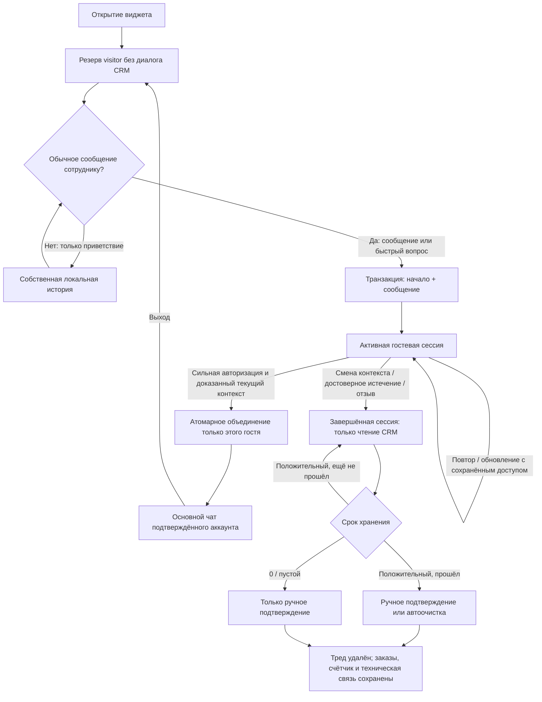
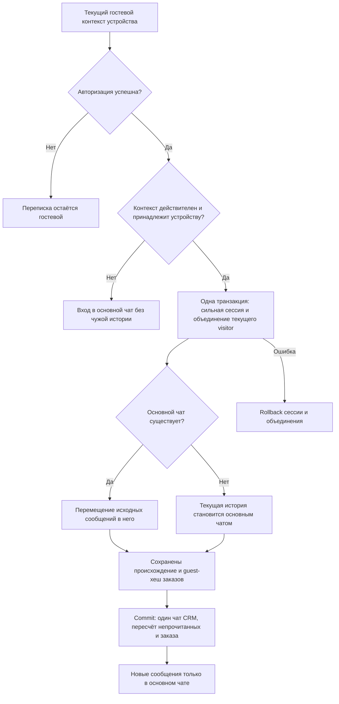
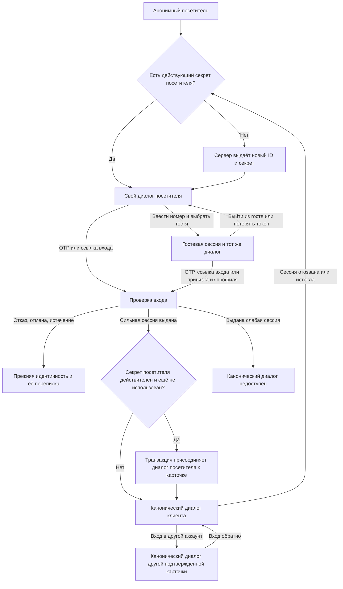
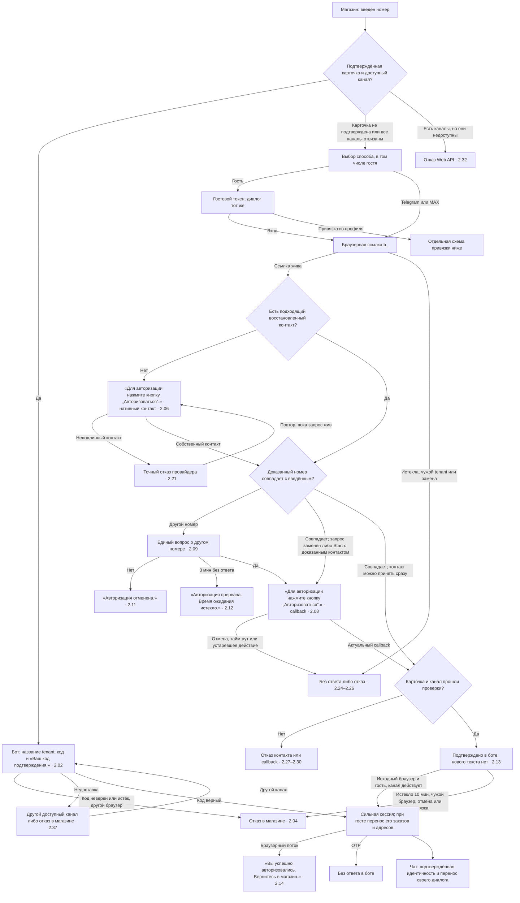
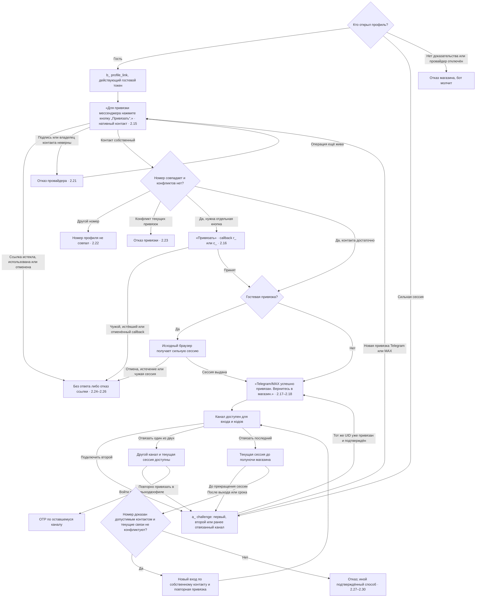
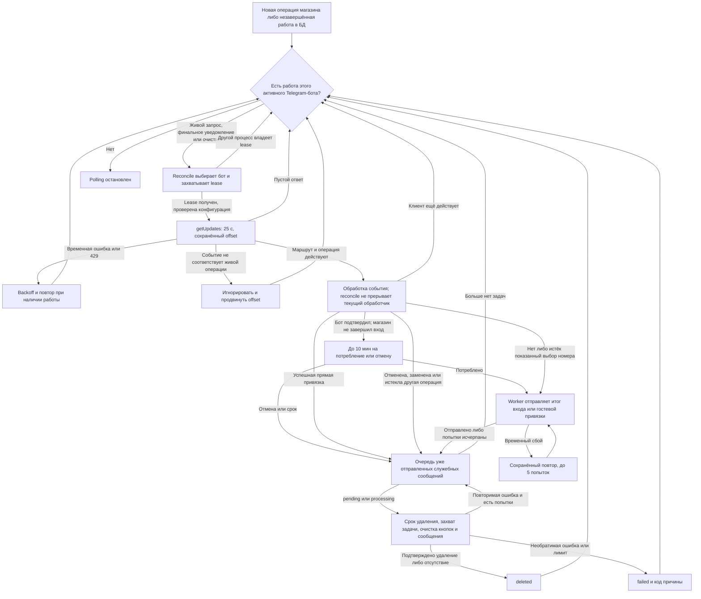
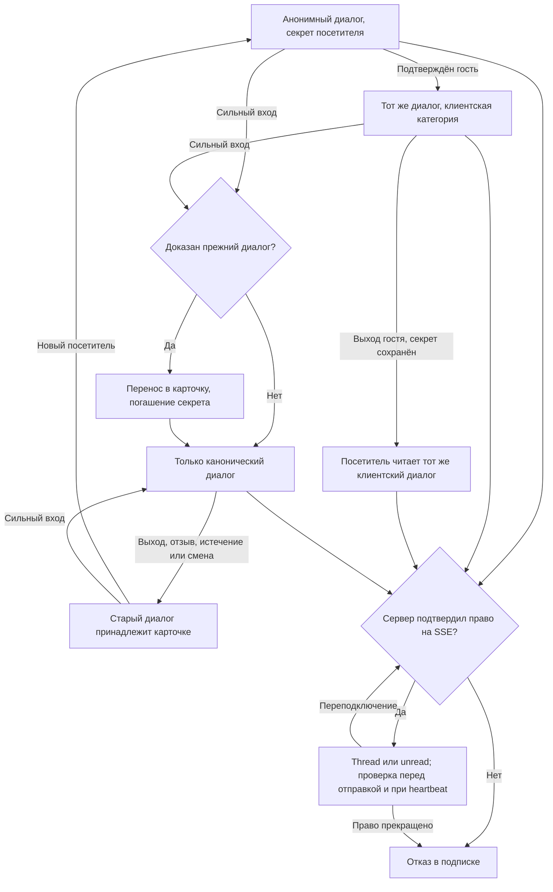
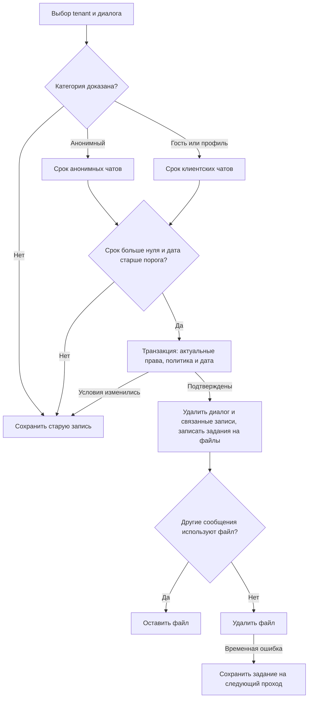
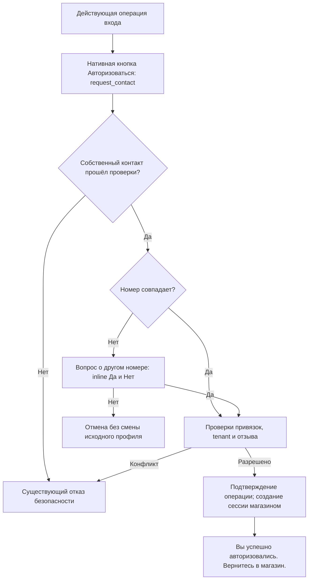
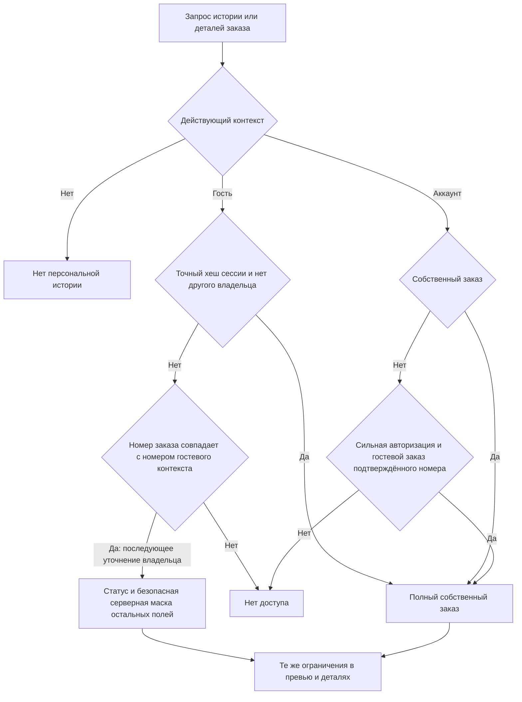

# Состояния клиента и ответы ботов Telegram и MAX

## Гостевые сессии CRM · итоговые состояния 23.11.2026

Это приоритетное дополнение к разделам о чатах. Последняя политика объединения при подтверждённой авторизации сохранена; тексты и кнопки Telegram/MAX этим этапом не изменялись.

| Исходное состояние | Действие / условие | Итог | Переписка, заказ и индикаторы | Источник |
| --- | --- | --- | --- | --- |
| Нет visitor-контекста | Открытие сайта/виджета | Резервируется приватный идентификатор без видимого треда и номера | CRM не получает пустой диалог | `api/chatTemp.js`, `reserveVisitor`, `POST /identity` |
| Зарезервированный контекст | Только приветствие без сообщения клиента | Серверная гостевая сессия не начинается | Приветствие сохраняется локально для этого контекста; пустого диалога CRM нет | `static/js/shop-company-chat.js`, `remoteCreateSharedMessage`, `persistDeferredChatMessages` |
| Контекст без треда | Первое сообщение, включая быстрый вопрос | Активная гостевая сессия без отображаемого номера | Начало и сообщение сохраняются транзакционно; приветствие и автоматический ответ сохраняются в том же треде, который виден CRM | `POST /thread/:clientId/messages`; `customerChatSessions.start`; `sendUserMessage`, `remoteCreateSharedMessage` |
| Активная гостевая сессия | Повторная отправка, обновление или повторное открытие браузера с сохранённым доступом | Та же сессия | Уникальный ID сообщения и блокировка контекста исключают создание второй сессии | `lockCustomerChatOwner`, `start`, `upsertSingleThreadMessage`, `POST /identity` |
| Активная гостевая сессия | Смена гостевого контекста устройства | Прежняя завершена; новый контекст ещё не является видимым диалогом | Старая история и точная связь с заказами сохраняются; входящие подписки старого гостя удаляются | `expireVisitorConnection`, `customerChatSessions.complete`, `POST /identity` |
| Активная гостевая сессия | Достоверное истечение/отзыв доступа | Запись запрещена; сервер фиксирует завершение | История доступна CRM; номер не освобождается | `readVisitor`, `assertWritable`, `refreshExpired` |
| Cookies вручную удалены | Следующее обращение без прежнего идентификатора | Новый контекст; новый диалог только после обычного сообщения | Старую историю не удаляют и не присоединяют по телефону; момент очистки cookies серверу неизвестен | `reserveVisitor`, `POST /identity` |
| Собственная гостевая сессия | Успешный сильный вход под тем же или другим номером | Только текущая доказанная история объединяется с основным чатом | Один основной чат, сохранены происхождение/даты/вложения/статусы. Заказы не переназначаются чужому номеру | `customerBrowserSession`, `claimVisitorAfterAuthorization`, `claimVisitorThread` |
| Несколько гостей указали один номер | Авторизовался один | Объединяется только его visitor ID | Другие гости остаются отдельными; группировка CRM не изменяет доступ | `claimVisitorThread`, `customerChatSessions.groupPage` |
| Авторизованный клиент | Другое устройство с сильной сессией | Тот же основной чат | Общая история аккаунта; гостевые полномочия не требуются | `resolveStrongChatSession`, `customerChatOwner` |
| Авторизованный клиент | Выход | Основной чат без сильной сессии недоступен; для гостевой переписки новый контекст | Новый гостевой диалог не появляется до первого обычного сообщения | `customerChatOwner`, `POST /identity` |
| Список клиентов CRM | Нажатие строки клиента | Сразу открывается единая карточка подтверждённого аккаунта справа и выбирается активная сессия (при нескольких — последняя по активности), иначе основной/последний имеющийся диалог. При нескольких диалогах аккордеон раскрывает их под клиентом, сдвигая список вниз | Для единственного активного диалога аккордеона нет. При отсутствии подтверждённой карточки правая колонка пуста; гостевые карточки не подставляются | `renderClientsList`, `buildChatClientRow`, `getChatCustomerProfileId`, `activateChatRightTab` |
| Список диалогов CRM | Выбор основного/гостевого | Меняется только средняя колонка; единая карточка клиента справа не переключается | Свои сообщения, прочтение, числовой бейдж и хедер. Красная точка клиента учитывает все его диалоги | `buildChatClientRow`, `selectClient`, `loadActiveClientData`, `getUnreadCount` |
| Выбранная гостевая сессия | Загрузка хедера | Последний доступный заказ точного guest-хеша либо скрытый хедер | Номер телефона не расширяет выбор. Поздний ответ предыдущего выбора не применяется | `GET /chat-guests/:visitorId`, `loadActiveClientData`, `setOrderHeaderFields` |
| Завершённая гостевая сессия | Открытие сотрудником | Только чтение, «Сессия завершена» | Можно отмечать фактически прочитанные; ответ/изменение запрещены сервером | `assertWritable`, `lockCustomerChatOwner`, `setComposerEnabled` |
| Завершённая сессия, положительный срок хранения ещё не прошёл | Попытка удалить | Отказ, исходная история остаётся | Заказы, права и номер не меняются | `assertDeletable`, `deleteCompletedGuestThread` |
| Завершённая сессия, срок прошёл | Подтверждённое ручное либо автоматическое удаление | Удалён только гостевой тред; tombstone сохранён | Заказы/платежи не удаляются, номер не переиспользуется, события убирают старую строку CRM | `assertDeletable`, `deleteCompletedGuestThread`, `reconcile_ids` |
| Завершённая сессия, срок 0/пустой | Ожидание либо подтверждённое ручное удаление | Автоматического удаления нет; ручное допустимо | Используются прежняя модалка и очередь вложений | `assertDeletable`, `deleteGuestClientChat`, `chat_attachment_gc` |
| Основной или активный гостевой чат | Запуск очистки / попытка удаления сессии | Не удаляется | Прежний `chat_thread_ttl_days` не запускает удаление основных чатов | `CHAT_RETENTION_CANDIDATES`, `assertDeletable` |
| История без доказанной visitor-записи и карточки | Открытие в CRM | «Исторический диалог», только просмотр | Номер/владелец/заказы не выдумываются, автоматической привязки и очистки нет | `decorate`, `assertWritable`, `dialogueLabel` |

[Полный отчёт, миграция и ограничения проверки](customer-auth-comprehensive-audit.md#гостевые-сессии-и-основной-чат-crm--итоговая-доработка-23112026).

## Приоритетное уточнение · 22.11.2026

После успешной авторизации текущая доказанная гостевая переписка объединяется с основным чатом подтверждённого аккаунта **независимо от совпадения номера гостя**. Объединение входит в транзакцию выдачи сессии; другие гости с тем же номером не затрагиваются. Старый тред и его вкладка исчезают из списка CRM; клиент продолжает общение в основном чате. Источники: `api/chatTemp.js`, `claimVisitorAfterAuthorization`, `claimVisitorThread`, `POST /identity`, `GET /clients`; `api/public/shop.js`, `customerBrowserSession`; `static/js/chat.js`, `applyServerMergeNotice`.

| Условие | Администратор | Клиент | Физическое объединение |
| --- | --- | --- | --- |
| Номер указан без авторизации | Отдельный гостевой диалог; другие переписки по номеру не добавляются | Только собственный гостевой тред | Нет |
| Несколько гостей на один номер | Отдельные записи и ID; источник каждого сообщения и адресат ответа различимы | Каждый видит только свой тред | Нет |
| Сильная авторизация, тот же номер, подтверждена гостевая сессия | Остаётся основной авторизованный тред; пометка и предупреждение у него исчезают | История аккаунта и только собственного объединённого гостя | Да, только конкретный исходный visitor ID |
| Другой подтверждённый номер, доказан текущий гостевой контекст | Остаётся основной чат; гостевой тред больше не дублируется | Основной чат с собственной гостевой историей; старый гостевой доступ отключён | Да, только текущий visitor ID |
| Нет действующего доказательства владения гостевым контекстом | Гостевой тред остаётся отдельным | Только подтверждённый аккаунт | Нет |
| Запоздалый ответ администратора в уже объединённый ID | Сервер под блокировкой разрешает основной тред; старая запись не создаётся повторно | Ответ доставляется подтверждённому аккаунту | Повторный перенос не выполняется |

Источники таблицы: `api/chatTemp.js`, `customerChatOwner`, `claimVisitorAfterAuthorization`, `claimVisitorThread`, `lockCustomerChatOwner`, `canonicalMutationMessageId`; `api/public/shop.js`, `customerBrowserSession`; `static/js/chat.js`, `applyServerMergeNotice`. Сообщения Telegram/MAX этим изменением не затронуты. [Полный отчёт](customer-auth-comprehensive-audit.md#объединение-текущей-гостевой-переписки--итоговое-уточнение-22112026).

Перенос гостевого заказа в профиль допускается только при совпадении номера в заказе с подтверждённым номером профиля и принадлежности заказа исходной гостевой сессии. Вход под другим номером не переносит в этот профиль заказ на прежний номер. Это правило имеет приоритет над историческими строками о переносе всех гостевых заказов. Тексты ботов не меняются. Источник: `api/helpers/customerAuth.js`, `promoteGuest`, строки 113–122.

19.11.2026 · `feat/messenger-auth` · рабочий код поверх `5082253`.

У каждого магазина (tenant) свои боты и свои данные. Номер, введённый в магазине, служит для выбора сценария. Право на профиль дают проверенный канал, код или собственный контакт с соблюдением условий конкретного сценария. Cookie запроса входа, гостевой токен, сессия клиента и доказательство владения перепиской имеют разные назначения. Источники: `api/messengerDelivery.js` `getTenantBotConfig` 74–95, `api/messengerAuth.js` `browserBinding` 1060–1069 и `consumeBrowserRequest` 1445–1513, `api/chatTemp.js` `customerChatOwner` 1358–1392.

Номера строк относятся к рабочему дереву этой ревизии. В таблицах «Без ответа» означает отсутствие нового сообщения бота. Пустое подтверждение callback указано отдельно. Переносы строк в сообщениях обозначены как `\n`. Там, где текст хранится в настройках tenant, приведены ключ, исходный текст и правила подстановки.

## Сверка достижимых ответов с тестовым сервисом · 19.11.2026

Рабочая копия и тестовый процесс различаются. Последняя read-only сверка обнаружила старые серверные обработчики от 18.11.2026, описанные в [отчёте о маршрутизации](customer-auth-comprehensive-audit.md#несогласованные-ответы-ботов-и-сверка-тестового-сервиса). Таблицы этого файла описывают рабочую копию после исправлений. Для изменения ответов работающего тестового сервиса требуется отдельно разрешённое развёртывание.

| Ответ или источник | Достижимость для клиента в итоговой рабочей копии | Условие | Источник |
| --- | --- | --- | --- |
| «Отправьте только собственный контакт системной кнопкой мессенджера.» | В клиентской подсказке недостижим | Шаблон contact_request существует в БД tenant 1, store 1, tg. Клиентские login и PROFILE_LINK обрабатываются до общего шаблонного блока | `api/tenantTelegramBot.js`, `customerResult`, 41–69; `api/botContentTemplates.js`, `createServiceTextRenderer`, 60–74 |
| «Номер подтверждён, Telegram привязан. Начните вход в исходной карточке и подтвердите новый запрос в боте.» | Сохранён в ветке сотрудника; клиентский контакт туда не допускается | onAuthContact требует выбранный employee challenge и передаёт employeeOnly и contactTarget | `api/tenantMessengerUpdate.js`, `onAuthContact`, 196–210; `api/tenantTelegramBot.js`, завершающий обработчик контакта, 197–211 |
| «Для авторизации нажмите кнопку „Авторизоваться“.» | Достижим | Текущий клиентский login ожидает контакт или отдельное подтверждение | `api/tenantTelegramBot.js`, `customerResult`, 41–69; `api/maxBotPolling.js`, `customerResult`, 798–824 |
| «Для привязки мессенджера нажмите кнопку „Привязать“.» | Достижим | Текущая PROFILE_LINK ожидает контакт либо связанный callback | `api/tenantTelegramBot.js`, `customerResult`, 41–55; `api/maxBotPolling.js`, `customerResult`, 798–810 |
| «Вы успешно авторизовались. Вернитесь в магазин.» | Достижим | Сессия создана, browser request потреблён, worker отправляет итог | `api/messengerCleanup.js`, `customerTerminalNoticeStateSql` и `notifyCustomerTerminal`, 503–568 |
| Обычный Telegram /start, лишний контакт, старый callback | Без ответа | Нет текущей маршрутизируемой операции либо событие устарело | `api/telegramPolling.js`, `resolveTelegramOperation`, 84–118; `api/tenantMessengerUpdate.js`, `handleTenantMessengerUpdate`, 53–100 |

Снимок Telegram-шаблонов tenant 1/store 1 на момент сверки содержит также request_error = «Не удалось выполнить запрос. Начните действие заново в магазине.» и request_expired = «Запрос истёк. Начните вход заново в магазине.». В тех отказах таблицы № 2, где указан T(request_error, …) или T(request_expired, …), применяются эти сохранённые строки. Для MAX записей этого tenant в bot_content_templates не обнаружено, поэтому используются строки адаптера. Основные клиентские подсказки и итоги обходят общие шаблоны. Шаблоны сотрудников не менялись. Источники: SELECT bot_content_templates WHERE tenant_id=1; `api/botContentTemplates.js`, `createServiceTextRenderer`, 60–74; `api/tenantTelegramBot.js`, `customerResult`, 41–69; `api/messengerCleanup.js`, `notifyCustomerTerminal`, 517–568.

## 1. Состояния клиента и переходы

«Данные профиля» ниже означают собственные заказы и адреса, бонусный аккаунт и операции, доступные по политике магазина. «Диалог посетителя» означает диалог с действующим доказательством владения, выданным сервером этому браузеру или приложению. Сильная сессия клиента открывает канонический диалог его карточки. Эти определения применяются во всех строках.

| Исходное состояние | Действие клиента | Условия | Новое состояние | Действия системы | Доступные заказы, бонусы и адреса | Доступная переписка | Источник |
| --- | --- | --- | --- | --- | --- | --- | --- |
| Анонимный | Открывает чат, пишет до ввода номера | Чат включён, tenant определён по хосту магазина | Анонимный | Сервер выдаёт ID и секрет посетителя или возвращает действующий ID | Собственных данных профиля нет | Свой диалог посетителя | `server.js` `requireChatPermission` 2358–2400; `api/chatTemp.js` `reserveVisitor` 1344–1356, `makeChatTempRouter` 4287–4400 |
| Анонимный | Вводит номер | Нет подтверждённой карточки либо она без действующих привязок | Анонимный, выбирает доступный способ | Магазин выдаёт варианты по настройкам и конфигурации ботов | Данные карточки закрыты | Тот же диалог посетителя | `api/public/shop.js` POST `/auth/phone-flow/start` 123–137 |
| Анонимный | Выбирает гостевой режим | Номер валиден и магазин определён. UI предлагает гостевой режим по условиям карточки входа | Гость | Создаётся отдельная гостевая сессия; при действующем токене того же номера он переиспользуется | Свои гостевые заказы и адреса; бонусы могут начисляться получателю по номеру заказа, баланс/списание по гостевому токену недоступны | Тот же диалог посетителя | `api/public/shop.js` POST `/auth/guest`, middleware `/me` 193–213, GET `/me/orders` 9183–9215 и `submitOrder` 24108–24115, 26272–26305; `api/helpers/customerAuth.js` `createGuest` 70–79; `api/chatTemp.js` POST `/identity` 4306–4350 |
| Гость | Повторно выбирает гостя с другим номером | Магазин определён; новый номер валиден | Гость с другим токеном | Для нового номера создаётся отдельная сессия | Заказы и адреса прежнего гостя остаются за прежним токеном | Тот же диалог посетителя при сохранённом доказательстве | `api/helpers/customerAuth.js` `getGuest`/`createGuest` 60–79; `api/public/shop.js` GET `/me/orders` 9183–9215; `api/chatTemp.js` POST `/identity` 4306–4350 |
| Гость | Выходит или теряет гостевой токен | Токен отозван, отсутствует либо недействителен. У нового гостя `expires_at=NULL`; если срок сохранён в БД, он применяется | Анонимный | Гостевые маршруты закрывают доступ; токен чата живёт отдельно | Гостевые данные закрыты | Свой диалог посетителя при действующем секрете | `api/public/shop.js` POST `/auth/logout` 7476–7496, middleware `/me` 199–213; `api/helpers/customerAuth.js` `revokeGuest`, `getGuest` 39–50, 60–69; `api/chatTemp.js` `customerChatOwner` 1358–1368 |
| Анонимный или гость | Вводит номер подтверждённой карточки | Есть доступный проверенный канал | Прежнее состояние, ожидает OTP | Привязанный бот отправляет код; запрос закреплён за браузером, карточкой, каналом и при необходимости гостевым токеном | До успешной проверки доступны только прежние данные | Тот же диалог посетителя | `api/public/shop.js` POST `/auth/phone-flow/start` 123–188; `api/messengerAuth.js` `verifyCustomerBrowserCode` 1534–1545 |
| Анонимный или гость, ожидает OTP | Вводит правильный код | Совпадают cookie, запрос, карточка, канал; гость предъявил исходный токен | Авторизованный клиент | Проверка расходует код и выдаёт сильную сессию; при госте передаются собственные заказы и адреса. Чат переносится отдельно при вызове `/identity` | Данные этой карточки и перенесённые гостевые заказы/адреса; получатель бонусов в строке заказа сохраняется | Канонический диалог, включая подтверждённый диалог посетителя | `api/public/shop.js` `customerBrowserSession` (вызов из POST `/auth/phone-flow/verify`) 103–121, 189–192; `api/messengerAuth.js` `verifyCodeChallenge` 916–974, `verifyCustomerBrowserCode` 1534–1545; `api/helpers/customerAuth.js` `promoteGuest` 126–138; `api/chatTemp.js` `claimVisitorThread` 3834–3880 |
| Анонимный или гость | Открывает ссылку входа Telegram/MAX | Живой запрос `b_`, правильный tenant, доступный канал; нет пригодного сохранённого контакта | Прежнее состояние, ожидает нативный контакт | Запрос закрепляется за аккаунтом мессенджера | Прежние данные | Тот же диалог посетителя | `api/public/shop.js` POST `/auth/messenger-browser/start` 228–258; `api/messengerAuth.js` `browserBotAction` 1155–1226, 1275–1288 |
| Анонимный или гость | Открывает ссылку входа уже подтверждённым каналом | Сервер безопасно восстанавливает подтверждённый контакт этого канала | Ожидает подтверждение либо выбор другого номера | Отправляется callback для входа или выбора номера | Прежние данные | Тот же диалог посетителя | `api/messengerAuth.js` `restoreVerifiedBrowserContact` 1111–1132, `browserBotAction` 1222–1274 |
| Ожидает контакт | Передаёт собственный контакт с тем же номером | Первая либо однозначно адресованная операция, без обязательного дополнительного подтверждения | Запрос подтверждён в боте | Для нового номера создаётся активная карточка; существующая подходящая карточка используется; канал проверяется и сохраняется | До получения сессии прежние данные | Тот же диалог посетителя | `api/messengerAuth.js` `browserBotAction` 1200–1221, 1256–1275, 1316–1387 |
| Ожидает контакт | Передаёт собственный контакт после замены предыдущей операции | Новая операция помечена как требующая подтверждения | Ожидает callback именно новой операции | Контакт записывается; сессия ещё не выдаётся | Прежние данные | Тот же диалог посетителя | `api/messengerAuth.js` `activateCustomerOperation` 286–307, `browserBotAction` 1214–1221, 1256–1259 |
| Ожидает контакт или callback | Номер подтверждённого контакта отличается от номера входа | Обычный вход, запрос содержит введённый номер | Ожидает «Да» или «Нет» | В запросе фиксируется расхождение; показывается единый текст для гостя и посетителя | Прежние данные | Тот же диалог посетителя | `api/messengerAuth.js` `browserBotAction` 1245–1273; `api/tenantTelegramBot.js` `customerResult` 59–68; `api/maxBotPolling.js` `customerResult` 813–824 |
| Ожидает решения о другом номере | Нажимает «Да» | Callback связан с живой операцией и её аккаунтом мессенджера | Ожидает отдельное «Авторизоваться» | Фиксируется согласие, даются 3 минуты на подтверждение | Прежние данные | Тот же диалог посетителя | `api/messengerAuth.js` `browserBotAction` 1245–1273 |
| Ожидает решения о другом номере | Нажимает «Нет» либо не отвечает | Согласие ещё отсутствует | Прежнее состояние, запрос отменён либо истёк | Worker отправляет соответствующий итог. Заказы, адреса, бонусы и диалог остаются у прежних владельцев | Прежние данные | Тот же диалог посетителя | `api/messengerAuth.js` `browserBotAction` 1227–1247; `api/messengerCleanup.js` `customerTerminalNoticeStateSql`, `notifyCustomerTerminal` 503–568 |
| Ожидает финальное действие | Нажимает «Авторизоваться» | Тот же мессенджер; при расхождении было согласие; действуют проверки карточки и канала | Запрос подтверждён в мессенджере | Проверка карточки и привязка в транзакции; для исходного браузера устанавливаются 10 минут | Прежние данные | Тот же диалог посетителя | `api/messengerAuth.js` `browserBotAction` 1227–1259, 1276–1283, 1339–1400 |
| Запрос подтверждён в мессенджере | Магазин запрашивает статус в исходной карточке входа | Совпали браузер и гость, tenant и карточка активны, канал ещё привязан | Авторизованный клиент | Выдаётся и записывается сильная сессия. При повторном запросе допускается возврат действующей результирующей сессии. Если был гость, переносятся только принадлежащие ему заказы/адреса | Данные подтверждённой карточки, в том числе свои гостевые заказы; у заказа неизменны контактный номер и получатель бонусов | Канонический диалог с полученной по доказательству перепиской посетителя | `api/public/shop.js` завершение входа 103–121 и POST `/auth/messenger-browser/status` 259–270; `api/messengerAuth.js` `consumeBrowserRequest` 1445–1513; `api/helpers/customerAuth.js` `promoteGuest` 126–138; `api/chatTemp.js` POST `/identity` 4306–4350 |
| Анонимный или гость | Входит ранее непривязанным Telegram или MAX | Получен подписанный собственный контакт; карточка активна либо создаётся; конфликтующих текущих связей нет | После завершения входа авторизован | Карточка определяется по доказанному номеру в tenant, Мессенджер привязывается, слабые сессии отзываются | Данные итоговой карточки; гостевые данные переходят по доказанному токену | Свой диалог посетителя переносится в канонический | `api/messengerAuth.js` `findPhoneCustomer`, `browserBotAction` 1099–1105, 1339–1390; `api/helpers/customerAuth.js` `promoteGuest` 126–138; `api/chatTemp.js` `claimVisitorThread` 3834–3880 |
| Анонимный или гость | Снова входит через Telegram или MAX после добровольной отвязки | Допустимый собственный контакт подтверждает номер карточки. Возможен другой UID, если нет действующего конфликта либо административного отзыва | После завершения входа авторизован; Мессенджер привязан | Выбирается карточка по номеру и создаётся новая связь | Данные подтверждённой карточки | Канонический диалог с подтверждённой перепиской посетителя | `api/public/shop.js` POST `/auth/phone-flow/start` 123–137; `api/messengerAuth.js` `adoptUnlinkedCustomerChannel` 345–355, `browserBotAction` 1339–1390 |
| Гость | Запрашивает привязку из профиля | Действующий гость; допустимый контакт Telegram или MAX совпадает с гостевым номером; текущие связи не конфликтуют | Ожидает завершение в магазине → авторизованный клиент | Используется браузерный запрос `profile_link`; по-прежнему обрабатываются гостевые имя и фото, если они заданы | Гостевые заказы и адреса становятся доступны в итоговом профиле; получатель бонусов остаётся прежним | Диалог посетителя присоединяется к каноническому | `api/public/shop.js` POST `/auth/link-token` 7517–7541; `api/messengerAuth.js` `browserBotAction` 1190–1208, 1328–1356, 1382–1387; `api/helpers/customerAuth.js` `promoteGuest` 126–138 |
| Авторизованный клиент | Подключает первый, второй или отвязанный мессенджер из профиля | Сильная сессия, провайдер разрешён; собственный контакт совпадает с телефоном профиля и ни канал, ни номер не конфликтуют | Тот же клиент с новым действующим каналом | Одноразовая ссылка `a_`, нативный контакт, при необходимости callback `c_`; канал связан с той же карточкой, срок действующих сильных сессий сбрасывается при успешной привязке | Те же данные профиля | Тот же канонический диалог | `api/public/shop.js` POST `/auth/link-token` 7543–7567; `api/messengerAuth.js` `createLinkChallenge` 267–285, `completeLinkChallenge` 345–608 |
| Авторизованный клиент с уже активным каналом | Открывает из профиля новую ссылку тем же UID | Сильная сессия действительна, тот же канал уже подтверждён и относится к той же карточке | Тот же клиент с тем же каналом | Challenge может завершиться прямо по ссылке, используя существующую подтверждённую привязку. Попытка заменить активный UID другим приводит к отказу | Те же данные профиля | Тот же канонический диалог | `api/messengerAuth.js` `completeLinkChallenge` 408–477, 497–587; `api/tenantTelegramBot.js` `handleTenantTelegramUpdate` 150–159; `api/maxBotPolling.js` `handleTenantMaxUpdate` 909–922 |
| Авторизованный клиент | Отвязывает один из двух каналов | Сильная сессия; другой подтверждённый канал остаётся | Тот же клиент, доступен оставшийся канал | Удаляется связь с профилем и локальные идентификаторы; связанные незаконченные запросы закрываются | Те же данные профиля | Тот же канонический диалог | `api/public/shop.js` DELETE `/auth/messenger-links/:provider` 7569–7582; `api/messengerAuth.js` `unlinkAccountChannel` 609–690 |
| Авторизованный клиент | Отвязывает последний канал | Сильная сессия | Текущая сессия доживает до полуночи магазина; после выхода или истечения — анонимный | Другие сильные сессии отзываются; действующий клиент может снова привязать канал | До прекращения сессии те же данные; затем данные профиля закрыты | До прекращения сессии канонический диалог; затем диалог посетителя | `api/messengerAuth.js` `unlinkAccountChannel` 654–689; `api/public/shop.js` `getCustomerByToken` 5936–6008; `api/chatTemp.js` `resolveStrongChatSession` 1385–1392 |
| Клиент с незавершённым входом | Отменяет из магазина или начинает новую операцию | Запрос привязан к исходному браузеру, при госте — к той же сессии | Прежнее состояние; при замене — ожидание новой операции | Закрывается прежний запрос; использованные кнопки и сообщения очищаются по очереди. Истёкший выбор номера имеет собственное уведомление | Прежние данные | Тот же диалог | `api/public/shop.js` POST `/auth/messenger-browser/start` 228–258; `api/messengerAuth.js` `activateCustomerOperation` 286–307, `consumeBrowserRequest` 1443–1474; `api/messengerCleanup.js` `markOperation` 89–131, `tick` 571–591 |
| Авторизованный клиент | Выходит, меняет аккаунт или его сессия прекращается | Старый токен отозван, истёк или заменён в клиенте | Анонимный, гость либо новый авторизованный клиент | Клиент сбрасывает состояние старого чата; сервер проверяет каждый запрос и перед отправкой события SSE и на heartbeat. Повторный вход в прежний аккаунт снова открывает сохранённый диалог | Доступны данные текущей идентичности | Старый канонический диалог закрывается; открывается только диалог текущей подтверждённой идентичности | `api/public/shop.js` POST `/auth/logout` 7476–7496; `api/chatTemp.js` `requireCurrentChatOwner`, `resolveStrongChatSession` 1377–1392; `static/js/shop-company-chat.js` `syncServerChatIdentity`, `refreshChatClientProfileIfNeeded` 3558–3588, 3770–3900; `mobile-apps/mobile-user/src/features/chat/useChatThread.ts` `useChatThread`, `clearChatIdentity`, `handleChatIdentityError` 306–312, 398–409, 577–583; `mobile-apps/mobile-user/src/pages/chat/ChatPage.tsx`, `ChatPage` 380–395 |
| Анонимный или гость, старый диалог | Обновляет страницу, меняет устройство, удаляет cookie или предоставляет прежний числовой ID | Нет действующей серверной идентичности посетителя | Та же категория с новой идентичностью чата | Создаётся новый ID; прежний диалог автоматически не переносится. Канонический старый диалог открывается сильной сессией его владельца | Определяются отдельной сессией входа | Новый диалог либо канонический диалог подтверждённого владельца | `api/chatTemp.js` `readVisitor`, `customerChatOwner` 1336–1368, POST `/identity` 4306–4350, ACL 4358–4400 |
| Клиент в магазине с разрешённым старым входом по дате рождения | Вводит совпадающую дату | Настройка включена, номер ещё не подтверждён, нет действующих каналов | Слабая сессия | Выдаётся ограниченная сессия. Сервер чата требует сильную сессию для канонической переписки | Ограничения слабой сессии и запрет списания; слабая сессия не служит доказательством привязки | Канонический диалог недоступен | `api/public/shop.js` POST `/auth/login` 6923–7030, middleware `/me` 88–101, `getCustomerByToken` 5936–6008; `api/chatTemp.js` `resolveStrongChatSession`, POST `/identity` 1385–1392, 4306–4350 |
| Пользователь MAX с legacy-привязкой | Переходит по одноразовой ссылке бота | Клиент активен, MAX разрешён, токен не использован и не истёк | Для подтверждённого телефона или выключенной политики даты рождения — переход в магазин без сессии. Иначе — слабая сессия | `/max/finish-login` расходует токен; постоянный `ptoken` отвергается | Данные определяет текущий токен или ограничения слабой сессии. Маршрут не переносит гостевые заказы | Канонический чат требует сильную сессию | `api/maxBotPolling.js` `issueOneTimeLoginToken` 496–505, `buildLoginMessage` 581–620; `api/public/shop.js` GET `/max/finish-login` 7056–7180, `dualWriteSession` 5884–5917; `api/chatTemp.js` POST `/identity` 4306–4350 |
| Пользователь со старой одноразовой ссылкой Telegram | Открывает `/tg/finish-login` | Клиент активен, Telegram разрешён, сохранённый токен не использован и не истёк; клиентский бот такую ссылку уже не выдаёт | Переход в магазин без сессии либо слабая сессия для неподтверждённого номера при разрешённой политике даты рождения | Токен расходуется. Постоянный `ptoken` отвергается | Данные определяет текущий токен или ограничения слабой сессии | Канонический чат требует сильную сессию | `api/public/shop.js` GET `/tg/finish-login` 7182–7308, GET `/tg/auth-link` 7049–7053; `api/telegramPolling.js` `resolveTelegramOperation` 84–118; `api/chatTemp.js` `resolveStrongChatSession` 1385–1392 |

## 2. Ситуации и ответы ботов

### Как читать сроки и ответы

- `T(key, "текст")` означает фактический кастомный шаблон `key` из `bot_content_templates` по tenant, магазину и провайдеру. При отсутствии записи отправляется приведённая дословная строка. Служебный renderer передаёт `{store_name}` как имя магазина, затем `site_name` или имя tenant. Для разрешённых `{site_url}` и `{mini_app_url}` он подставляет пустые строки. В `welcome` MAX передаются все три переменные, с `site_name` или именем tenant в `{store_name}`. Значения настроек конкретного рабочего tenant определяются в момент отправки. `api/botContentTemplates.js`, `renderTemplate`, `createServiceTextRenderer`, `listTemplates`, 3–14, 54–103; `api/maxBotPolling.js`, `sendConfiguredMaxWelcome`, 771–794.
- Очередь обычного служебного сообщения держит его до срока операции. При успехе и отмене сообщения обычно остаются ещё 15 секунд, при ошибке и истечении применяется 30-секундное правило. Если операция сама истекла, прежнее сообщение может быть доступно очистке сразу по первоначальному сроку. Кнопку использованного согласия или привязки назначают к очистке сразу. Уведомление об истечении выбора отсчитывает своё время после отправки. Worker выполняет задания асинхронно. `api/messengerCleanup.js`, `markOperation`, `recordServiceMessage`, `syncBrowserCleanupDeadline`, `scheduleCurrentControlCleanup`, 89–131, 175–239, 394–411, 571–649.
- Telegram очищает inline-клавиатуру через `editMessageReplyMarkup`; для нативной клавиатуры использует `remove_keyboard` в итоговом сообщении или отправляет «Запрос завершён.» и удаляет это дополнительное сообщение. Если другая живая операция ещё использует клавиатуру в этом чате, её сохраняют. MAX удаляет сервисное сообщение вместе с его кнопками. Отметки ввода клиента для клиентских операций не ставятся на удаление. `api/messengerCleanup.js`, `clearTelegramControls`, `deleteMaxMessage`, `tick`, 460–501, 607–646; `api/tenantMessengerUpdate.js`, `handleTenantMessengerUpdate`, 119–205.
- Пустой Telegram callback — `answerCallbackQuery` без текста; пустой MAX callback — ответ с пустым сообщением. Ни один не показывает текстового уведомления. В отказах с текстом указан точный текст popup. `api/tenantTelegramBot.js`, `handleTenantTelegramUpdate`, 71–95; `api/maxBotPolling.js`, `answerTenantMaxCallback` и `handleTenantMaxUpdate`, 749–758, 826–851.

| № | Операция | Исходное состояние | Условие возникновения | Действие системы | Точный текст сообщения Telegram | Точный текст сообщения MAX | Кнопки | Действие клиента | Следующее состояние | Срок ожидания | Очистка сообщений | Источник |
| --- | --- | --- | --- | --- | --- | --- | --- | --- | --- | --- | --- | --- |
| 2.01 | Телефон, гостевой режим, дата рождения, выход | Посетитель, гость или клиент | Действие выполнено только в магазине | Маршрут возвращает данные/статус в магазин | Без ответа | Без ответа | Нет в боте | Продолжить в магазине | Гость, ограниченная сессия или анонимный после выхода | Зависит от операции | Нет новой записи | `api/public/shop.js`, POST `/auth/phone-flow/start`, `/auth/guest`, `/auth/login`, `/auth/logout`, 123–138, 193–198, 6923–7030, 7476–7496 |
| 2.02 | Код входа | Посетитель или гость с номером подтверждённой карточки | Доступен привязанный канал | Отправляет OTP только выбранным ботом; при недоставке и наличии второго канала может переключиться на него | `{магазин}: {код} - Ваш код подтверждения.` | `{магазин}: {код} - Ваш код подтверждения.` | Нет | Ввести код в исходной карточке | Ожидает ввода | 3 мин, 4 цифры, 5 попыток; повторная отправка через 60 с | Удаляется выбранным ботом; по окончании задачи кода | `api/public/shop.js`, POST `/auth/phone-flow/start`, 123–188; `api/messengerDelivery.js`, `getTenantBotConfig`, `deliverCode`, 74–95, 194–239; `api/messengerAuth.js`, `issueCodeChallengeLocked`, `verifyCodeChallenge`, 716–891, 916–974 |
| 2.03 | Повторный запрос кода | Ожидание OTP | Совпадают прежний живой запрос, браузер, карточка и гость либо повтор разрешён после паузы | Возвращает `already_sent` или выдаёт новый OTP по 2.02 | Без ответа при `already_sent` | Без ответа при `already_sent` | Нет | Ввести действующий код или запросить новый | Ожидает ввода | Остаток срока прежнего кода или 3 мин нового | Старое сообщение живёт по очереди своего задания | `api/public/shop.js`, POST `/auth/phone-flow/start`, 139–188; `api/messengerAuth.js`, `issueCodeChallengeLocked`, 741–825 |
| 2.04 | Проверка OTP | Ожидание OTP | Правильный, ошибочный, просроченный или повторно использованный код; чужая cookie/сессия; лимит попыток | Сессия выдаётся только при корректном запросе. Ответ об отказе получает магазин. Для входа по OTP worker итог входа не отправляет | Без ответа | Без ответа | Нет | Ввести действующий код или заново начать запрос | Авторизован либо прежнее состояние | До 3 мин и до 5 попыток; лимит новых запросов до 20 за 15 мин по IP | Код очищается с учётом итога или срока | `api/messengerAuth.js`, `verifyCodeChallenge`, `createBrowserRequest`, `verifyCustomerBrowserCode`, 916–974, 1133–1153, 1534–1545; `api/messengerCleanup.js`, `customerTerminalNoticeStateSql`, 503–510 |
| 2.05 | Дополнительное подтверждение телефона в профиле | Профиль, требующий проверки | Маршрут `/phone-verification/send`, подходящий привязанный канал | Отправляет код цели `phone_verify` | `Код подтверждения: {код}. Он действует 3 мин. Никому не сообщайте этот код.` | `Код подтверждения: {код}. Он действует 3 мин. Никому не сообщайте этот код.` | Нет | Ввести код в магазине | Телефон подтверждён при успехе | 3 мин, повтор через 60 с, 5 попыток | По состоянию задачи кода. Если настроен `code_sent`, его текст добавляется перед кодом через `\n\n` | `api/public/shop.js`, POST `/phone-verification/send`, `/phone-verification/verify`, 7409–7473; `api/messengerDelivery.js`, `codeMessage`, `deliverCode`, 178–239; `api/messengerAuth.js`, `issueCodeChallengeLocked`, `verifyCodeChallenge`, 716–825, 916–974 |
| 2.06 | Открытие ссылки входа с запросом номера | Посетитель или гость | Живой запрос, требуется доказать номер | Закрепляет запрос за UID и запрашивает контакт | Для авторизации нажмите кнопку „Авторизоваться“. | Для авторизации нажмите кнопку „Авторизоваться“. | «Авторизоваться» — Telegram reply `request_contact`, MAX `request_contact` в `inline_keyboard` | Передать контакт системной кнопкой | Ожидает контакт | Начальный срок 3 мин | По сроку и итогу | `api/messengerAuth.js` `browserBotAction` 1235–1287; `api/maxBotPolling.js` `customerResult` 798–824 |
| 2.07 | Повторный Start в той же операции | Ожидает контакт или подтверждение, либо подтверждён в боте | Фаза уже отправлена и записана либо операция подтверждена | Подавляет повторное сообщение; если соответствующий признак отправки ещё отсутствует, отправляет актуальную форму 2.06, 2.08 или 2.09 | Без ответа при записанной фазе | Без ответа при записанной фазе | Уже выданные кнопки | Использовать актуальную кнопку | Состояние не меняется | Остаток срока | Прежняя очередь | `api/messengerAuth.js`, `browserBotAction`, 1222–1226, 1235–1265; `api/messengerCleanup.js`, `recordCustomerPrompt`, 412–435 |
| 2.08 | Вход без нового контакта, подтверждение после замены или после «Да» | Ожидает вход или выбор | Восстановлен подтверждённый контакт, нужна кнопка после замены либо принято «Да» | Создаёт финальную кнопку для текущего запроса. На «Да» — пустой callback и немедленная очистка старого выбора | Для авторизации нажмите кнопку „Авторизоваться“. | Для авторизации нажмите кнопку „Авторизоваться“. | «Авторизоваться» — TG inline `callback_data=auth:r_…`; MAX `callback` с тем же payload | Нажать «Авторизоваться» | Ожидает финальную кнопку | Остаток исходного срока или 3 мин после «Да» | Кнопка выбора — сразу; финальное сообщение — по итогу/сроку | `api/messengerAuth.js`, `browserBotAction`, 1214–1274; `api/tenantTelegramBot.js`, `customerResult`, `handleTenantTelegramUpdate`, 41–88; `api/maxBotPolling.js`, `handleTenantMaxUpdate`, 813–851 |
| 2.09 | Другой номер | Посетитель либо гость | Подтверждённый номер отличается от номера входа | Просит отдельное согласие независимо от гостевых заказов | `Номер телефона в Telegram отличается от номера, указанного в магазине.\n\nАвторизоваться под другим номером?` | `Номер телефона в MAX отличается от номера, указанного в магазине.\n\nАвторизоваться под другим номером?` | «Да» и «Нет» — inline callback `auth:r_…:yes`, `auth:r_…:no` | Выбрать | Ожидает решения | 3 мин от первой записи отправленной фазы выбора | По использованию/истечению | `api/tenantTelegramBot.js`, `customerResult`, 65–67; `api/maxBotPolling.js`, `customerResult`, 813–817; `api/messengerAuth.js`, `browserBotAction`, 1245–1273; `api/messengerCleanup.js`, `recordCustomerPrompt`, 412–435 |
| 2.11 | Отказ от другого номера | Ожидает выбор | Нажал «Нет» до согласия | Помечает отмену. Пустой callback; сообщение отправляет worker | Авторизация отменена. | Авторизация отменена. | Нет; TG `remove_keyboard`, если она не нужна другой операции | При необходимости заново начать вход | Отменён | Выбор до 3 мин; отправка фоновая | Кнопка выбора — сразу, итог — 15 с | `api/messengerAuth.js`, `browserBotAction`, 1231–1234; `api/tenantMessengerUpdate.js`, `handleTenantMessengerUpdate`, 128–141; `api/messengerCleanup.js`, `notifyCustomerTerminal`, 514–568 |
| 2.12 | Тайм-аут выбора номера | Ожидает выбор | Выбор был отправлен, «Да»/«Нет» не зафиксированы, наступил срок | Worker закрывает запрос и отправляет итог | Авторизация прервана. Время ожидания истекло. | Авторизация прервана. Время ожидания истекло. | Нет; TG `remove_keyboard` при отсутствии другой активной клавиатуры | Начать вход заново | Истёк | 3 мин после отправки выбора | Предыдущее сообщение — по дедлайну; итог — правило 30 с | `api/messengerCleanup.js`, `recordCustomerPrompt`, `customerTerminalNoticeStateSql`, `notifyCustomerTerminal`, 412–435, 503–568 |
| 2.13 | Подтверждение входа в боте | Ожидает подходящий контакт либо финальную кнопку | Номер/канал и карточка прошли проверки; либо кнопка после согласия | Записывает `confirmed`; финальный callback подтверждается пустым ответом | Без ответа | Без ответа | Нет новой кнопки | Вернуться в исходный магазин | Бот подтвердил; сессия ещё не выдана | До 10 мин на магазин | Сообщения остаются привязанными к операции до завершения или истечения | `api/messengerAuth.js`, `browserBotAction`, 1320–1396; `api/tenantTelegramBot.js`, `handleTenantTelegramUpdate`, 41–88; `api/maxBotPolling.js`, `handleTenantMaxUpdate`, 798–851 |
| 2.14 | Завершение входа, в том числе после повторной привязки | Бот подтвердил | Исходный магазин успешно потребил запрос и получил сессию | Worker отправляет итог один раз при зафиксированном успехе доставки | Вы успешно авторизовались. Вернитесь в магазин. | Вы успешно авторизовались. Вернитесь в магазин. | Нет; TG `remove_keyboard` условно | Продолжить в магазине | Авторизован | Отправка фоновая; до 5 попыток с 30-секундным окном повтора | Итог — правило 15 с | `api/messengerAuth.js`, `consumeBrowserRequest`, 1492–1511; `api/messengerCleanup.js`, `notifyCustomerTerminal`, 514–568 |
| 2.15 | Запрос привязки из профиля | Авторизованный либо гость | Живая ссылка `a_` авторизованного или `b_` гостя, нужен контакт | Просит собственный контакт | Для привязки мессенджера нажмите кнопку „Привязать“. | Для привязки мессенджера нажмите кнопку „Привязать“. | «Привязать» — Telegram reply `request_contact`, MAX `request_contact` в `inline_keyboard` | Передать свой контакт | Ожидает контакт | 10 мин; у гостя не позднее срока его сессии, если такой срок установлен | По итогу/сроку | `api/public/shop.js`, POST `/auth/link-token`, 7517–7567; `api/tenantTelegramBot.js`, `customerResult`, 41–55; `api/maxBotPolling.js`, `customerResult`, 798–810 |
| 2.16 | Дополнительное подтверждение привязки | Ожидает контакт для привязки | Система требует завершить именно новую операцию после замены | Отправляет отдельную кнопку | Для привязки мессенджера нажмите кнопку „Привязать“. | Для привязки мессенджера нажмите кнопку „Привязать“. | «Привязать» — Telegram inline callback или MAX callback, `auth:c_…` для сессии клиента, `auth:r_…` для гостя | Нажать «Привязать» | Ожидает финальную кнопку | Остаток срока запроса | При использовании — сразу, остальное по итогу | `api/messengerAuth.js`, `completeLinkChallenge`, 379–462, `browserBotAction`, 1256–1259; `api/tenantTelegramBot.js`, `handleTenantTelegramUpdate`, 41–88; `api/maxBotPolling.js`, `handleTenantMaxUpdate`, 798–851 |
| 2.17 | Успешная привязка из сильного профиля | Текущая сильная сессия | Оба провайдера завершают challenge допустимым контактом, callback после него либо уже действующей проверенной связью | Сохраняет связь. У callback пустое подтверждение | Telegram успешно привязан. Вернитесь в магазин. | MAX успешно привязан. Вернитесь в магазин. | Кнопок нет. TG при Start или контакте передаёт `remove_keyboard`, при callback — пустое подтверждение | Вернуться | Тот же клиент с каналом | Ответ обработчика события | 15 с по состоянию успеха; при callback первоначальная кнопка ставится в очередь сразу | `api/tenantTelegramBot.js`, `handleTenantTelegramUpdate`, 72–88, 150–159, 174–182; `api/maxBotPolling.js`, `handleTenantMaxUpdate`, 826–851, 875–881, 909–922; `api/tenantMessengerUpdate.js`, `handleTenantMessengerUpdate`, 119–159, 185–194 |
| 2.18 | Успешная привязка из гостевого профиля | Гость, бот подтвердил профиль | Браузер успешно потребил запрос `profile_link` и получил сильную сессию | На подтверждении пустой callback либо без ответа на контакт; затем worker отправляет итог | Telegram успешно привязан. Вернитесь в магазин. | MAX успешно привязан. Вернитесь в магазин. | Нет | Продолжить в магазине | Авторизован с каналом | До 10 мин на потребление запроса | Итог — правило 15 с | `api/messengerAuth.js`, `browserBotAction`, `consumeBrowserRequest`, 1382–1387, 1492–1511; `api/messengerCleanup.js`, `notifyCustomerTerminal`, 514–568 |
| 2.19 | Отвязка, просмотр способов входа | Авторизован | Web API с сильной сессией | Изменяет или читает связи; уведомление ботом не предусмотрено | Без ответа | Без ответа | Нет | Продолжить в профиле | Тот же профиль либо профиль с ограниченным сроком сессии | При последней отвязке до полуночи магазина | Задания ранее отменённых операций обрабатываются отдельно | `api/public/shop.js`, GET `/auth/options`, DELETE `/auth/messenger-links/:provider`, 7569–7582, 8333–8373; `api/messengerAuth.js`, `unlinkAccountChannel`, 609–690 |
| 2.20 | Отмена в магазине, замена операции, обычное истечение | Ожидает контакт, финальную кнопку, код или выдачу сессии | Нет зафиксированного нажатия «Нет» и нет истёкшего неполученного решения по номеру | Состояние отменяется/истекает; при замене отрабатывает старый запрос | Без ответа | Без ответа | Прежние удаляются по очереди | Начать новый запрос при необходимости | Прежняя клиентская идентичность | Вход/OTP 3 мин, `profile_link` и выдача после подтверждения до 10 мин | Отмена — правило 15 с; истечение — до срока прежней записи/правило 30 с | `api/messengerAuth.js`, `activateCustomerOperation`, `consumeBrowserRequest`, 286–307, 1443–1474; `api/messengerCleanup.js`, `customerTerminalNoticeStateSql`, `tick`, 503–510, 571–594 |
| 2.21 | Чужой, пересланный, поддельный контакт | Ожидает нативный контакт или MAX получил контакт без живой операции | TG есть маршрут, но контакт не собственный; MAX нарушена подпись/владелец/формат/событие не из диалога | Отвергает контакт без входа. TG без маршрута — без ответа | Отправьте только собственный контакт системной кнопкой Telegram. Пересланные контакты не принимаются. | В клиентской операции: «Контакт не подтверждён MAX. Используйте системную кнопку «Авторизоваться» или «Привязать» в текущем запросе.» Вне неё: «Контакт не подтверждён MAX. Используйте только кнопку «Поделиться контактом», не текст и не пересланную карточку.» | Нет | Повторить системной кнопкой, пока запрос действителен | Подтверждение отсутствует | Остаток срока; вне операции MAX использует служебный контекст события | По операции или ошибке; MAX при живой клиентской операции отклонённый контакт не помечает эту операцию ошибкой | `api/tenantTelegramBot.js`, `handleTenantTelegramUpdate`, 164–174; `api/maxBotPolling.js`, `handleTenantMaxUpdate`, 863–879; `api/telegramPolling.js`, `resolveTelegramOperation`, 84–118 |
| 2.22 | Номер профиля и контакта различается | Запрошена привязка из профиля | Собственный контакт имеет другой номер | Привязка не производится | Номер телефона в Telegram отличается от номера вашего профиля. Привязка невозможна. | Номер телефона в MAX отличается от номера вашего профиля. Привязка невозможна. | Нет; при контакте TG передаёт `remove_keyboard`, при callback — пустое подтверждение | Начать привязку с правильным аккаунтом | Прежний профиль | Ответ обработчика | Ошибка — правило 30 с | `api/messengerAuth.js`, `completeLinkChallenge`, 410–493, `browserBotAction`, 1190–1208; `api/tenantTelegramBot.js`, `handleTenantTelegramUpdate`, 74–88, 174–182; `api/maxBotPolling.js`, `handleTenantMaxUpdate`, 826–851, 875–881 |
| 2.23 | Иной конфликт при привязке | Уже открыт запрос привязки | Ошибка обработки привязки из профиля после контакта/в callback | Привязка не производится | Не удалось привязать Telegram. Начните привязку заново в профиле. | Не удалось привязать MAX. Начните привязку заново в профиле. | Нет; при контакте TG передаёт `remove_keyboard`, при callback `PROFILE_LINK` — пустое подтверждение | Повторить из своего профиля или разрешить конфликт | Прежний профиль | Ответ обработчика | Ошибка — правило 30 с | `api/messengerAuth.js`, `completeLinkChallenge`, 345–608, `browserBotAction`, 1388–1396; `api/tenantTelegramBot.js`, `handleTenantTelegramUpdate`, 74–88, 174–182; `api/maxBotPolling.js`, `handleTenantMaxUpdate`, 826–851, 875–881 |
| 2.24 | Открытие недействительной ссылки привязки | Профиль | `a_` не принят; для TG только если событие дошло до обработчика, обычный просроченный токен отсеивается | Отказ | Ссылка недействительна, истекла или привязка конфликтует. Получите новую в профиле. | Ссылка недействительна или истекла. Получите новую в профиле. | Кнопок нет. TG передаёт `remove_keyboard` | Получить новую ссылку | Прежний профиль | Ответ обработчика | По ошибке / контексту отправки | `api/telegramPolling.js`, `resolveTelegramOperation`, 84–118; `api/tenantTelegramBot.js`, `handleTenantTelegramUpdate`, 149–160; `api/maxBotPolling.js`, `handleTenantMaxUpdate`, 909–922 |
| 2.25 | Открытие недействительной ссылки входа | Посетитель или гость | Непринятый `b_`; TG только если резолвер допустил событие, а обработка затем отказала | Отказ | `T(request_expired, "Запрос истёк. Начните вход заново в магазине.")` | `T(request_expired, "Запрос истёк. Начните заново в магазине.")` | Кнопок нет. TG передаёт `remove_keyboard` | Начать новый запрос | Прежнее состояние | Ответ обработчика | Контекст ошибки | `api/telegramPolling.js`, `resolveTelegramOperation`, 84–118; `api/tenantTelegramBot.js`, `handleTenantTelegramUpdate`, 128–140; `api/maxBotPolling.js`, `handleTenantMaxUpdate`, 897–908 |
| 2.26 | Устаревшие и чужие действия | Запрос истёк, отменён, потреблён или закреплён за другим UID | TG не находит действующую операцию; MAX для известного клиентского callback возвращает `silent`; повторный контакт без операции также может быть проигнорирован | Доступ не выдаётся; MAX может отправить пустое подтверждение callback; при неоднозначном активном клиентском контакте диспетчер журналирует и игнорирует | Без ответа | Без ответа | Нет; устаревшие удаляются очередью | Начать новую операцию в исходном магазине | Прежнее состояние | По сроку операции | Только существующие записи | `api/telegramPolling.js`, `resolveTelegramOperation`, 84–118; `api/tenantMessengerUpdate.js`, `handleTenantMessengerUpdate`, 53–112, 125–166; `api/messengerAuth.js`, `completeLinkChallenge`, 345–407, `browserBotAction`, 1166–1189 |
| 2.27 | Контакт Telegram вне запрошенной стадии | Посетитель, гость или профиль | Не записана отправка запроса контакта, время сообщения старше запроса, контакт уже принят либо стадия сменилась | Игнорирует событие без изменения принадлежности и выдачи сессии | Без ответа | Эта проверка применяется к Telegram; MAX использует прежние проверки | Нет новых кнопок | Использовать актуальный запрос | Прежнее состояние | Остаток срока | Существующая очередь операции | `api/messengerAuth.js`, `completeLinkChallenge` 431–439, `browserBotAction` 1217–1226 |
| 2.28 | Контакт относится к другой подтверждённой карточке или каналу | Вход по контакту | `ACCOUNT_PERSON_CONFLICT` либо `CUSTOMER_PHONE_CONFLICT` | Останавливает вход, карточки не объединяет | ACCOUNT_PERSON_CONFLICT: «Обнаружена другая подтверждённая привязка. Доступ не выдан; требуется безопасное разрешение конфликта администратором.» CUSTOMER_PHONE_CONFLICT: «Номер и мессенджер относятся к разным карточкам. Автоматическое объединение запрещено; обратитесь к администратору.» | `T(request_expired, "Запрос отсутствует или истёк. Начните вход заново в исходной карточке.")` | Нет | Уточнить привязку у администратора | Прежнее состояние | Ответ обработчика | Ошибка — правило 30 с | `api/messengerAuth.js`, `browserBotAction`, 1316–1375; `api/tenantTelegramBot.js`, `handleTenantTelegramUpdate`, 192–200; `api/maxBotPolling.js`, `handleTenantMaxUpdate`, 883–888 |
| 2.29 | Другой отказ при принятии контакта | Вход по контакту | Подтверждённый номер канала конфликтует с номером связанной карточки, запрос истёк между маршрутизацией и обработкой либо иной отказ | Завершает обработку с отказом | При отказе принятия контакта — «Контакт не принят для входа. Создайте новый запрос в исходной карточке.»; отдельные REQUEST_EXPIRED и CONTACT_PHONE_MISMATCH описаны в исходном обработчике. | `T(request_expired, "Запрос отсутствует или истёк. Начните вход заново в исходной карточке.")` | Нет | Повторить с правильными данными | Прежнее состояние | Ответ обработчика | Ошибка — правило 30 с | `api/messengerAuth.js`, `browserBotAction`, 1181–1213, 1358–1396; `api/tenantTelegramBot.js`, `handleTenantTelegramUpdate`, 192–200; `api/maxBotPolling.js`, `handleTenantMaxUpdate`, 883–888 |
| 2.30 | Отказ по финальному callback | Ожидает кнопку | Операция дошла до обработчика и вернула ошибку без признака silent вне `PROFILE_LINK` либо MAX получил синтаксически подходящий неизвестный callback | Отклоняет, показывает popup и сообщение | Popup «Запрос истёк или доступ не разрешён». Сообщение `T(request_error, "Вход не подтверждён. Запрос истёк, привязка конфликтует или требуется обновление CRM. Вернитесь в исходную карточку входа.")` | Popup «Запрос истёк или доступ не разрешён». Сообщение `T(request_error, "Вход не подтверждён. Начните заново в исходном браузере.")` | Нет | Начать заново в исходной карточке | Прежнее состояние | Ответ обработчика | По состоянию ошибки | `api/tenantTelegramBot.js`, `handleTenantTelegramUpdate`, 72–95; `api/maxBotPolling.js`, `handleTenantMaxUpdate`, 826–851; `api/messengerAuth.js`, `browserBotAction`, 1388–1396 |
| 2.32 | Канал отключён магазином | Посетитель либо профиль | Web API обычно отказывает до выдачи ссылки. Если payload достиг ветки с полностью выключенным входом, адаптер отвечает | Новая привязка или вход не выполняются | Вход через бота отключён в настройках магазина. | Вход через бота отключён в настройках магазина. | TG без кнопки; MAX «Открыть мини-приложение» — ссылка при наличии URL | Продолжить другим способом | Прежнее состояние | Ответ обработчика | Обработка ошибки/контекста | `api/public/shop.js`, POST `/auth/messenger-browser/start`, 228–258; `api/tenantMessengerUpdate.js`, `handleTenantMessengerUpdate`, 119–177; `api/tenantTelegramBot.js`, `handleTenantTelegramUpdate`, 120–127; `api/maxBotPolling.js`, `handleTenantMaxUpdate`, 853–862 |
| 2.33 | Обычный Start, текст, действие вне маршрута | Посетитель бота | Обычный Start или нерелевантный текст | TG фильтрует событие; MAX отвечает только на поддерживаемые типы | Без ответа | На обычный Start / `bot_started`: `Добро пожаловать в {store_name}! Здесь можно открыть магазин, получить помощь и управлять рекламными сообщениями.` или настроенный `welcome`. На произвольный другой текст — Без ответа | MAX «Открыть магазин», «Открыть mini app» — ссылки при валидных URL | Открыть магазин при необходимости | Вход не начат | Нет запроса входа | Для отправленного приветствия используется служебный контекст события с обычным завершением | `api/telegramPolling.js`, `resolveTelegramOperation`, 84–118; `api/maxBotPolling.js`, `sendConfiguredMaxWelcome`, `handleTenantMaxUpdate`, 771–794, 961–978; `api/botContentTemplates.js`, `TEMPLATE_DEFINITIONS`, 3–14; `api/messengerCleanup.js`, `runWithOperation`, 138–157 |
| 2.34 | Произвольный стартовый payload MAX | Посетитель бота | Payload не принят текущими операциями a_, b_ или l_ | Игнорирует, не ищет карточку и не выдаёт legacy-токен входа | Без ответа | Без ответа | Нет | Начать вход из магазина | Прежнее состояние | Нет | Новых сообщений нет | `api/maxBotPolling.js`, `handleTenantMaxUpdate`, 922–927 |
| 2.35 | Текстовый номер либо контакт без операции | Посетитель бота | Для контакта не найдена текущая операция; текст не является подтверждением | Контакт игнорируется диспетчером. Старый поиск MAX-клиента по текстовому номеру отключён | Без ответа | Без ответа | Нет | Использовать текущую ссылку магазина, если вход нужен | Прежнее состояние | Нет | Новых сообщений нет | `api/tenantMessengerUpdate.js`, `handleTenantMessengerUpdate`, 53–100; `api/maxBotPolling.js`, `handleTenantMaxUpdate`, 922–930 |
| 2.36 | Снятие Telegram-клавиатуры при очистке | Завершённая операция | У исходного сообщения была reply-клавиатура, очистка ещё не сделана, другой живой операции клавиатура не нужна | Отправляет временное сообщение с `remove_keyboard`, убирает его и исходное сообщение | Запрос завершён. | Без ответа | `remove_keyboard` — действие интерфейса, кнопок нет | Действий нет | Состояние клиента прежнее | Когда наступил срок удаления | Дополнительное и исходное сообщения удаляются одним заданием; inline-кнопки очищаются через edit | `api/messengerCleanup.js`, `clearTelegramControls`, `tick`, 460–483, 597–646 |
| 2.37 | Ошибка доставки, callback, очистки | Любое | Тайм-аут, 429, недоступность API, недоступный чат/токен, подтверждение обработки уже идёт | Web API, входной диспетчер или worker фиксируют отказ, выполняют применимые повторы; отдельного текста о технической ошибке доставки или очистки клиента нет | Без ответа при недоставке | Без ответа при недоставке | Нет новой кнопки | При недоставке кода — доступный способ в магазине; очистка действий не требует | Прежняя сессия или уже состоявшийся вход | Отправка итога до 5 попыток; удаление до 5 попыток, с backoff или `retry_after` | `already_missing`/подтверждённое удаление → `deleted`; необратимый/исчерпанный отказ → `failed` | `api/public/shop.js`, POST `/auth/phone-flow/start`, 155–186; `api/messengerCleanup.js`, `telegramCleanupRequest`, `deleteMaxMessage`, `notifyCustomerTerminal`, `tick`, 438–501, 514–649; `api/telegramPolling.js`, `run`, 139–224 |

Маршруты `/max/auth-link`, `/tg/auth-link` возвращают отключённую legacy-ссылку. `/auth/messenger-code/send` и `/auth/messenger-code/verify` отвечают `BROWSER_CONFIRMATION_REQUIRED`, а прямой `/max/link-confirm` — `LEGACY_LINK_CONFIRM_DISABLED`. Устаревший обработчик `l_` есть в обоих адаптерах. Клиентские маршруты не задают `deferUntilStart`, поэтому обычный OTP доставляется непосредственно. Заказные и рекламные рассылки работают отдельно от входа, привязки и чата. Источники: `api/public/shop.js`, соответствующие маршруты, 6841–6847, 7044–7054, 7358–7362, 7409–7440; `api/messengerAuth.js`, `issueCodeChallengeLocked`, `completeBotLoginRequest`, 776–825, 893–914.

## 3. Некорректные ситуации

### Полностью предотвращённые в перечисленных маршрутах

| Ситуация | Реально возможна после исправлений | Причина | Как предотвращается или разрешается | Требуется ли действие клиента | Сообщение бота | Источник |
| --- | --- | --- | --- | --- | --- | --- |
| Получение чужого диалога по ID клиента, телефону или чужому tenant | Доступ через API чата предотвращён | Числовой ID и телефон не удостоверяют владельца | Владелец определяется сервером по сильной сессии или доказательству посетителя; маршруты списка и слияния закрыты для клиента | Войти в свой профиль или предъявить свой секрет | Без ответа | `server.js`, `requireChatPermission`, 2358–2400; `api/chatTemp.js`, `customerChatOwner`, `makeChatTempRouter`, 1358–1392, 4306–4400 |
| Присвоение чужих гостевых заказов по введённому номеру | Предотвращено для переноса гостевых заказов | Указанный контакт заказа может не совпадать с его владельцем | Транзакция сверяет токен гостя и меняет владельца только у его заказов без `customer_id` | Предъявить исходный гостевой токен при входе | При выборе другого номера — 2.09. При переносе отдельного ответа нет | `api/helpers/customerAuth.js`, `promoteGuest`, 126–138; `api/messengerAuth.js`, `consumeBrowserRequest`, 1443–1460 |
| Получение сессии из другого браузера, с чужим гостевым токеном или одним нажатием «Да» | Предотвращено | Согласие и ссылка в бот предшествуют выдаче сессии | Сверка cookie и гостя, отдельный callback, проверка канала при завершении | Вернуться в исходную карточку и нажать финальную кнопку, если она выдана | «Для авторизации нажмите кнопку „Авторизоваться“.» при переходе к кнопке. Отказ Web API — Без ответа | `api/messengerAuth.js`, `browserBotAction`, `consumeBrowserRequest`, 1227–1259, 1445–1513; `api/tenantTelegramBot.js`, `customerResult`, 63–68; `api/maxBotPolling.js`, `customerResult`, 818–824 |
| Привязка по текстовому, чужому или пересланному контакту | Предотвращена | Такой контакт не подтверждает принадлежность | Telegram сверяет UID и признаки пересылки; MAX проверяет подпись vCard, UID, единственный телефон и личный диалог | Передать свой контакт | Точные отказы в 2.21; текстовый номер в MAX обрабатывается по 2.35 | `api/tenantTelegramBot.js`, `handleTenantTelegramUpdate`, 164–174; `api/maxBotPolling.js`, `handleTenantMaxUpdate`, 863–879, 966–978 |
| Продолжение прежней активной операции после отвязки и новой привязки | Предотвращено для закрытых запросов и ссылок на уже выданную сессию | После повторной привязки UID может снова совпасть | Отвязка отменяет активные запросы и обнуляет результат потреблённых; новая операция получает новую ссылку | Открыть новый запрос | Без ответа; MAX для известного устаревшего callback может отправить пустое подтверждение | `api/messengerAuth.js`, `unlinkAccountChannel`, 609–690; `api/telegramPolling.js`, `resolveTelegramOperation`, 84–118; `api/maxBotPolling.js`, `handleTenantMaxUpdate`, 826–851 |

### Автоматически разрешаемые системой

| Ситуация | Реально возможна после исправлений | Причина | Как предотвращается или разрешается | Требуется ли действие клиента | Сообщение бота | Источник |
| --- | --- | --- | --- | --- | --- | --- |
| Вход с диалогом посетителя при уже существующем диалоге клиента | Да | У посетителя и карточки независимые диалоги | Транзакция присоединяет сообщения, вложения, карточки заказов и отметки к канонической переписке. При совпадении логического ID сохраняется сообщение канонического диалога | Нет, после входа клиент вызывает `/identity` | Без отдельного сообщения о чате | `api/chatTemp.js`, `claimVisitorThread`, 3834–3880; `static/js/shop-company-chat.js`, `syncServerChatIdentity`, 3558–3590; `mobile-apps/mobile-user/src/features/chat/storage.ts`, `resolveUserChatProfile`, 330–367 |
| Дубль события, повторный Start, замена операции на том же UID | Да | Повтор доставки, несколько вкладок, новая ссылка | Входное событие дедуплицируется, подсказка повторно не отправляется при наличии отметки, предыдущая операция закрывается. Контакт после замены требует кнопки новой операции, когда включён соответствующий режим | Использовать актуальную кнопку | Без ответа для подавленного повтора; новая подсказка 2.06, 2.08 или 2.16 | `api/messengerAuth.js`, `processWebhookEvent`, `activateCustomerOperation`, `browserBotAction`, 286–307, 995–1059, 1214–1269; `api/tenantMessengerUpdate.js`, `handleTenantMessengerUpdate`, 75–117 |
| Сообщение уже удалено | Да | Его удалили ранее | Подтверждённое API отсутствие регистрируется как `already_missing`, задача становится `deleted` | Нет | Без ответа; при отдельной необходимости снять нативную клавиатуру — «Запрос завершён.» | `api/messengerCleanup.js`, `telegramCleanupRequest`, `clearTelegramControls`, `tick`, 438–483, 607–646 |

### Требующие решения клиента

| Ситуация | Реально возможна после исправлений | Причина | Как предотвращается или разрешается | Требуется ли действие клиента | Сообщение бота | Источник |
| --- | --- | --- | --- | --- | --- | --- |
| Вход под другим номером | Да | Номер входа отличается от доказанного | «Да» ведёт к отдельному подтверждению, «Нет» закрывает запрос, ожидание без решения ограничено | Выбрать либо оставить запрос незавершённым | 2.09. Итог — «Авторизация отменена.» или «Авторизация прервана. Время ожидания истекло.» | `api/messengerAuth.js`, `browserBotAction`, 1227–1259; `api/messengerCleanup.js`, `notifyCustomerTerminal`, 514–568 |
| Неподходящий номер привязки, неверный код, истёкшая или чужая операция | Да, как отказ | Условия доказательства не выполнены | Использовать аккаунт с правильным номером или начать запрос в нужном браузере; неверный OTP тратит попытку | Да | При другом номере профиля — точный ответ 2.22. Отказ проверки кода в магазине — Без ответа | `api/messengerAuth.js`, `completeLinkChallenge`, `verifyCodeChallenge`, `consumeBrowserRequest`, 410–493, 916–974, 1443–1474; `api/tenantTelegramBot.js`, `handleTenantTelegramUpdate`, 174–182; `api/maxBotPolling.js`, `handleTenantMaxUpdate`, 875–881 |
| Один мессенджер отвязан, другой подходит для входа | Да | Активный канал остался у той же карточки | Войти по оставшемуся каналу и при необходимости привязать второй из сильной сессии | Да | Код 2.02; отвязка — Без ответа | `api/public/shop.js`, POST `/auth/phone-flow/start`, DELETE `/auth/messenger-links/:provider`, 123–188, 7569–7582; `api/messengerAuth.js`, `unlinkAccountChannel`, 609–690 |

### Требующие участия администратора

| Ситуация | Реально возможна после исправлений | Причина | Как предотвращается или разрешается | Требуется ли действие клиента | Сообщение бота | Источник |
| --- | --- | --- | --- | --- | --- | --- |
| Номер, карточка и подтверждённый UID конфликтуют | Да, как отказ | Канал или номер уже связан с другой карточкой либо человеком | Автоматического объединения нет; при отсутствии самостоятельного способа владелец CRM разбирает конфликт | Обратиться в магазин, если другой способ отсутствует | 2.28 при приёме контакта; 2.30 при callback; 2.23 для привязки | `api/messengerAuth.js`, `completeLinkChallenge`, `browserBotAction`, 460–545, 1339–1400; `api/tenantTelegramBot.js`, `handleTenantTelegramUpdate`, 87–95, 192–200; `api/maxBotPolling.js`, `handleTenantMaxUpdate`, 843–851, 883–888 |
| Глобально отозванный канал или непогашенная административная блокировка связи | Да | У канала установлен `revoked_at` | Канал не выдаёт сессию и не используется при новой привязке. Добровольная отвязка не удаляет отозванную связь | Использовать разрешённый независимый способ либо обратиться в магазин | Общий отказ 2.23, 2.29 или 2.30 по точке операции | `api/messengerAuth.js`, `completeLinkChallenge`, `unlinkAccountChannel`, `browserBotAction` 501–547, 630–662, 1294–1307 |

### Связанные с техническими сбоями

| Ситуация | Реально возможна после исправлений | Причина | Как предотвращается или разрешается | Требуется ли действие клиента | Сообщение бота | Источник |
| --- | --- | --- | --- | --- | --- | --- |
| Код не доставлен или не подтверждён callback | Да | Недоступен API, клиент Telegram не открыл личный чат или ответ потерян | Возможна отправка OTP другим привязанным ботом. Ошибка пустого подтверждения логируется; операция может быть уже записана | При недоставке кода — выбрать доступный способ | Без ответа при недоставке; успешно отправленный альтернативный код — 2.02 | `api/public/shop.js`, POST `/auth/phone-flow/start`, 155–186; `api/messengerDelivery.js`, `assertTenantTelegramContact`, `deliverCode`, 65–72, 194–239; `api/tenantTelegramBot.js`, `handleTenantTelegramUpdate`, 71–95; `api/maxBotPolling.js`, `handleTenantMaxUpdate`, 826–851 |
| Финальный ответ может задержаться или продублироваться | Да при сбое API/БД | Внешняя отправка и фиксация результата в БД выполняются отдельно | Атомарный захват и ограниченные попытки; сессия клиента хранится независимо | Нет | Соответствующий итог 2.11, 2.12, 2.14 или 2.18; при полной недоставке — Без ответа | `api/messengerCleanup.js`, `notifyCustomerTerminal`, 514–568 |
| Сообщение Telegram/MAX невозможно удалить | Да | API окончательно отказал, токен отсутствует или исчерпаны повторы | Задача становится `failed` с кодом причины; её не учитывает новый расчёт спроса на клиентский polling | Нет | Без ответа о сбое | `api/messengerCleanup.js`, `telegramCleanupRequest`, `deleteMaxMessage`, `tick`, 438–501, 597–646; `api/telegramPolling.js`, `pollingDemand`, 59–80 |
| Перезапуск или конкурирующий экземпляр backend | Да | Процесс завершился либо потерял lease | Новый экземпляр использует сохранённый offset и обрабатывает истёкшие lease задач. При потере внешнего ответа возможен повтор отправки | Обычно нет | Без ответа о перезапуске | `api/telegramPolling.js`, `run`, `reconcile`, 139–249; `api/messengerCleanup.js`, `notifyCustomerTerminal`, `tick`, 514–646 |

### Требующие дополнительного согласования

| Ситуация | Реально возможна после исправлений | Причина | Как предотвращается или разрешается | Требуется ли действие клиента | Сообщение бота | Источник |
| --- | --- | --- | --- | --- | --- | --- |
| Старый анонимный диалог без серверного доказательства или утеря секрета | Да | Прежний ID не удостоверяет владельца; новый секрет истекает | Сервер создаёт новую идентичность. Восстановление старого диалога требует надёжного доказательства владения | Можно начать новый диалог | Без ответа | `api/chatTemp.js`, `readVisitor`, `reserveVisitor`, POST `/identity`, 1336–1356, 4306–4350 |
| Прямой ранее известный URL изображения чата | Выдача через Express защищена. Внешние копии могут сохраняться | Файлы раньше обслуживались общим публичным путём | Оба старых пути используют проверку tenant и текущих прав. Клиентский маршрут требует также существующее сообщение. Service worker перестал кешировать изображения чата | Проверка промежуточных хранилищ при развёртывании | Без ответа | `server.js`, защита путей 801–817 и service worker 1727–1754; `api/chatTemp.js`, `serveChatAttachment` 5797–5832 |
| Последний канал добровольно отвязан | Да | Клиент снова подтверждает номер | Можно войти Telegram или MAX, включая новый UID, если текущие связи и административный отзыв не конфликтуют | Передать допустимый собственный контакт | Подсказки 2.06 и 2.15 | `api/messengerAuth.js`, `browserBotAction` 1172–1400, `completeLinkChallenge` 356–635 |

## Расхождения сообщений и условий

| Согласованное ожидание | Фактическое поведение | Источник |
| --- | --- | --- |
| Убрать «Код для входа отправлен. Никому его не сообщайте.» перед кодом входа, «По щам» брать из названия tenant | Клиентский `login` совпадает. Пример при соответствующем `site_name` или `name` — «По щам: 9143 - Ваш код подтверждения.» Самостоятельный `phone_verify` может добавить настроенный `code_sent` и имеет отдельный текст о трёх минутах | `api/messengerDelivery.js`, `getTenantBotConfig`, `codeMessage`, `deliverCode`, 74–95, 178–210 |
| Нативная кнопка при входе называется «Авторизоваться», при привязке «Привязать» | В MAX проверяется подпись, UID и отсутствие пересылки. Telegram принимает собственный непересланный контакт после отправленной системной кнопки для живой операции. Ручной собственный контакт с теми же API-полями может пройти эти проверки | `api/maxBotPolling.js` 798–824, 863–879; `api/tenantTelegramBot.js` 41–48; [MAX](https://dev.max.ru/docs-api/use-cases/sending-messages/keyboard#кнопка-request_contact) · [Telegram](https://core.telegram.org/bots/api#contact) |
| Конфликт карточек должен давать безопасный отказ с объяснением | Telegram различает два конфликта при контакте; MAX использует `request_expired` даже при действующем сроке. При callback оба могут использовать `request_error`. Гостевая `PROFILE_LINK` при конфликте даёт общий отказ привязки | `api/messengerAuth.js`, `browserBotAction`, 1339–1400; `api/tenantTelegramBot.js`, `handleTenantTelegramUpdate`, 74–95, 174–200; `api/maxBotPolling.js`, `handleTenantMaxUpdate`, 826–851, 875–888 |
| При выборе другого номера используется одинаковый вопрос | В обоих адаптерах удалено условное предупреждение о заказах, а в серверной операции — запрос, обслуживавший этот абзац | `api/messengerAuth.js`, `browserBotAction` 1245–1273; `api/tenantTelegramBot.js` 65–67; `api/maxBotPolling.js` 813–817 |
| При завершении операции приходит итог | Итог обычного входа ждёт потребления браузером; OTP заканчивается в магазине, без сообщения об успехе. Для отмены из магазина нет «Авторизация отменена.» без отдельного `customer_declined_at` | `api/messengerCleanup.js`, `customerTerminalNoticeStateSql`, `notifyCustomerTerminal`, 503–568 |
| В таблице согласования основной текст фиксирован | Основные шаги входа, привязки и клиентский OTP фиксированы. Сообщения со ссылкой на `T(…)` и приветствие MAX зависят от настроек | `api/botContentTemplates.js`, `createServiceTextRenderer`, `listTemplates`, 54–103; `api/maxBotPolling.js`, `sendConfiguredMaxWelcome`, 771–794 |

## Схемы

### 1. Идентичность клиента и принадлежность переписки

Источники переходов: `api/helpers/customerAuth.js`, `getGuest`, `createGuest`, `promoteGuest`, 60–79, 126–138; `api/public/shop.js`, `customerBrowserSession`, POST `/auth/logout`, 105–121, 7476–7496; `api/chatTemp.js`, `customerChatOwner`, `resolveStrongChatSession`, `claimVisitorThread`, POST `/identity`, 1358–1392, 3834–3880, 4306–4400.

### 2. Вход через Telegram или MAX

Кнопки, popup, точные варианты текста и источники этапов приведены в 2.01–2.14 и 2.20–2.37. Обычный Start MAX даёт приветствие 2.33, иной стартовый payload и текстовый телефон обрабатываются по 2.34–2.35. Telegram вне маршрутизируемой операции молчит. Источники маршрутизации: `api/tenantMessengerUpdate.js`, `handleTenantMessengerUpdate`, 23–221; `api/telegramPolling.js`, `resolveTelegramOperation`, 84–118.

### 3. Жизненный цикл привязки

Источники: `api/public/shop.js`, POST `/auth/link-token`, DELETE `/auth/messenger-links/:provider`, 7517–7582; `api/messengerAuth.js`, `createLinkChallenge`, `completeLinkChallenge`, `unlinkAccountChannel`, `browserBotAction`, 267–690, 1190–1259, 1339–1400; точные ответы в 2.15–2.32. Сильная сессия позволяет повторять цикл без количественного лимита отвязок и привязок. Для каждой новой операции действуют те же проверки и сроки.

### 4. Telegram On-Demand Long Polling

| Участок схемы | Фактическое условие | Источник |
| --- | --- | --- |
| Создание и запуск | Живые операции выбираются `pendingOperationsSql`. `pollingDemand` добавляет живой клиентский `confirmed`, ожидающее итоговое уведомление и открытые клиентские задачи очистки Telegram. Выбор ограничен активным tenant и обслуживаемым токеном бота | `api/telegramPolling.js`, `pollingOwnsToken`, `pendingOperations`, `pollingDemand`, `reconcile`, 22–80, 227–249; `api/messengerAuth.js`, `createLinkChallengeLocked`, `createBrowserRequest`, 308–343, 1133–1153 |
| Получение событий | `getUpdates` использует lease 75 с, offset в БД и типы `message`, `callback_query`, `my_chat_member`. Очистка не даёт права маршрутизировать новые клиентские действия | `api/telegramPolling.js`, `resolveTelegramOperation`, `run`, 84–118, 139–224; `server.js`, создание Telegram worker, 103–124 |
| Завершение и уведомление | Браузер оставляет `confirmed` до выдачи; при выдаче записывает `consumed`. Фоновая отправка держит polling до закрытия попыток. Для прямой привязки ответ отправляет обработчик, пока `handlingUpdate` защищает его от остановки | `api/messengerAuth.js`, `browserBotAction`, `consumeBrowserRequest`, 1382–1396, 1492–1511; `api/messengerCleanup.js`, `notifyCustomerTerminal`, 514–568; `api/telegramPolling.js`, `pollingDemand`, `run`, `reconcile`, 59–80, 178–187, 227–249 |
| Задержка и очистка | Сроки 15/30 с и первоначальный срок сохранены. Удаление использует lease 120 с, `retry_after` и backoff. Polling учитывает `pending` и `processing`; терминальные `deleted` и `failed` перестают удерживать бот | `api/messengerCleanup.js`, `markOperation`, `recordServiceMessage`, `clearTelegramControls`, `tick`, 89–131, 175–239, 460–483, 571–649; `api/telegramPolling.js`, `pollingDemand`, 59–80 |
| Остановка и восстановление | При отсутствии работы цикл выходит или reconcile прерывает запрос и освобождает lease. Новая работа запускает цикл на следующем reconcile. Offset, очередь и причины отказа сохраняются; после перезапуска фоновые задачи не требуют нового Start | `api/telegramPolling.js`, `run`, `reconcile`, `schedule`, 139–271; `api/messengerCleanup.js`, `tick`, `schedule`, 571–655 |

## 4. Категории чатов, SSE и сроки хранения

Таблицы этого раздела уточняют чатовые столбцы таблиц выше. Telegram и MAX используют ранее описанные операции входа и кнопки. Состояние чата, выбор политики хранения и транспорт принадлежат магазину. [Разбор реализации и ограничений](customer-auth-comprehensive-audit.md#завершение-ревизии-клиентских-чатов--19112026).

| Состояние пользователя | Категория чата | Доказательство владения | Применяемая настройка хранения | Доступная переписка | SSE-подписка | Источник |
| --- | --- | --- | --- | --- | --- | --- |
| Анонимный посетитель | Анонимный при создании | Серверный непогашенный секрет, cookie или заголовок приложения | Время жизни анонимных чатов | Свой диалог посетителя | `thread` в чате или `unread` для счётчика | `api/chatTemp.js` `reserveVisitor` 1344–1356, POST `/identity` 4306–4350, ACL 4358–4400 |
| Гость с действующей сессией | Клиентский | Токен гостя подтверждает категорию, секрет посетителя подтверждает доступ | Время жизни клиентских чатов | Тот же диалог | SSE своего диалога, веб меняет контекст при смене токена | `api/chatTemp.js` `customerChatOwner` 1358–1368, POST `/identity` 4306–4350; `static/js/shop-company-chat.js` 3559–3625 |
| Посетитель после выхода из гостевого режима | Клиентский для уже сохранённой гостевой переписки | Тот же непогашенный секрет, если сохранился | Время жизни клиентских чатов для прежней переписки | Свой диалог посетителя с прежней категорией | SSE того же диалога; без секрета — новая анонимная идентичность | `api/chatTemp.js` `customerChatOwner` 1358–1368, POST `/identity` 4306–4350 |
| Авторизованный клиент | Клиентский | Действующая сильная сессия; для SSE и локального файла также текущий контекст браузера или приложения | Время жизни клиентских чатов | Канонический диалог, включая доказанно перенесённую историю | SSE канонического диалога с проверкой при открытии, отправке и heartbeat | `api/chatTemp.js` `resolveStrongChatSession` 1385–1392, `claimVisitorThread` 3834–3880, ACL 4358–4400, `serveChatAttachment` 5797–5832 |
| Посетитель после выхода из профиля | Клиентский для сохранённого профиля, анонимный для нового диалога посетителя | Секрет нового посетительского диалога; профиль требует новой сильной сессии | Для каждого диалога применяется собственная настройка | Новый собственный диалог посетителя. Профильная переписка закрыта | Старая подписка перестаёт проходить проверку | `api/public/shop.js` POST `/auth/logout` 7476–7496; `api/chatTemp.js` POST `/identity` 4306–4350, ACL 4358–4400, `createSseSubscriber` 1896–1919 |

| Исходное состояние | Действие пользователя | Новое состояние | Категория чата до перехода | Категория после перехода | Принадлежность переписки | Правило хранения | Действие с SSE | Источник |
| --- | --- | --- | --- | --- | --- | --- | --- | --- |
| Анонимный | Начинает гостевую сессию | Гость | Анонимный | Клиентский | Тот же доказанный посетительский ID | Клиентский срок от прежнего `updated_at` | Переподписка с текущим контекстом | `api/chatTemp.js` POST `/identity` 4306–4350; `static/js/shop-company-chat.js` `syncServerChatIdentity` 3559–3597 |
| Анонимный | Входит по коду или через мессенджер | Авторизован | Анонимный | Клиентский | Доказанный диалог переносится в каноническую карточку | Клиентский срок от более поздней из двух меток активности | Старый ID закрывается; открывается канонический | `api/chatTemp.js` `claimVisitorThread` 3834–3880, POST `/identity` 4306–4350 |
| Гость | Входит с тем же или другим подтверждённым номером | Авторизован | Клиентский | Клиентский | Переносится только доказанный диалог в подтвердившуюся карточку | Клиентский срок, без обновления даты ради смены владельца | Переподписка на канонический ID | `api/chatTemp.js` `claimVisitorThread` 3834–3880; `static/js/shop-company-chat.js` 3559–3597 |
| Гость | Выходит либо теряет гостевой токен | Анонимный | Клиентский | Сохранённый диалог остаётся клиентским | Доступ по непогашенному секрету посетителя | Клиентский срок | Текущая подписка для доказанного ID; при смене токена клиент переподписывается | `api/chatTemp.js` `customerChatOwner` 1358–1368, POST `/identity` 4306–4350; `static/js/shop-company-chat.js` 3559–3597 |
| Авторизован | Выходит, сессия истекает либо входит другой клиент | Анонимный или другой авторизованный | Клиентский | Старый остаётся клиентским | Старый диалог остаётся за прежней карточкой | Клиентский срок старого; новые данные по политике нового диалога | Сервер прекращает старые события, UI очищается | `api/chatTemp.js` POST `/identity` 4306–4350, ACL 4358–4400, heartbeat 1927–1948; `mobile-apps/mobile-user/src/features/chat/useChatThread.ts` 398–409, 577–583 |
| Анонимный или гость | Отменяет вход, отклоняет другой номер либо ждёт истечения | То же состояние | Прежняя | Прежняя | До сильной сессии условия переноса не выполнены | Прежняя настройка | Подписка своего диалога продолжается | `api/messengerAuth.js` `consumeBrowserRequest` 1445–1513; `api/chatTemp.js` POST `/identity` 4306–4350 |
| Анонимный | Входит снова в прежнюю карточку | Авторизован | Анонимный при наличии нового диалога | Клиентский | Доступна каноническая история, если сохранена | Клиентский срок | Новая проверенная подписка | `api/chatTemp.js` `resolveStrongChatSession` 1385–1392, POST `/identity` 4306–4350 |
| Любое | Чат истекает по политике | Те же права на профиль | Текущая | Запись удаляется | Клиенту доступен новый диалог. Прежний секрет удалён вместе с посетительским диалогом | В транзакции повторно проверены категория, политика и дата | Посетительская подписка теряет доказательство; канонический поток получает обновление | `api/chatTemp.js` `cleanupExpiredChatThreads` 1502–1547, GET `/thread/:clientId/stream` 4537–4595 |

| Срок клиентских | Срок анонимных | Клиентские чаты | Анонимные чаты | Источник |
| --- | --- | --- | --- | --- |
| 0 | 0 | Бессрочно | Бессрочно | `api/chatTemp.js` `CHAT_RETENTION_CANDIDATES` 1451–1460 |
| 0 | 1 | Бессрочно | Удаляются после 1 дня без активности | `api/chatTemp.js` `CHAT_RETENTION_CANDIDATES` 1451–1460 |
| 10 | 0 | Удаляются после 10 дней без активности | Бессрочно | `api/chatTemp.js` `CHAT_RETENTION_CANDIDATES` 1451–1460 |
| 30 | 7 | 30 дней без активности | 7 дней без активности | `api/chatTemp.js` `CHAT_RETENTION_CANDIDATES` 1451–1460 |
| Пусто | Пусто | Бессрочно | Бессрочно | `api/admin/tenant.js`, сохранение 4105–4130; `api/chatTemp.js` 1451–1460 |
| Изменено администратором | Любое | Актуальное значение применяется к той же категории и прежней метке активности | Актуальное значение применяется к своей категории | `api/admin/tenant.js`, сохранение 4327–4332; `api/chatTemp.js` `cleanupExpiredChatThreads` 1502–1547 |

### Переходы и переподписка

### Очистка по категории

Источники схем: `api/chatTemp.js` POST `/identity` 4306–4350, `claimVisitorThread` 3834–3880, ACL 4358–4400, `createSseSubscriber` и `startSseHeartbeat` 1896–1953, `cleanupExpiredChatThreads` и `cleanExpiredChatFiles` 1476–1547.

## Подтверждение собственного контакта Telegram и MAX

Telegram принимает контакт в личном диалоге после отправленной системной кнопки «Авторизоваться» или «Привязать» для текущего запроса. Сервер сверяет UID, отсутствие пересылки, запись отправки кнопки, стадию и время сообщения. Непрошедшее проверку стадии событие игнорируется без нового сообщения. После принятия контакта повтор не завершает другую стадию; callback относится к конкретному запросу. Источники: `api/messengerAuth.js`, `completeLinkChallenge` 431–439, `browserBotAction` 1217–1226; `api/tenantTelegramBot.js`, проверка контакта 164–173; `api/tenantMessengerUpdate.js`, `onBrowserContact` 143–166.

В Telegram вручную отправленный собственный контакт с теми же API-полями может пройти эти проверки. Это принятое ограничение, а отдельного сообщения об этом ограничении бот больше не отправляет. В MAX требуется подписанный собственный контакт, сохраняются проверки HMAC, владельца и пересылки. [Telegram Contact](https://core.telegram.org/bots/api#contact) · [MAX request_contact](https://dev.max.ru/docs-api/use-cases/sending-messages/keyboard).

Первичная и повторная авторизация, первая привязка, подключение второго мессенджера и повторная привязка с новым UID после добровольной отвязки доступны для обоих провайдеров при отсутствии текущих конфликтов и административного отзыва. История прежнего UID не требуется. OTP через подтверждённый канал продолжает использовать существующий сценарий. Источники: `api/messengerAuth.js`, `completeLinkChallenge` 356–635, `browserBotAction` 1172–1400; `api/public/shop.js`, POST `/auth/phone-flow/start` 123–188.

## Уточнение согласованного сценария 19.11.2026: inline только «Да» и «Нет»

Это уточнение заменяет прежние строки и схемы, допускавшие финальную inline-кнопку «Авторизоваться» при клиентском входе, включая шаг после «Да». Кнопка запроса собственного контакта «Авторизоваться» остаётся нативной `request_contact`. При совпадении номера проверенный контакт сразу продолжает текущий вход; при несовпадении «Да» сразу продолжает вход под подтверждённым номером, «Нет» отменяет операцию без смены исходного профиля. Дополнительного подтверждения входа нет. Привязка из профиля — отдельная операция.

| Сценарий | До исправления | После исправления | Формирование / отправка |
| --- | --- | --- | --- |
| Контакт с совпадающим номером после замены операции | `contact_confirmation_required` возвращал `consentAccepted`, затем вторую inline-кнопку | Вход не устанавливает и не учитывает этот флаг; подтверждённый контакт сразу проходит оставшиеся проверки | `api/messengerAuth.js`, `browserBotAction`; `api/tenantTelegramBot.js`, `handleTenantTelegramUpdate`; `api/maxBotPolling.js`, `handleTenantMaxUpdate` |
| Другой номер, «Да» | `consentAccepted` и финальная inline-кнопка | Согласие записывается, текущая транзакция продолжает проверки и подтверждение входа | Те же функции; адаптеры больше не формируют финальную inline-кнопку клиентского входа |
| Старая inline-кнопка входа | Могла продолжить начатую операцию | Без ответа, без подтверждения операции | `browserBotAction`, проверка `confirm && !contact && !phoneChoice` для клиентского login |

Проверены синтаксис и diff изменённых исходников. Сервисы после этих правок не перезапускались, развёртывание не выполнялось. Соответствие работающего бота этим изменениям не подтверждено.

## 2026-11-23. Уточнение доступа к профилю и заказам

Тексты, кнопки и переходы ботов этим изменением не менялись. Подробности реализации и ограничения проверки: [раздел ревизии профиля и заказов](customer-auth-comprehensive-audit.md#2026-11-23-ограниченный-профиль-заказы-и-карточка-crm).

| Контекст | Профиль посетителя | Заказы | Карточка CRM | Источник |
| --- | --- | --- | --- | --- |
| Нет действующего клиентского или гостевого токена | Существующий профиль с безопасными масками, без загрузки карточки по телефону | API не возвращает персональную историю | Существующая карточка клиента не создаётся заново | `static/js/shop-late.js`: `restrictedVisitorProfile`, `openProfilePanel`, `openProfileSheet`; `api/public/shop.js`: `/me/orders` |
| Действующая гостевая сессия; её собственный заказ | Имя, дата рождения и контактные строки замаскированы в существующей разметке | Полный заказ только при точном совпадении гостевого хеша и отсутствии другого владельца | Заказ по контактному номеру виден в соответствующей карточке без ожидания авторизации | `api/public/shop.js`: `/me/orders`, `/me/orders/:id`; `api/admin/clients.js`: `/:id/orders` |
| Гостевой контекст; заказ другого контекста того же номера | Данные существующей карточки клиента не загружаются | По последующему уточнению владельца — ограниченная карточка: действительные ID/статус, безопасная маска остальных полей; без права оплаты или изменений. Это раскрывает факт заказа по заявленному номеру и заменяет первоначальный запрет такого раскрытия | Владелец заказа и гостевой хеш сохраняются | `api/helpers/customerOrderPrivacy.js`: `restrictedOrder`; `api/public/shop.js`: `/me/orders`, `/me/orders/:id` |
| Подтверждённый аккаунт | Свежие разрешённые данные аккаунта | Свои заказы и гостевые заказы подтверждённого номера; историческая слабая сессия не получает дополнительный доступ по номеру | Та же карточка клиента | `api/public/shop.js`: `/orders/by-phone`, `/me/orders`, `/me/orders/:id` |
| Смена токена или выход | Защищённый кеш очищается, старые ответы не восстанавливают данные, тот же профиль обновляется | Превью и детали перечитываются с текущими правами | Серверные заказы и переписка не удаляются | `static/js/shop-core.js`: `setCustomerToken`, `clearCustomer`, `loadMeBootstrap`; `static/js/shop-late.js`: `refreshAuth`, `fetchMeSafe`; `static/js/shop-company-chat.js`: обработчик `shop:customer-profile-changed` |
| CRM: несколько активных заказов клиента, включая гостевые | Полномочия сотрудника сохраняются | Блок текущих заказов показывает все активные заказы, включая №678 и №677. Аккордеон «Завершённые заказы» содержит только завершённые без отменённых, с прежней пагинацией | Связь по телефону применяется при чтении, без присвоения гостевого заказа и без дубликатов | `api/admin/clients.js`: `/:id/orders`, режимы `active` и `completed`; `static/js/clients.js`: `loadClientActiveOrder`, `renderClientActiveOrder`, `loadMoreClientCompletedOrders`; `views/partials/clients/profile_content.ejs` |

Статическая проверка пройдена; работающий сервер, браузерные переходы и внешний вид не проверены. Тесты не запускались, сервисы не перезапускались.
