# Состояния и ответы сотрудников CRM

Итоговая статическая ревизия локальных исходников `feat/messenger-auth`, 19.11.2026. Работающий сервис не обновлялся: соответствие запущенного бота этим изменениям не подтверждено.

Повторная read-only сверка тестового сервиса установила старую версию в его каталоге: employeeAuthResponse отсутствует, хеши отличаются от локальных, процесс работает с 18.11.2026. Точные источники Telegram/MAX, сохранённые шаблоны БД и версия по SHA-256 перечислены в [основном отчёте](employee-auth-comprehensive-audit.md). Последнее уточнение владельца: при другом номере операция прекращается; при входе итог содержит «Авторизация невозможна.», при привязке — «Привязка невозможна.», без «Обратитесь к администратору» и без кнопок.

Номер задаётся администратором и выбирает существующую карточку. Контакт подтверждает номер, но права CRM проверяются отдельно. `employee` и `customer` имеют отдельные scopes операций, кода и сессий. Код не создаёт сотрудника из контакта.

## Источники

Ссылки в таблицах указывают файл, функцию и строку её начала; развилки внутри функции описаны в соответствующей строке таблицы.

- **A** — `api/messengerAuth.js:1233`, browserBotAction
- **L** — `api/messengerAuth.js:384`, completeLinkChallenge
- **U** — `api/messengerAuth.js:684`, unlinkAccountChannel
- **I** — `api/messengerAuth.js:803`, issueCodeChallengeLocked
- **V** — `api/messengerAuth.js:1643`, verifyEmployeeBrowserCode
- **Q** — `api/messengerAuth.js:1211`, createBrowserRequest
- **C** — `api/messengerAuth.js:1541`, consumeBrowserRequest
- **M** — `api/botContentTemplates.js:149`, employeeAuthResponse
- **D** — `api/messengerDelivery.js:194`, deliverCode
- **TG** — `api/tenantTelegramBot.js:37`, handleTenantTelegramUpdate / customerResult
- **MX** — `api/maxBotPolling.js:796`, handleTenantMaxUpdate / customerResult
- **W** — `api/messengerCleanup.js:532`, createMessengerCleanupWorker / notifyCustomerTerminal
- **K** — `api/messengerCleanup.js:463`, clearTelegramControls
- **T** — `api/messengerCleanup.js:588`, createMessengerCleanupWorker / tick
- **P** — `api/telegramPolling.js:59`, pollingDemand
- **J** — `api/auth.js:81`, POST /messenger-browser/start
- **B** — `api/auth.js:34`, POST /phone-flow/start
- **S** — `api/admin/team.js:980`, PUT /users/:id
- **Z** — `api/admin/team.js:282`, cancelEmployeeAuthOperations
- **R** — `api/middleware/auth.js:103`, authMiddleware
- **H** — `api/messengerAuth.js:111`, assertAccountActive
- **E** — `api/messengerAuth.js:269`, assertEmployeeSessionVersion
- **F** — `api/messengerAuth.js:302`, activateCustomerOperation

## Таблица 1. Состояния и переходы

| Исходное состояние | Действие сотрудника | Условия | Новое состояние и действия системы | Сессия | Привязки | Доступные права | Источник |
| --- | --- | --- | --- | --- | --- | --- | --- |
| Нет сессии | Ввести номер | Нет единственной активной карточки с ролью | EMPLOYEE_NOT_FOUND, ссылка не выдаётся | Не создаётся | Без изменений | Нет новых | `api/auth.js:81`, POST /messenger-browser/start |
| Нет сессии | Начать вход | Карточка и подтверждённый канал существуют | Создать OTP и browser request с account_id | Ещё нет | Существующие | Ещё не выданы | `api/auth.js:34`, POST /phone-flow/start, `api/messengerAuth.js:803`, issueCodeChallengeLocked |
| Нет сессии | Открыть Telegram/MAX | Существующая карточка закреплена за запросом | pending → started, запрос контакта | Ещё нет | До проверки не меняются | Ещё нет | `api/auth.js:81`, POST /messenger-browser/start, `api/messengerAuth.js:1233`, browserBotAction |
| started | Передать контакт | Собственный, правильный номер, актуальная стадия | Проверки; привязка исходной карточки; confirmed | Ещё нет | Только для исходной карточки | Ещё нет | `api/messengerAuth.js:1233`, browserBotAction |
| pending/started | Нажать «Авторизоваться» callback | Контакт восстановлен из действующей подтверждённой связи | Проверки → confirmed без повторного контакта | Ещё нет | Существующие | Повторная проверка | `api/messengerAuth.js:1233`, browserBotAction |
| confirmed | Браузер завершает вход | Binding, tenant, статус, номер, связь, роль актуальны | consumed, выдача JWT | Создан JWT; при нескольких ролях — ограниченный выбор роли | Существующие | Текущие, без переноса | `api/messengerAuth.js:1541`, consumeBrowserRequest, `api/messengerAuth.js:111`, assertAccountActive |
| OTP | Ввести правильный код | Код, исходный номер, канал и browser binding актуальны | Код потреблён, JWT выдан | Создаётся | Существующие | Текущие | `api/messengerAuth.js:1643`, verifyEmployeeBrowserCode |
| OTP | Ввести неверный код | Код ещё действителен | Попытка +1; после 5 попыток отказ | Новая не создаётся | Сохраняются | Не расширяются | `api/messengerAuth.js:803`, issueCodeChallengeLocked, `api/messengerAuth.js:1643`, verifyEmployeeBrowserCode |
| OTP | Повторить запрос | Допустимый browser login | Новый код; прежние коды аннулируются | Без новой до проверки | Сохраняются | Не расширяются | `api/messengerAuth.js:803`, issueCodeChallengeLocked, `api/auth.js:34`, POST /phone-flow/start |
| Сессия | Первая привязка | authVersion, статус, роль допустимы | link challenge, запрос собственного контакта | Сохраняется | Ожидание | Сохраняются | `api/messengerAuth.js:269`, assertEmployeeSessionVersion, `api/messengerAuth.js:384`, completeLinkChallenge |
| Один мессенджер | Подключить второй | Текущий номер, нет конфликта или отзыва | Добавляется связь второго провайдера | Сохраняется | Оба провайдера | Сохраняются | `api/messengerAuth.js:384`, completeLinkChallenge |
| Привязка | Отправить другой номер | Даже если номер принадлежит другому сотруднику | Отказ; challenge закрывается, запись откатывается | Существующая не меняется | Сохраняются | Сохраняются | `api/messengerAuth.js:384`, completeLinkChallenge |
| Вход | Отправить другой номер | Контакт не равен requested_phone | Отказ и отмена текущей операции | Новая не создаётся | Изменения откатываются | Не выдаются | `api/messengerAuth.js:1233`, browserBotAction |
| Два мессенджера | Отвязать один | Актуальная employee сессия | Удаляется выбранная employee связь; операции провайдера закрываются | Сохраняется | Второй остаётся | Сохраняются | `api/messengerAuth.js:684`, unlinkAccountChannel |
| Последний мессенджер | Отвязать | Актуальная сессия, нет глобального отзыва | Employee связь и пустой account link удаляются | Сохраняется, парольный вход доступен | Клиентские связи сохраняются | Сохраняются | `api/messengerAuth.js:684`, unlinkAccountChannel |
| После добровольной отвязки | Привязать прежний/новый UID | Собственный текущий номер, нет активного конфликта или revoked_at | Обычная привязка; история не блокирует | Существующая | Новая employee связь | Прежние | `api/messengerAuth.js:384`, completeLinkChallenge, `api/messengerAuth.js:684`, unlinkAccountChannel |
| Операция | Отменить в браузере | Binding соответствует | cancelled, очередь очистки | Новая не создаётся | Уже завершённые связи не откатываются | Не расширяются | `api/messengerAuth.js:1541`, consumeBrowserRequest, `api/messengerCleanup.js:588`, createMessengerCleanupWorker / tick |
| Операция | Ничего не делать | Истёк deadline | Продолжение запрещено; cleanup expired | Новая не создаётся | Без новых изменений | Не расширяются | `api/messengerAuth.js:1541`, consumeBrowserRequest, `api/messengerCleanup.js:588`, createMessengerCleanupWorker / tick |
| Завершённая операция | Повторить контакт/ссылку/callback | consumed, cancelled, неверная стадия/UID | Без повторной выдачи доступа | Без новой | Без новой | Не расширяются | `api/messengerAuth.js:1233`, browserBotAction, `api/messengerAuth.js:384`, completeLinkChallenge, `api/botContentTemplates.js:149`, employeeAuthResponse |
| Любое | Администратор меняет номер | Разрешено редактирование | В одной транзакции auth_version +1, отмена запросов, закрытие OTP/link, удаление только employee связей | Старые JWT недействительны; потоки закрываются после commit | Клиентские связи и global revoked_at сохраняются | Карточка, должность, роли, tenant сохраняются | `api/admin/team.js:980`, PUT /users/:id, `api/admin/team.js:282`, cancelEmployeeAuthOperations, `api/middleware/auth.js:103`, authMiddleware |
| Любое | Блокировка/увольнение | Административный status action | Статус и auth_version изменяются, pending операции закрываются | JWT недействителен | Отзыв не сбрасывается | CRM недоступна | `api/admin/team.js:282`, cancelEmployeeAuthOperations, `api/messengerAuth.js:111`, assertAccountActive, `api/middleware/auth.js:103`, authMiddleware |
| Любое | Отзыв канала администратором | Заполнен revoked_at | Вход/повторная привязка отказывают | Не даёт новую | Отзыв сохраняется | Не расширяются | `api/messengerAuth.js:1233`, browserBotAction, `api/messengerAuth.js:384`, completeLinkChallenge, `api/messengerAuth.js:684`, unlinkAccountChannel |
| Сессия/операция | Изменены роли | При выдаче и запросах проверяются текущие роли | Отсутствующая роль не даёт доступ | По существующим правилам JWT/middleware | Без изменений | Только актуальные | `api/messengerAuth.js:111`, assertAccountActive, `api/middleware/auth.js:103`, authMiddleware |
| started сотрудника | Начать новую операцию того же UID | Нет активной клиентской операции | Старые employee ожидания закрываются; используется новая операция | До проверки не создаётся | Без изменений | Без изменений | `api/messengerAuth.js:302`, activateCustomerOperation |
| started клиента | Начать сотрудническую операцию того же UID | Контакт имеет неоднозначное назначение | Новое employee ожидание не запускается; клиентская операция сохраняется | Не создаётся | Без изменений | Без изменений | `api/messengerAuth.js:302`, activateCustomerOperation |
| started сотрудника | Начать клиентскую операцию того же UID | Контакт переходит к новому клиентскому ожиданию | Employee ожидание закрывается; клиентский сценарий не меняется | Employee сессия из client операции не создаётся | Без смешения карточек | Без переноса | `api/messengerAuth.js:302`, activateCustomerOperation |
| Нет доступа по паролю | Восстановление через действующий канал | Существующая password_reset операция | Подтверждение в боте, новый пароль в браузере, next=login | Существующее повышение auth_version | Не создаёт сотрудника | Подтверждение само не даёт прав | `api/messengerAuth.js:1233`, browserBotAction, `api/messengerAuth.js:1541`, consumeBrowserRequest, `api/auth.js:81`, POST /messenger-browser/start |
| Нет сессии | Логин и пароль | Действующие учётные данные и статус | Существующий парольный вход, временный пароль/выбор роли | Существующая политика JWT | Без произвольной привязки | Текущие | `api/middleware/auth.js:103`, authMiddleware, `api/messengerAuth.js:111`, assertAccountActive; api/auth.js, POST /login |

## Сроки и очистка

Повторное открытие link-ссылки при уже действующей подтверждённой связи того же UID не требует повторного контакта: операция проверяет текущий доступ и завершает привязку с тем же итогом строки 4 таблицы 2. Новая связь после отвязки или новый UID по-прежнему требует собственного контакта. Подтверждённый employee канал не зависит от наличия исторического customer proof: используются текущие m.verified_at/c.verified_at и актуальная app_users; административная смена номера удаляет employee связи. Источник: L, A, E, U.

Восстановление пароля при первом открытии ссылки закрепляется за единственной карточкой действующего канала и её текущим номером. При последующем подтверждении другой account_id либо изменённый номер не допускаются; отложенное восстановление не переключается между сотрудниками. Источник: A, C.

OTP и browser login/password_reset — 3 минуты; link challenge — 10 минут; OTP имеет 5 попыток. В issuer записывается resend_after +60 секунд, но существующий browser login обоих account_type исключён из общего cooldown/rate-блока и возвращает resend_after=0. Это сохранённое клиентское поведение, а не обязательная 60-секундная пауза. Для остальных code purposes действует общий cooldown 60 секунд. Источники: I, B, Q.

Успех/отмена — удаление через 15 секунд; ошибка — через 30 секунд. Пока операция pending, сообщения планируются на её deadline: при обычном expiry уже ожидавшие сообщения доступны для удаления на deadline, а не обязательно спустя ещё 30 секунд. Для нового сообщения, зарегистрированного после terminal expired, применяется общий terminal delay 30 секунд. Использованные кнопки могут ставиться на немедленную очистку. Worker независим от входящих обновлений, интервал 600 мс; фактическое удаление зависит от сети и БД. Не более 5 попыток удаления; задержка max(retry_after, min(300, 2^attempts)). Необратимая ошибка — failed с причиной, не deleted. Источники: T, K.

## Таблица 2. Все ответы сотруднических операций

Тексты фиксированы кодом, не шаблоном БД. MAX request_contact размещается API внутри attachment inline_keyboard, но тип кнопки именно request_contact, не callback. ACK без text не создаёт всплывающего уведомления.

| № | Операция, исходное состояние | Условие и действие системы | Точный Telegram | Точный MAX | Кнопки и тип | Действие → следующее состояние | Ожидание | Очистка | Источник формирования / отправки |
| --- | --- | --- | --- | --- | --- | --- | --- | --- | --- |
| 1 | Вход, pending | Нет восстановленного подтверждённого контакта; started | Для авторизации нажмите кнопку „Авторизоваться“. | Для авторизации нажмите кнопку „Авторизоваться“. | Авторизоваться, request_contact | Собственный контакт → проверки | 3 мин | Deadline, затем 15/30 с | `api/botContentTemplates.js:149`, employeeAuthResponse / `api/tenantTelegramBot.js:37`, handleTenantTelegramUpdate / customerResult, `api/maxBotPolling.js:796`, handleTenantMaxUpdate / customerResult; `api/messengerAuth.js:1233`, browserBotAction |
| 2 | Вход, pending | Контакт восстановлен из действующей связи | Для авторизации нажмите кнопку „Авторизоваться“. | Для авторизации нажмите кнопку „Авторизоваться“. | Авторизоваться, callback auth:r_{public_id} | Нажать → confirmed | 3 мин | Использованная кнопка и общая очередь | `api/botContentTemplates.js:149`, employeeAuthResponse / `api/tenantTelegramBot.js:37`, handleTenantTelegramUpdate / customerResult, `api/maxBotPolling.js:796`, handleTenantMaxUpdate / customerResult; `api/messengerAuth.js:1233`, browserBotAction |
| 3 | Привязка | Действующий challenge закреплён за UID | Для привязки мессенджера нажмите кнопку „Привязать“. | Для привязки мессенджера нажмите кнопку „Привязать“. | Привязать, request_contact | Контакт → link consumed | 10 мин | Успех 15 с, ошибка 30 с | `api/botContentTemplates.js:149`, employeeAuthResponse / `api/tenantTelegramBot.js:37`, handleTenantTelegramUpdate / customerResult, `api/maxBotPolling.js:796`, handleTenantMaxUpdate / customerResult; `api/messengerAuth.js:384`, completeLinkChallenge |
| 4 | Привязка завершена | Транзакция связи committed | Telegram успешно привязан. | MAX успешно привязан. | Нет; Telegram remove_keyboard | Работа в CRM | Нет | 15 с | `api/botContentTemplates.js:149`, employeeAuthResponse / `api/tenantTelegramBot.js:37`, handleTenantTelegramUpdate / customerResult, `api/maxBotPolling.js:796`, handleTenantMaxUpdate / customerResult; `api/messengerAuth.js:384`, completeLinkChallenge |
| 5 | OTP любого employee code purpose | Сервер создал код, отправляет подтверждённому каналу | {название магазина}: {код} - Ваш код подтверждения. | {название магазина}: {код} - Ваш код подтверждения. | Нет | Ввести код в CRM → проверка | 3 мин | Успех/аннулирование 15 с; expiry на deadline; ошибка 30 с | `api/messengerDelivery.js:194`, deliverCode / sendTelegramText или sendMaxMessage; `api/messengerAuth.js:803`, issueCodeChallengeLocked |
| 6 | Подтверждение входа в боте | Контакт/callback принят, JWT ещё не выдан | Без ответа | Без ответа | Callback ACK пустой, новой кнопки нет | Браузер завершает вход | Исходный deadline | Ждать фактическое завершение | `api/botContentTemplates.js:149`, employeeAuthResponse / `api/tenantTelegramBot.js:37`, handleTenantTelegramUpdate / customerResult, `api/maxBotPolling.js:796`, handleTenantMaxUpdate / customerResult; `api/messengerAuth.js:1541`, consumeBrowserRequest |
| 7 | Вход без OTP завершён | Браузер выдал JWT, state=consumed | Вы успешно авторизовались. | Вы успешно авторизовались. | Нет; Telegram remove_keyboard, если не нужна другая клавиатура | Работа в CRM / выбор роли | Worker, до 5 попыток уведомления | 15 с | `api/messengerCleanup.js:532`, createMessengerCleanupWorker / notifyCustomerTerminal / requestTelegramApi или sendMaxMessage; `api/messengerAuth.js:1541`, consumeBrowserRequest |
| 8 | OTP принят | Токен выдан через phone-flow/verify | Без ответа | Без ответа | Нет | Работа в CRM / выбор роли | Нет | Код удаляется | `api/messengerAuth.js:1643`, verifyEmployeeBrowserCode, `api/messengerCleanup.js:532`, createMessengerCleanupWorker / notifyCustomerTerminal |
| 9 | Другой номер, вход/привязка | Отказ; изменения откатываются | При авторизации: Номер телефона в Telegram отличается от номера, указанного в вашем профиле. Авторизация невозможна. При привязке: Номер телефона в Telegram отличается от номера, указанного в вашем профиле. Привязка невозможна. | При авторизации: Номер телефона в MAX отличается от номера, указанного в вашем профиле. Авторизация невозможна. При привязке: Номер телефона в MAX отличается от номера, указанного в вашем профиле. Привязка невозможна. | Нет; Telegram remove_keyboard | Обратиться к администратору; под B продолжить нельзя | Нет | Ошибка 30 с | `api/botContentTemplates.js:149`, employeeAuthResponse / `api/tenantTelegramBot.js:37`, handleTenantTelegramUpdate / customerResult, `api/maxBotPolling.js:796`, handleTenantMaxUpdate / customerResult; `api/messengerAuth.js:1233`, browserBotAction, `api/messengerAuth.js:384`, completeLinkChallenge |
| 10 | Чужая действующая связь / отозванный канал | ACCOUNT_PERSON_CONFLICT, LINK_USER_CONFLICT, EMPLOYEE_CONTACT_CONFLICT, MESSENGER_NOT_LINKED | Обнаружена другая подтверждённая привязка. Доступ не выдан; требуется безопасное разрешение конфликта администратором. | Обнаружена другая подтверждённая привязка. Доступ не выдан; требуется безопасное разрешение конфликта администратором. | Нет; Telegram remove_keyboard | Решение администратора; новой сессии нет | Нет | Ошибка 30 с | `api/botContentTemplates.js:149`, employeeAuthResponse / `api/tenantTelegramBot.js:37`, handleTenantTelegramUpdate / customerResult, `api/maxBotPolling.js:796`, handleTenantMaxUpdate / customerResult; клиентская формулировка переиспользована |
| 11 | Отмена в браузере | Binding допустим, state=cancelled | Без ответа | Без ответа | Нет новых | Исходное состояние без новой сессии | Нет | 15 с; снятие native keyboard отдельно, строка 13 | `api/messengerAuth.js:1541`, consumeBrowserRequest, `api/messengerCleanup.js:588`, createMessengerCleanupWorker / tick |
| 12 | Истечение | Deadline истёк; продолжение отвергается | Без ответа | Без ответа | Нет новых | При необходимости новый запрос | 3/10 мин | На deadline; снятие native keyboard отдельно, строка 14 | `api/botContentTemplates.js:149`, employeeAuthResponse, `api/messengerCleanup.js:588`, createMessengerCleanupWorker / tick |
| 13 | Очистка native keyboard после отмены/ошибки | Только если reply keyboard осталась, нет другой активной клавиатуры, итог ещё не убрал её | Авторизация отменена. | Без ответа | remove_keyboard | Снять клавиатуру завершённой операции | Очередь, 15/30 с | Сообщение снятия удаляется в том же задании | `api/messengerCleanup.js:463`, clearTelegramControls / requestTelegramApi |
| 14 | Очистка native keyboard после expiry | Те же условия, operation.status=expired | Авторизация прервана. Время ожидания истекло. | Без ответа | remove_keyboard | Новый запрос при необходимости | Deadline, по очереди | Сообщение снятия удаляется в том же задании | `api/messengerCleanup.js:463`, clearTelegramControls / requestTelegramApi |
| 15 | Восстановительная очистка native keyboard после успеха | Только если снятие ранее не было зафиксировано | При operation_kind=link: Telegram успешно привязан. При browser: Вы успешно авторизовались. | Без ответа | remove_keyboard | Уже завершённая связь/сессия | Очередь | Сообщение сразу удаляется; зафиксированный обычный итог исключает повтор | `api/messengerCleanup.js:463`, clearTelegramControls, `api/messengerCleanup.js:532`, createMessengerCleanupWorker / notifyCustomerTerminal |
| 16 | Чужой, пересланный, неподписанный контакт / текстовый номер | Контакт не допускается и не предоставляет доступ | Без ответа | Без ответа | Нет новых | При действующем запросе использовать ранее отправленную кнопку | Исходный срок | Исходная очередь | `api/tenantTelegramBot.js:37`, handleTenantTelegramUpdate / customerResult, `api/maxBotPolling.js:796`, handleTenantMaxUpdate / customerResult, `api/messengerAuth.js:1233`, browserBotAction, `api/messengerAuth.js:384`, completeLinkChallenge |
| 17 | Контакт без операции / обычный start | Нет действующего назначения | Без ответа | Без ответа авторизации; независимое приветствие MAX не относится к auth | Нет auth-кнопок | Никаких привязок/сессий | Нет | Новых auth-сообщений нет | `api/tenantTelegramBot.js:37`, handleTenantTelegramUpdate / customerResult, `api/maxBotPolling.js:796`, handleTenantMaxUpdate / customerResult; dispatcher `api/tenantMessengerUpdate.js:23`, handleTenantMessengerUpdate |
| 18 | Повтор, чужое/устаревшее действие, l_, employee callback c_ | Неверный UID, стадия, token, consumed/cancelled/expired | Без ответа | Без ответа | Callback ACK пустой; новых кнопок нет | Завершённый результат не меняется | Нет нового срока | Существующая очередь | `api/botContentTemplates.js:149`, employeeAuthResponse, `api/messengerAuth.js:1233`, browserBotAction, `api/messengerAuth.js:384`, completeLinkChallenge, `api/tenantTelegramBot.js:37`, handleTenantTelegramUpdate / customerResult, `api/maxBotPolling.js:796`, handleTenantMaxUpdate / customerResult |
| 19 | Отказ статуса, роли, tenant, конфигурации либо технический сбой | Текущие проверки не пройдены; новый текст не вводится | Без ответа | Без ответа | Нет новых | Ошибка API CRM/журнал; права не выдаются | Срок не продлевается | Ошибка 30 с / expiry | `api/botContentTemplates.js:149`, employeeAuthResponse, `api/messengerAuth.js:111`, assertAccountActive, `api/middleware/auth.js:103`, authMiddleware, `api/messengerCleanup.js:588`, createMessengerCleanupWorker / tick |
| 20 | Восстановление пароля | Существующая password_reset операция | Для авторизации нажмите кнопку „Авторизоваться“. | Для авторизации нажмите кнопку „Авторизоваться“. | Request_contact или callback Авторизоваться по действующему подтверждению | Подтвердить; новый пароль в браузере; next=login | 3 мин | Общая очередь; успех входа не объявляется | `api/botContentTemplates.js:149`, employeeAuthResponse, `api/messengerAuth.js:1233`, browserBotAction, `api/messengerAuth.js:1541`, consumeBrowserRequest |
| 21 | Доставка не состоялась / удаление отвергнуто | API-сбой; не считается успехом | Без ответа | Без ответа | Нет | Retry либо failed; администратор при необратимом отказе | Ограниченные retry | Не deleted до подтверждённого удаления/отсутствия | `api/messengerDelivery.js:194`, deliverCode, `api/messengerCleanup.js:588`, createMessengerCleanupWorker / tick |

## Таблица 3. Некорректные ситуации

| Ситуация | Категория и возможность | Причина / предотвращение | Состояние после отказа, связи и права | Действие сотрудника/администратора | Ответ | Источник |
| --- | --- | --- | --- | --- | --- | --- |
| Гостевой вход employee | Предотвращён архитектурой | Employee не принимает guestSessionHash/profile_link; фиксированные scopes | Нет employee сессии; клиентские данные не трогаются | Не требуется | Без ответа | `api/messengerAuth.js:1211`, createBrowserRequest, `api/auth.js:81`, POST /messenger-browser/start |
| Саморегистрация из контакта | Предотвращена | Только существующая app_users; исходный account_id | Нет новой карточки/прав | Создание сотрудника администратором | Без ответа | `api/auth.js:81`, POST /messenger-browser/start, `api/messengerAuth.js:1233`, browserBotAction |
| Номер B/другая карточка | Реальный отказ безопасности | Контакт и актуальный профиль сравниваются с исходным номером; смена account_id запрещена | Карточка и права сохранены; новой сессии нет | Обратиться к администратору | Строка 9 | `api/messengerAuth.js:1233`, browserBotAction, `api/messengerAuth.js:384`, completeLinkChallenge, `api/botContentTemplates.js:149`, employeeAuthResponse |
| Самостоятельная смена номера | Предотвращена | Запись phone в административном team handler с проверкой полномочий | Номер и права сохранены | Администратор редактирует текущую карточку | Без ответа | `api/admin/team.js:980`, PUT /users/:id |
| Присвоение действующего UID | Реальный конфликт | Нельзя заменить UID текущего provider; проверяются чужая employee связь и person | Нет новой связи; прежние сохранены | Администратор | Строка 10 | `api/messengerAuth.js:384`, completeLinkChallenge, `api/messengerAuth.js:1233`, browserBotAction |
| Исторический UID после добровольной отвязки | Автоматически разрешается при отсутствии конфликта | История сама по себе не ограничивает новый UID | Обычная привязка с правильным текущим номером | Собственный контакт | Строки 3–4 | `api/messengerAuth.js:384`, completeLinkChallenge, `api/messengerAuth.js:684`, unlinkAccountChannel |
| Административный revoked_at | Реальный отказ, требует администратора | Отзыв проверяется до обновления канала и не сбрасывается | Отзыв сохраняется | Административное решение | Строка 10 | `api/messengerAuth.js:384`, completeLinkChallenge, `api/messengerAuth.js:1233`, browserBotAction, `api/messengerAuth.js:684`, unlinkAccountChannel |
| Старый JWT после смены номера | Предотвращён | auth_version в транзакции с номером; middleware сравнивает версию | JWT недействителен; карточка/права/клиентские связи сохранены | Новый вход | Без ответа | `api/admin/team.js:980`, PUT /users/:id, `api/admin/team.js:282`, cancelEmployeeAuthOperations, `api/middleware/auth.js:103`, authMiddleware |
| Конкурентное завершение со старым номером | Предотвращается блокировками и повторными проверками | FOR UPDATE, authVersion и текущий номер; аннулирование pending | Если JWT выдан до изменения, следующая версия отзывает его; если изменение первым — отказ старому запросу | Новый запрос после отказа/rollback | Строка 9 либо Без ответа при DB rollback | `api/messengerAuth.js:269`, assertEmployeeSessionVersion, `api/admin/team.js:980`, PUT /users/:id, `api/messengerAuth.js:1233`, browserBotAction, `api/messengerAuth.js:384`, completeLinkChallenge, `api/messengerAuth.js:1643`, verifyEmployeeBrowserCode |
| Блокировка/увольнение во время входа | Предотвращается до выдачи доступа | Повторный статус/роль/tenant; отмена pending | JWT отозван; нового доступа нет | Администратор | Без ответа | `api/messengerAuth.js:111`, assertAccountActive, `api/admin/team.js:282`, cancelEmployeeAuthOperations, `api/middleware/auth.js:103`, authMiddleware |
| Смешение client/employee | Предотвращается маршрутизацией | Token, UID, tenant, account_type и стадия; остаточная неоднозначность игнорируется | Нет передачи доказательства/прав другому scope | Закрыть конфликтующее ожидание и начать нужное | Без ответа | `api/messengerAuth.js:302`, activateCustomerOperation, `api/tenantMessengerUpdate.js:23`, handleTenantMessengerUpdate |
| Telegram ручная собственная карточка | Технически возможна, принятое ограничение API | При одинаковых полях не отличить от request_contact; остальные проверки сохранены | Только собственный номер, права проверяются отдельно | Дополнительный сервис не добавлен | Обычный сценарий | `api/tenantTelegramBot.js:37`, handleTenantTelegramUpdate / customerResult, `api/messengerAuth.js:1233`, browserBotAction, `api/messengerAuth.js:384`, completeLinkChallenge |
| MAX неподписанный/чужой контакт | Предотвращён | HMAC VCF, UID, отсутствие пересылки и действующая операция | Нет доступа/привязки | Системная кнопка | Без ответа | `api/maxBotPolling.js:796`, handleTenantMaxUpdate / customerResult |
| Не доставлен OTP / потерян ответ API | Технический сбой, возможен | Timeout и failed delivery | Новый JWT не выдаётся | Повторить допустимым каналом | Без ответа | `api/messengerDelivery.js:194`, deliverCode, `api/auth.js:34`, POST /phone-flow/start |
| Необратимое удаление | Технический сбой, возможен | failed отличается от deleted; причина сохранена | Сообщение может остаться; права не меняются | Администратор проверяет токен/API | Без ответа | `api/messengerCleanup.js:588`, createMessengerCleanupWorker / tick |
| Специфические новые тексты отказов | Требуют отдельного согласования | Новые фразы для блокировки/роли/технических ошибок не вводились | Отказ CRM/журнал, без выдачи доступа | При необходимости согласовать тексты | Без ответа | `api/botContentTemplates.js:149`, employeeAuthResponse |

## Mermaid-схемы

### 1. Полный жизненный цикл

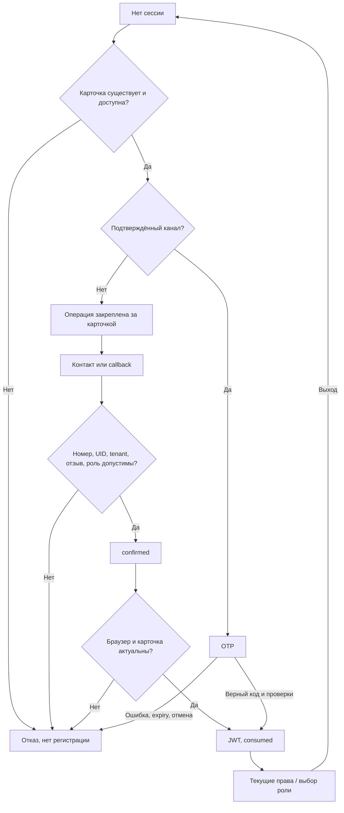

Источники: A, C, I, V, J, H.

### 2. Состояния, переходы и ответы

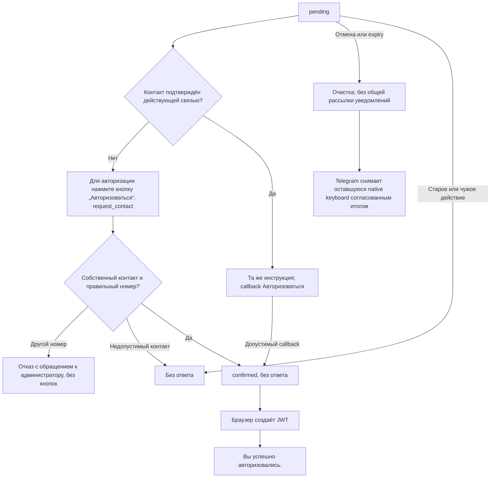

Источники: M, A, C, K, W, TG, MX; точные варианты отказов — таблица 2.

### 3. Авторизация по OTP

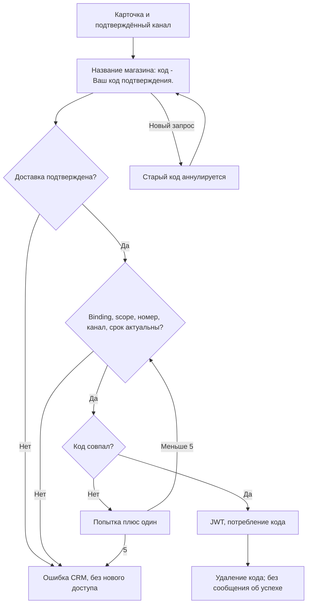

Источники: I, V, B, D, T.

### 4. Первая и повторная привязка

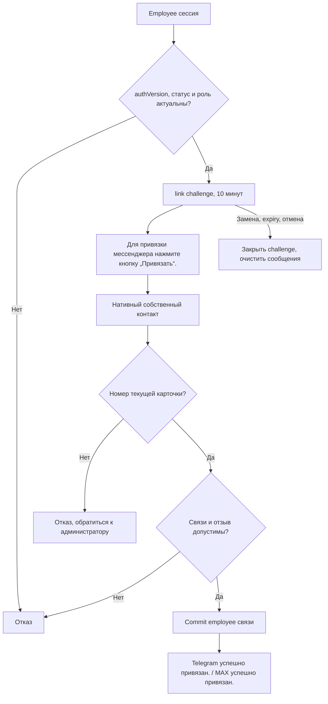

Источники: E, L, M, T.

### 5. Второй мессенджер

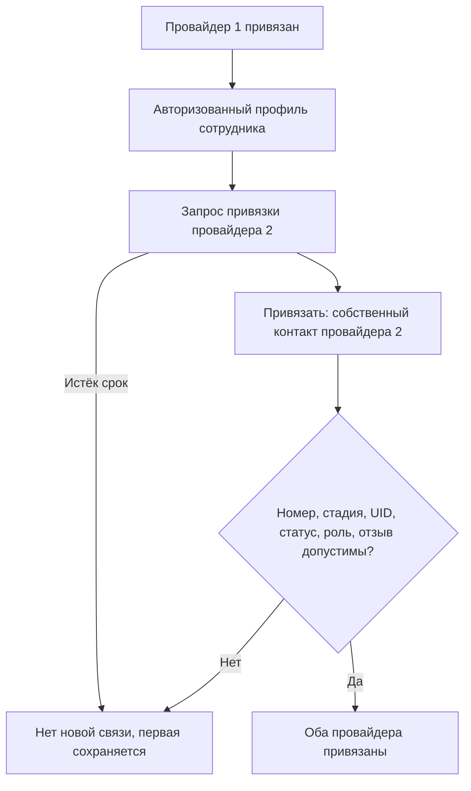

Источники: L, E, M.

### 6. Добровольная отвязка и новый UID

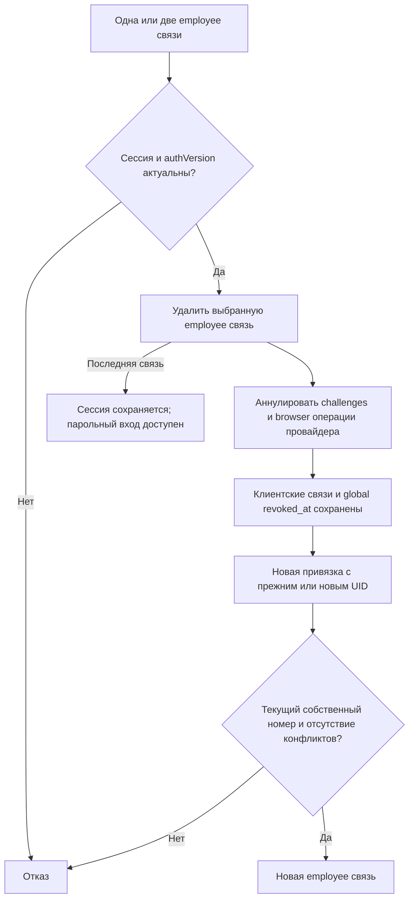

Источники: U, L, E.

### 7. Несовпадение номера и отказ

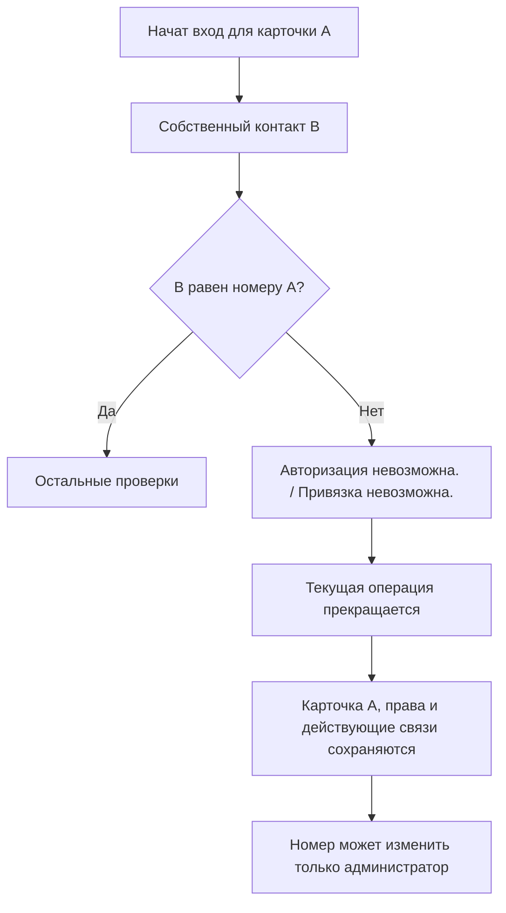

Источники: A, L, M; полный текст для обоих ботов — строка 9 таблицы 2.

### 8. Административное изменение номера

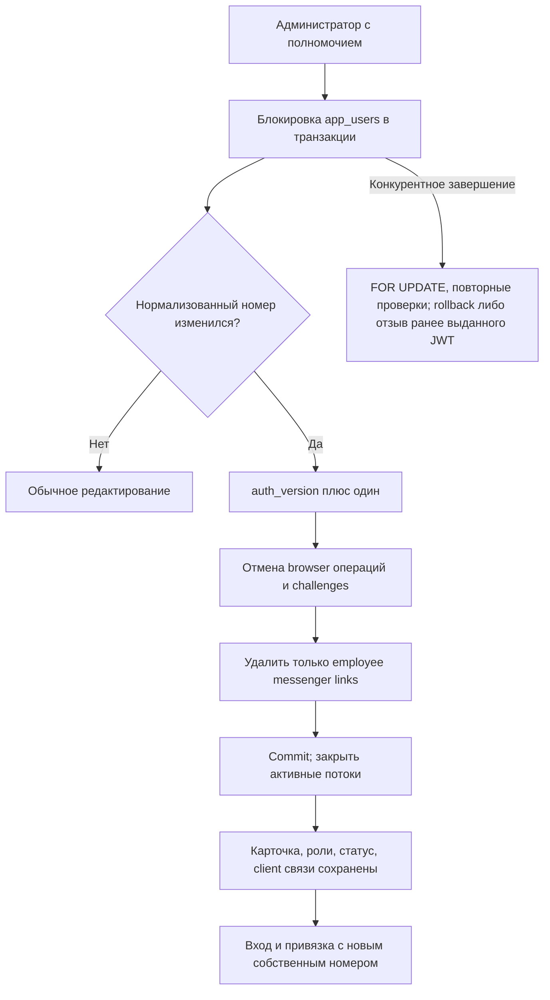

Источники: S, Z, E, A, L, V, R.

### 9. Административный отзыв доступа

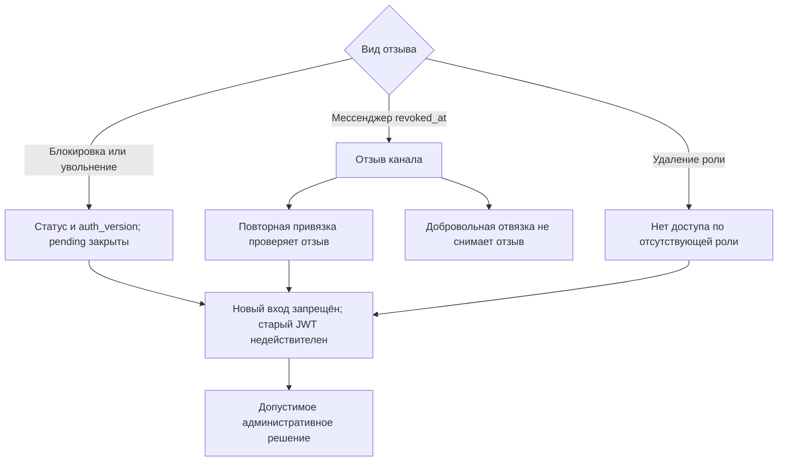

Источники: H, Z, R, L, U.

### 10. Telegram On-Demand Long Polling

```mermaid
flowchart TD
 A[Общий reconcile бота tenant] --> D{Есть операция client/employee, итог или очистка?}
 D -->|Нет| S[Poller не нужен]
 D -->|Да| L[Одна bot identity: advisory lock и lease]
 L -->|Не владеет| W[Ожидание другого процесса]
 L -->|Владеет| P[getUpdates]
 P --> R[Маршрутизация и дедупликация]
 R --> C[Независимый worker очистки]
 C -->|Pending, processing, retry, клавиатура| D
 C -->|Необратимый отказ| F[failed с причиной, не deleted]
 C -->|Удалено| D
 P -->|Ошибка сети или 409| E[Backoff и перепроверка]
 E --> D
```

Источники: P, T, W; механизм offset, lease и дедупликации сохранён. MAX остаётся Webhook.

### 11. Разделение client и employee

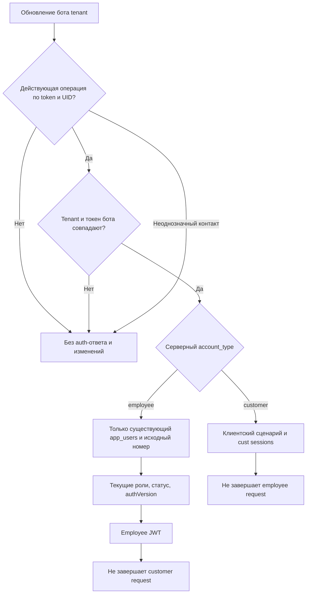

Источники: F, Q, C, `api/tenantMessengerUpdate.js:23`, handleTenantMessengerUpdate, R.

## Сравнение клиентов и сотрудников

| Направление | Общее | Клиент | Сотрудник | Источник |
| --- | --- | --- | --- | --- |
| Идентичность | Собственный номер, UID, tenant | Клиентская регистрация разрешена | Только исходная app_users | `api/messengerAuth.js:1233`, browserBotAction, `api/auth.js:81`, POST /messenger-browser/start |
| Гость/другой номер | Нет переноса CRM-прав | Согласованные guest, Да/Нет | Запрещены | `api/messengerAuth.js:1233`, browserBotAction, `api/messengerAuth.js:1211`, createBrowserRequest |
| OTP | Один формат, общий issuer/verifier | Customer scope | Employee scope | `api/messengerDelivery.js:194`, deliverCode, `api/messengerAuth.js:803`, issueCodeChallengeLocked, `api/messengerAuth.js:1643`, verifyEmployeeBrowserCode |
| Контакт | Telegram ограничение API, MAX HMAC | Клиентская политика | Строго номер администратора | `api/tenantTelegramBot.js:37`, handleTenantTelegramUpdate / customerResult, `api/maxBotPolling.js:796`, handleTenantMaxUpdate / customerResult, `api/messengerAuth.js:384`, completeLinkChallenge |
| Повторный вход | Проверенный канал и текущая операция | Контакт без финального inline | Известный контакт допускает callback без повторного контакта | `api/messengerAuth.js:1233`, browserBotAction, `api/botContentTemplates.js:149`, employeeAuthResponse |
| Привязка | Общие каналы, конфликты и отзыв | Сильная client session | Employee JWT и повторный authVersion | `api/messengerAuth.js:384`, completeLinkChallenge, `api/messengerAuth.js:269`, assertEmployeeSessionVersion |
| Добровольная отвязка | История не запрещает новый UID | Согласованные клиентские сроки | Employee JWT сохраняется | `api/messengerAuth.js:684`, unlinkAccountChannel |
| Успех | После потребления browser request; OTP без дополнительного успеха | Вы успешно авторизовались. Вернитесь в магазин. | Вы успешно авторизовались. | `api/messengerCleanup.js:532`, createMessengerCleanupWorker / notifyCustomerTerminal, `api/messengerAuth.js:1541`, consumeBrowserRequest |
| Сессии | Не смешиваются | cust_customer_sessions | JWT, auth_version, текущие роли | `api/messengerAuth.js:1541`, consumeBrowserRequest, `api/middleware/auth.js:103`, authMiddleware |
| Очистка и polling | Одна очередь, lease/retry, failed отдельно от deleted | Существующий lifecycle | Добавлен employee demand | `api/messengerCleanup.js:588`, createMessengerCleanupWorker / tick, `api/telegramPolling.js:59`, pollingDemand |
| Изменение номера | Подтверждение собственного контакта | Клиентская политика | Только администратор с отзывом старого доступа | `api/admin/team.js:980`, PUT /users/:id, `api/admin/team.js:282`, cancelEmployeeAuthOperations |

## Ограничения и нерешённые вопросы

1. Telegram API не отличает ручную собственную карточку от request_contact при одинаковых полях. Это принятое ограничение; вход не отключается. MAX HMAC не ослаблен.
2. При потере ответа API exactly-once недостижимо: retry итогового сообщения может дать повтор. При необратимом отказе удаления сообщение может остаться; failed не означает успешную очистку.
3. Для отсутствия роли, блокировки, отключённого канала, неоднозначности и технических ошибок новые фразы не придуманы: в боте без ответа, ошибка в CRM/журнале. Если нужны отдельные человекочитаемые ответы, их следует согласовать. Это не блокирует допустимые операции.
4. Telegram требует отправку сообщения для remove_keyboard; при отмене/expiry это отдельный согласованный итог только для снятия клавиатуры, сразу удаляемый. MAX такого сообщения не требует.
5. Независимые приветствия MAX, подключение чатов магазина, системные боты, реклама и уведомления заказов не являются employee auth. Существующая регистрация владельца нового tenant через /register не является самостоятельной регистрацией сотрудника существующего tenant и не изменялась.
